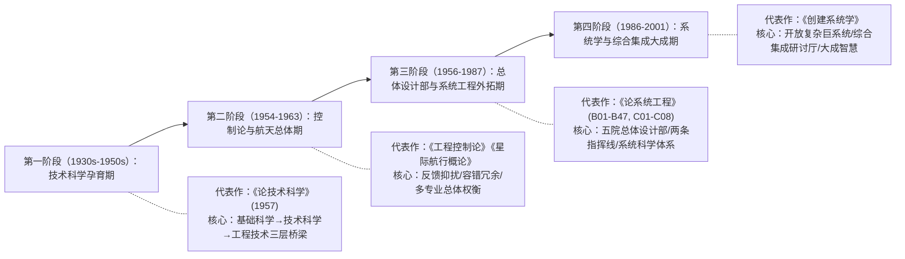

# 四大原著底本考据与全书脉络提炼

> **研究定位**：本文档对钱学森系统科学思想体系的四大核心原著底本进行版本学考据、目录结构核验与思想演化分期提炼，作为全库研究唯一真源（SSOT）的书目与理论总纲。全部书目元数据、页码偏移与校验哈希均锚定于 [《论系统工程》（新世纪版）及首批原始文献目录考订](../sources/catalog_lun_xitong_gongcheng.md)。

---

## 一、四大核心原著底本考据总览

| 序号 | 书名与本地底本 | 著者 / 编者 | 出版与版本沿革 | 物理规模与哈希摘要（SHA256 前 12 位） | 思想史核心地位 |
| :---: | :--- | :--- | :--- | :--- | :--- |
| **1** | **《工程控制论（第三版）》（上、下册）** `工程控制论(第三版).钱学森_宋健.pdf` | 钱学森、宋健 著 | 1954 英文初版（McGraw-Hill）→ 1956 俄文版 → 1957 德文版 → 1958 科学出版社中文第 1 版 → 1980 修订第 2 版 → **2011 年 2 月科学出版社第 3 版**（上册 ISBN 978-7-03-030094-2；下册 ISBN 978-7-03-030099-7） | 1,067 页（21 章，上册 1–12 章，下册 13–21 章），10,385,947 字节，SHA256 `731f7d443008...` | **理论基石与技术科学范本**：首次把自动控制经验提升为“技术科学”，建立反馈、摄动、滤波、自寻优、自适应、冯·诺伊曼容错冗余与大系统数学框架 |
| **2** | **《星际航行概论》** `钱学森_星际航行概论.pdf` | 钱学森 著 | 源于 1961—1962 年在中国科学技术大学近代力学系讲授的《火箭技术概论》；**1963 年 2 月科学出版社第 1 版** | 319 页（全书 14 章，含完整书签），16,262,338 字节，SHA256 `7534bf6c5069...` | **航天工程总体化总论**：完整展示运载火箭、推进、轨道、制导、通信、再入防热、生命保障与可回收复用体系的多目标系统工程权衡 |
| **3** | **《论系统工程（新世纪版）》** `[论系统工程](新世纪版).钱学森.pdf` 及 `钱学森_论系统工程.md` | 钱学森 等著（中国系统工程学会、上海交大编） | 1982 年 6 月湖南科技初版（20 篇）→ 1988 年 3 月湖南科技增订本（45 篇，加 12 篇钱作与 13 篇宋健、于景元、王寿云、许国志等作）→ **2006/2007 上海交大出版社新世纪版**（增补 C 部分 8 篇及编后记） | 405 页（卷首 `A1–A3` + 正文 `B01–B47` + 附录 `C01–C08` + 编后记；书内页码与 PDF 页码偏移 `+8`），2,337,129 字节，SHA256 `3d61bc7d5884...` | **系统工程与系统科学体系化总集**：从五院总体设计部实践提炼“系统工程”，向上构建“工程技术—技术科学—基础科学（系统学）—哲学（系统论）”四级台阶 |
| **4** | **《创建系统学》** `钱学森创建系统学.pdf` | 钱学森 著 | **2001 年 11 月山西科学技术出版社第 1 版**（ISBN 7-5377-1948-9），收录 1983—2000 年间讲话、论文与书信 | 581 页（许国志序、编辑说明、讲话篇 23 篇、论文篇 21+ 篇、书信篇 1983—2000），10,679,108 字节，SHA256 `c8304d781a2f...` | **开放复杂巨系统与综合集成法总纲**：突破还原论与西方复杂性学派局限，确立“开放的复杂巨系统”“从定性到定量综合集成法”与“大成智慧工程” |

---

## 二、逐部原著的文本结构与核心脉络

### 1. 《工程控制论（第三版）》（1954 / 1980 / 2011）：以薄弱、受扰部件构建高可靠精密系统的技术科学

- **版本考据与历史沧桑**：
  - 1954 年英文版 *Engineering Cybernetics* 在钱学森受美方软禁期间完成（**C05**，书第 380 页，PDF 第 388 页：“我经过五年的禁闭，终于从美国回到祖国”）。钱学森在第三版《序：现代化、技术革命与控制论》（写于 1978.12.24，改于 1979.11.29，PDF pp. 4–16）中明确交代：1980 年修订版（第三版沿用该格局）绝大部分工作由宋健带头及于景元、林金、郭孝宽、唐志强等青年控制科学家在 1963 年启动修订、历经“文革”手稿散失与王寿云冒死保存后完成（**宋健《前言》**，PDF pp. 17–19）。
  - 修订版在保留 1954 年原书基础框架上，全新增补第 8 章（最速控制）、第 12 章（分布参数系统）、第 17 章（逻辑控制与有限自动机）、第 20 章（信号与信息）、第 21 章（大系统），并将原第 17 章更名为“自镇定和自适应系统”（现第 18 章）、原第 18 章“误差的控制”更名为“冗余技术和容错系统”（现第 19 章）（**宋健《前言》**，PDF pp. 17–18）。
- **全书 21 章逻辑脉络**：
  - **基础工具与经典分析（Ch. 1–6）**：从“实践—理论—实践”出发（Ch. 1 引《实践论》及指南车、苏颂水运仪象台），将时域微分方程借由拉普拉斯变换“翻译”为 `s` 域代数运算（Ch. 2–3），引入状态空间、Hilbert 空间（$L_2$）与 Kalman 能控性/能观测性（Ch. 4），经由极点配置（Ch. 5）拓展至多变量“互不影响准则”的协调控制（Ch. 6）。
  - **非线性、最优控制与无穷维拓展（Ch. 7–12）**：处理非线性元件的有益利用（Ch. 7），依托 Pontryagin 极大值原理与 Bellman 动态规划建立时间最短“最速控制”（Ch. 8）与积分指标最优控制（Ch. 9），平行展开离散采样系统（Ch. 10）、时滞系统与 Satche 图无条件稳定（Ch. 11），以及偏微分方程描述的分布参数系统与阴范空间 $H_{+1} \subset H_0 \subset H_{-1}$（Ch. 12）。
  - **不完备先验信息、容错与大系统跃迁（Ch. 13–21）**：这是本书最深刻的系统工程思想内核——当系统参数未知、噪声强烈、元件易损时，借助**摄动理论间接测扰制导（Ch. 13）**、**随机滤波（Ch. 14–15，含 Kalman 滤波）**、**连续理解与自寻最优点（Ch. 16）**、**自镇定与模型参考自适应（Ch. 18）**、**冯·诺伊曼复合冗余与 Moore-Shannon 容错线路（Ch. 19）**，最终迈向**信号编码纠错（Ch. 20）**与**多级分散协调大系统（Ch. 21）**。

### 2. 《星际航行概论》（1963）：中国航天“总体系统观”的工程教科书

- **成书背景与编排逻辑**：全书 14 章 319 页，诞生于钱学森 1958 年创办中国科大近代力学系并亲自为首届学生讲授《火箭技术概论》的讲义。在 1960 年苏联撤走专家、1962 年“东风二号”初试受挫的严峻背景下，全书直接面向零实战经验的青年技术骨干构建完整的航天总体视野。
- **全书 14 章知识结构**：
  - **任务边界与能量物理约束（Ch. 1–3）**：以三个宇宙速度（$7.91$、$11.18$、$16.63\text{ km/s}$）与齐奥尔科夫斯基公式确立航行边界；区分“星际航行是现实的，宇宙航行目前只是理想”（§1.8）；揭示发动机研制的巨大试错代价（最少准备报废 40 台样机、耗时 2.5 年以上，Ch. 3）。
  - **运载系统、轨道与制导权衡（Ch. 4–8）**：明确运载火箭六阶段严密研制纪律（§4.4）与“每克必争”的结构减重（$2.5\text{ kg}$ 以下小零件占结构总重 $46.1\%$，§4.3）；推导“在势能低处加速更经济”的三段发射最优轨道（Ch. 5）与 Hohmann 过渡轨道（Ch. 6）；前瞻核裂变/聚变与低推力电火箭（Ch. 7）；并在 Ch. 8 用 250 km 轨道误差菱形可行域与火星起飞精度算例，阐明**动力最优与制导精度的根本矛盾必须由“总体概念”综合平衡**。
  - **通信、再入、生命保障与可复用基础设施（Ch. 9–14）**：推导通信发送机与天线等重分配原则 $W_A = W_T$（Ch. 9）、钝头烧蚀防热与大气制动（Ch. 10）、辐射生物当量 `rem`（Ch. 11）、小球藻封闭生态循环“星际农业”（Ch. 12）、分层电源匹配（Ch. 13），直至第 14 章提出轨道空间站（“公共汽车站—火车站”层级）、海上发射、火箭回收（降落伞+反推/氦气球）及可复用空天运载飞机。

### 3. 《论系统工程（新世纪版）》（1978—1987）：从航天实战经验走向“系统科学”学科大厦

- **文献构成与编纂体例**：
  - 全书主体收文跨越 1978 年 9 月至 1987 年 11 月这一中国改革开放与科学春天开端的关键十年，共含卷首 `A1–A3`、正文 `B01–B47`（47 篇，含钱学森独立/合著 32 篇，宋健、于景元、王寿云、许国志、顾基发等核心团队成员 15 篇）及新世纪版补收附录 `C01–C08`（8 篇）。
  - 编委会保留 1988 年增订本 A、B 原貌，在 C 部分补齐《在上海机械学院系统工程研究所成立大会上的讲话》（`C01`）、《系统思想、系统科学和系统论》（`C04`）、《软科学是新兴的科学技术》（`C07`）、《软科学是定性与定量相结合的系统科学》（`C08`）等极其关键的过渡性文献（《编后记》，书第 397 页，PDF 第 405 页）。
- **核心理论建树**：
  1. **定义与组织化落地**：`B01`（1978）首次向全国系统阐述“总体设计部”与“系统工程”概念，将运筹学定名为“事理”，并阐明“运筹学 + 电子计算机 + 总体设计部”三位一体结构。
  2. **跨界谱系外拓**：从工程（`B01`）、军事（`B03`）、科研（`B06`）、情报（`B05`）迅速拓展至社会（`B02`）、农业（`B07`）、国民经济（`B08`、`B28`、`B35`、`B36`）、计量/标准（`B09`、`B10`）、人才（`B20`）、环境（`B27`）、人口（`B23`、`B33`）、法制（`B30`）、历史定量化（`B40`）等 **14 门以上系统工程专业**（`B38` 书第 290–291 页）。
  3. **科学技术体系学与“三归一”**：`B14`→`B16`→`B21`→`B37`→`C04` 确立现代科学技术“三层次（工程技术—技术科学—基础科学）+ 哲学桥梁 + 马克思主义哲学”的纵横矩阵，在 `C04`、`C08` 中力排众议主张“控制论、信息论是技术科学，只有**系统论**是桥梁，三论应归一论”。

### 4. 《创建系统学》（1986—2001）：面向“开放的复杂巨系统”与“大成智慧”的方法论革命

- **成书结构与历史背景**：全书 581 页记录了钱学森自 1986 年 1 月主持“系统学讨论班”直至 2000 年晚年思考的完整轨迹，分为讲话篇（PDF pp. 34–133）、论文篇（PDF pp. 134–340）与书信篇（PDF pp. 341–581）。
- **核心范式突破**：
  1. **提出“开放的复杂巨系统”概念**（`《一个科学新领域——开放的复杂巨系统及其方法论》` 1990，PDF p. 228；`《再谈开放的复杂巨系统》` 1990，PDF p. 254）：指出“巨”（亿万级子系统）、“复杂”（子系统种类成百上千、中间层次难以辨认）、“开放”（与环境交换物质能量信息）、“特殊”（含具有意识与利益的人）。明确划界：耗散结构、协同学与系统动力学仅能处理“简单巨系统”，面对脑、人体、地理与社会系统必须另辟蹊径。
  2. **创立“从定性到定量综合集成法”与“综合集成研讨厅体系”**（`《处理开放的复杂巨系统不能简单化》` PDF p. 60；`《以人为主发展大成智慧工程》` PDF p. 336）：将专家定性经验（“灰色系统”）、统计实测数据与千百参数计算机仿真模型耦合迭代，完成认识论上从感性到理性的螺旋上升，并在 1992 年进一步提出结合 VR（灵境技术）、AI 与知识工程的**大成智慧工程（MsE）**。
  3. **自上而下构建系统学**：在晚年书信中（1994—1997，PDF pp. 541–581）提出先确立“开放的复杂巨系统”总理论，再将简单系统、大系统、简单巨系统作为简化特例分化出来的“从繁到简”建构路线。

---

## 三、钱学森系统思想的四阶段演化脉络

| 演化阶段 | 时间跨度 | 核心问题意识 | 标志性文献/组织实践 | 关键方法论跃迁 |
| :--- | :---: | :--- | :--- | :--- |
| **Stage 1 技术科学奠基** | 1930s—1957 | 自然科学基础定律（牛顿/热力学）无法直接解决工程极端边界问题 | 物理力学、《论技术科学》（1957，载《科学通报》第 4 期，B14 引注） | 在基础科学与工程技艺之间架设**“技术科学”**中间层，提出自然现象简化建模原则 |
| **Stage 2 工程控制与航天总体** | 1954—1963 | 如何用有误差、有噪声、寿命有限的元件构建高可靠制导与航天系统 | 《工程控制论》（1954/1980）、《星际航行概论》（1963） | 从单一器件性能极值转向**闭环反馈、摄动纠偏、自适应与冯·诺伊曼复合冗余** |
| **Stage 3 系统工程与体系外拓** | 1956—1987 | 如何在低工业底盘、低专家密度下组织万人级国防科研，并推广至国民经济与社会管理 | 五院总体设计部、两条指挥线、《论系统工程》（1978—1987） | 把工程协调制度化为**总体设计部**，确立**运筹学（事理）+ 计算机 + 组织**范式，构建 9—11 部门科学体系 |
| **Stage 4 系统学与综合集成** | 1986—2001 | 面对人脑、社会、经济、地理等“还原论失效”的开放复杂巨系统，纯数学模型失灵 | 《创建系统学》（1986 系统学讨论班、1990—2000 论文与书信） | 从纯定量优化跃迁为**“从定性到定量综合集成法”**，提出**以人为主、人机结合的大成智慧研讨厅** |

---

## 四、四大原著的深层内在统一性：一条贯通半世纪的底层逻辑

表面上看，钱学森早期研究空气动力学与《工程控制论》，中年领导导弹火箭工程，晚年钻研思维科学、人体科学与“大成智慧”，跨越十余个门类；但若从四大原著的底层结构审视，其半世纪探索始终围绕**同一个核心元问题**展开：

1. **受控系统从“确定全信息”到“不确定开放复杂巨系统”的演进**：《工程控制论》前 13 章研究确定系统，第 14—19 章已直面先验信息不完备、噪声与器件故障（Ch. 18 开篇明义区分全信息系统与信息不完备系统）；《论系统工程》将人、财、物、设备、任务、信息六要素纳入组织系统（`B01`）；《创建系统学》则把包含“有意识的人”和“开放环境”的社会/生态体系正式命名为**开放的复杂巨系统**。
2. **组织与控制结构对局部要素短板的补偿律**：在《工程控制论》第 19 章，它是**“用不那么可靠的元件组成高度可靠的系统”**（`B18` 书第 145—146 页；《工程控制论》§19.3）；在 1956—1970 年的中国航天史上，它是**以总体设计部、两条指挥线和“三步棋”弥补工业与人才匮乏**（`B29`）；在《创建系统学》中，它是**以“综合集成研讨厅”将有限的个体人类专家（“灰色系统”）与计算机大模型结合，涌现超越任何单体的集体智慧**（PDF p. 336）。
3. **认识与改造世界的辩证螺旋**：贯穿四书的唯一认识论红线，即是把《实践论》“感性→理性→实践检验”转化为可工程化的循环——工程控制论中的“反馈与试探寻优”（Ch. 16）、航天研制中的“预研—地面试车—故障归零”（《星际航行概论》§4.4、`B29`），以及系统学中的“定性假说→建模计算→专家评审→再建模”螺旋（`C08` 书第 395—396 页）。
