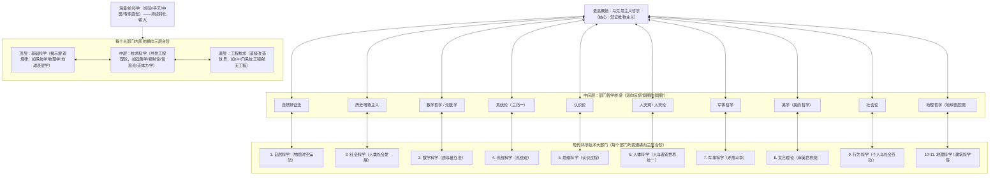

# 马克思主义哲学与现代科学技术体系之桥

> **核心文本锚点**：
> - **B14**《科学学、科学技术体系学、马克思主义哲学》（书第 109–117 页，PDF 第 117–125 页）
> - **B15**《自然辩证法、思维科学和人的潜力》（书第 118–127 页，PDF 第 126–135 页）
> - **B21**《现代科学的结构——再论科学技术体系学》（书第 160–164 页，PDF 第 168–172 页）
> - **B37**《现代科学技术的特点和体系结构》（书第 278–287 页，PDF 第 286–295 页）
> - **C04**《系统思想、系统科学和系统论》（书第 364–379 页，PDF 第 372–387 页）
> - **C07**《软科学是新兴的科学技术》（书第 386–391 页，PDF 第 394–399 页）与 **C08**《软科学是定性与定量相结合的系统科学》（书第 392–396 页，PDF 第 400–404 页）
> - **《创建系统学》**（1990—1994 年有关“十大、十一大部门”与系统论书信，PDF pp. 267–308, 421–480）

---

## 一、为什么哲学不能替代科学，但科学体系必须建构通向哲学之桥？

1978 年科学春天开启之际，钱学森面临一个紧迫的认识论困境：一方面，近代科学在西方经过四百年分科细化，出现了严重的“只见树木、不见森林”碎片化倾向（连科学学、管理科学、系统工程等名词也混作一谈，见 **C02** 书第 357–358 页）；另一方面，自恩格斯之后，相当一部分传统哲学工作者长期脱离现代科技前沿，以教条批判科学新成果——正如钱学森在 **B14**（书第 116 页，PDF 第 124 页）与 **B15**（书第 120 页，PDF 第 128 页）中直言痛陈：

> “摩尔根遗传学和基因的发现，化学键理论的共振论，控制论，人工智能，电子计算机代替人的一部分脑力劳动等等都曾受到过某些批判。这些批判都被事实证明是错误的，必须全部收回。”（**B15**，书第 120 页，PDF 第 128 页）
>
> “哲学作为科学技术的最高概括，它是扎根于科学技术中的，是以人的社会实践为基础的；哲学不能反对、也不能否定科学技术的发展，只能因科学技术的发展而发展，不然岂不僵化了吗？”（**B14**，书第 116 页，PDF 第 124 页）

针对上述“科哲脱节”的双向危机（科学界不学哲学而闭门造车，哲学界不学科学而被动发难），钱学森以自己创立“技术科学”的系统思维，提出了一项宏大的知识工程——**“科学技术体系学”**（**B14** 书第 113–115 页，PDF 第 121–123 页）：

- **哲学不是直接拿去套公式的“万能钥匙”，而是人类全部实践与科技知识的“最高概括”**；
- 在各门具体的现代科学技术大部门与马克思主义哲学（核心是**辩证唯物主义**）之间，**绝非平列关系，也不能直接悬空跳接**，而是必须通过各自的**部门哲学桥梁**与纵向**三层台阶**实现双向贯通与反馈（**C04** 书第 377 页，PDF 第 385 页）。

---

## 二、现代科学技术体系的纵横双维结构（从“四部分”到“九/十一大部门”）

### 1. 历史演进轨迹：钱学森认知框架的四次扩充

钱学森关于现代科学技术大部门的划分并非一次性拍板定型，而是在 1979—1994 年间随系统工程跨领域实践不断演化完善：

| 演化时期 | 代表文献 | 部门数量与结构形态 | 关键理论突破 |
| :--- | :--- | :--- | :--- |
| **1979 年** 初创期 | **B14**《科学学、科学技术体系学、马克思主义哲学》 | **4 个纵向层次成分 + 数学**（自然科学、科学的社会科学、技术科学、工程技术，外加数学） | 将“技术科学”与“工程技术”从自然科学中独立出来；指出数学不能归入自然科学，它是“科学技术的皇后”（书第 114 页，PDF 第 122 页） |
| **1981—1982 年** 六部门期 | **B16**、**B21**《现代科学的结构》、**C04** | **6 大部门**（自然科学、社会科学、数学科学、系统科学、思维科学、人体科学） + **文艺学/军事科学**雏形 | **B21 核心跃迁**：废除按“对象领域”划界的旧习惯，提出“六大部门皆研究整个客观世界，区别在于**着眼点（角度）**不同”（**B21** 书第 163 页，PDF 第 171 页） |
| **1985 年** 九部门定型期 | **B34**、**B37**《现代科学技术的特点和体系结构》、**B38** | **9 大部门**（新增**军事科学、文艺理论、行为科学**）+ **9 架桥梁** + 横向 **3 层台阶** | 将文化艺术、国防斗争、人际与社会行为全部纳入严密科学技术体系；明确“前科学”海量存在（**B37** 书第 285–287 页，PDF 第 293–295 页） |
| **1990—1994 年** 十至十一部门期 | **《创建系统学》**（《谈地理科学的内容及研究方法》等，PDF pp. 267, 288） | **10 至 11 大部门**（增设**地理科学**，后续讨论**建筑科学**）+ 对应桥梁 | 提出以**地球表层学**为基础科学的地理科学大部门（研究地球表层开放复杂巨系统），并与工程/人文建筑环境结合 |

### 2. 纵横全景架构图（Mermaid）

### 3. 各大部门“着眼点—三层台阶—哲学桥梁”完整映射表

据 **B21**（书第 160–164 页）、**B37**（书第 284–285 页，PDF 第 292–293 页）、**B38**（书第 290–299 页）、**C04**（书第 373–378 页，PDF 第 381–386 页）及 **《创建系统学》**（PDF pp. 267, 316, 479）核验整理：

| 大部门 | 认识客观世界的独特“着眼点” | 基础科学层（代表） | 技术科学层（代表） | 工程技术层（代表） | 通往马克思主义哲学之桥梁 |
| :--- | :--- | :--- | :--- | :--- | :--- |
| **1. 自然科学** | 物质在时空中的运动、层次及其相互关系（质量/长度/时间三基本量纲） | 物理、化学、生物、天文、地学（天、地、生、化归结于物理+数学） | 应用力学、物理力学、电子学、计算机科学等 | 机械、化工、航空、航天、核能、电子等工程技术 | **自然辩证法**（狭义，专司自然观） |
| **2. 社会科学** | 人类社会的发展运动、内部运动及客观世界对人类社会的影响 | 政治经济学、科学社会主义、教育学、科学学、社会学 | 生产力经济学、未来学、部门经济学、管理科学等 | 社会工程、企业管理、新闻出版、外交事务等社会技术 | **历史唯物主义**（社会辩证法） |
| **3. 数学科学** | 质和量的对立统一、质和量的互变（“辩证的辅助工具和表现方式”） | 数理逻辑、数论、拓扑、泛函分析、微分动力体系等 | 计算数学、概率统计、模糊数学、算法论等 | 数值仿真、软件工程、统计抽样与计算机实现技术 | **数学哲学 / 元数学**（或“数学学”） |
| **4. 系统科学** | 从系统的整体结构与功能联系、从局部到整体的演化规律出发 | **系统学（Systematology）**（尚待建立，综合自组织与复杂巨系统理论） | **运筹学（事理）、控制论、信息论**、大系统理论 | **系统工程**（工程/军事/经济/科研/农业/法治等 14+ 门） | **系统论（系统观）** |
| **5. 思维科学** | 人脑通过实践信息存储加工并认识客观世界的规律 | 思维学（抽象/逻辑思维、形象/直感思维、灵感/顿悟思维） | 人工智能、认识科学、语言学、数理逻辑、科学方法论 | 专家系统、模式识别、人机交互与智能信息终端技术 | **辩证唯物主义认识论** |
| **6. 人体科学** | 人体结构功能与宇宙客观世界相互作用的整体统一 | 生理学、解剖学、心理学、气功与中医现代基础理论 | 人-机工程、生物医学工程、临床应用医学理论 | 临床医疗技术、康复技术、中西医结合诊疗技术 | **人天观 / 人天论** |
| **7. 军事科学** | 敌对或竞争双方矛盾斗争的规律（含热战、科技战、智力战、商战） | 军事思想与战争基础规律 | 军事学术（战略学、战役学、战术学、军事运筹学） | 军事工程、武器装备技术、**军事系统工程**、C3I 自动化 | **军事哲学** |
| **8. 文艺理论** | 从“美”（主观实践与客观实际统一）的角度认识和反映客观世界 | 文艺学、艺术理论基础规律 | 建筑园林美学、诗学、音乐学、戏剧电影创作理论 | 文学创作、书画雕塑、音乐表演、影视综合艺术实践 | **美学（美的哲学）** |
| **9. 行为科学** | 个人行为与社会发展之间相互作用与滞后调适（诱导与约束） | 伦理学、法理学、社会心理基础理论 | 社会心理学、各专门法学（刑法、民法、诉讼法等） | 思想政治社会工程、**法制与法治系统工程**、行政系统工程 | **社会论** |
| **10–11. 地理科学等** | 地球表层（陆地深 5–6 km 至高空对流/平流层）人地开放复杂巨系统 | **地球表层学**（地理科学基础理论） | 环境科学、生态经济学、区域规划与国土治理理论 | 环境系统工程、国土整治、城市与建筑环境营造工程 | **地理哲学**（人地和谐观） |

---

## 三、“三归一”论断：为什么只有“系统论”是哲学桥梁，而控制论/信息论不是？

20 世纪 80 年代初，国内学术界流行将贝塔朗菲（一般系统论）、维纳（控制论）、香农（信息论）并称为哲学方法论性质的“三论”（即“老三论”）。钱学森在 **C04《系统思想、系统科学和系统论》**（1982.07.10，书第 364、371–372 页，PDF 第 372、379–380 页）及 **C08**（书第 393 页，PDF 第 401 页）中对此进行了针锋相对的科学厘清，提出著名的**“三归一”**命题：

1. **工程与技术科学层次不可越级充当哲学**：
   - 控制论（Cybernetics）与信息论（Information Theory）均诞生于 20 世纪 40 年代通信与自动控制工程实践，研究的是“控制指令与信息传输的定量技术规律”；在现代科学技术体系的纵横坐标上，**控制论、信息论与运筹学同属“技术科学”台阶**，其应用落地形态是各门系统工程（工程技术台阶）。
   - 钱学森幽默指出，将 *Cybernetics* 译作“控制论”、把 *Information Theory* 译作“信息论”，中文里带个“论”字才引发了概念混乱；“其实，从前要不译‘控制论’而译成‘控制学’……信息也叫论，其实，是‘信息学’”（**C04**，书第 371 页，PDF 第 379 页）。
2. **三论统一于系统科学体系中的唯一桥梁——系统论**：
   - 哲学性质的概括只有一个，即**系统论**（System Theory），它立足于**系统学**这一基础科学，将“控制”与“信息”作为系统内部相互作用与联系机制有机包容其中：“一个大的系统，当然要有控制呀。要控制，就有相互之间的信息传递，那就是信息嘛”（**C04**，书第 371 页，PDF 第 379 页）。
   - 同时，钱学森划清了马克思主义“系统论”与西方“一般系统论”的界限：贝塔朗菲的“一般系统论”仍停留在概念阐发与生物学直观，而钱学森提出的**系统论是立足于现代科学技术（运筹学、控制论、信息论 + 耗散结构、协同学、超循环、突变与混沌理论）的辩证唯物主义系统观**，因此比一般系统论深刻得多（**C04** 书第 372 页；**C07** 书第 387 页）。
3. **“圆圈的圆圈”——双向反馈的认识论闭环**：
   - 在这个结构中，既有“工程实践 → 技术科学 → 基础科学（系统学）→ 系统论 → 马克思主义哲学”的**自下而上抽象提炼**，又有“马克思主义哲学 → 桥梁 → 基础/技术科学 → 工程实践”的**自上而下方法论指导**，更有技术科学向基础科学的反向问题输送（如物理力学、生物力学反哺基础力学）。钱学森借列宁“圆圈的圆圈”概括这种非单向的、有序的交互结构（**C04**，书第 377 页，PDF 第 385 页）。

---

## 四、还原论与整体论的辩证统一：超越“非此即彼”的认识论革命

系统论之所以能成为连接马克思主义哲学与现代科技的关键桥梁，根本原因在于它历史地解决了人类认识史上延续两千多年的**整体论与还原论的对立**（**C04** 书第 364–366 页；**C08** 书第 393–394 页；**B37** 书第 286–287 页）：

1. **正题：古代朴素整体观与“自然哲学式”系统（肯定其直觉，指出其局限）**
   - 中国古代（老子、中医脏象经络阴阳五行）与古希腊（赫拉克利特）早已有朴素系统整体观；但因缺乏深入微观层次的实验与定量工具，整体联系中不得不掺杂大量臆想，属于**“自然哲学式的系统”**（**C04** 书第 364–365 页）与珍贵的**“前科学”**（**B37** 书第 287 页）。
2. **反题：近代科学还原论的兴起与历史功罪（肯定其历史进步，揭露其视野盲区）**
   - 16 世纪以来近代自然科学排除神灵与臆想，采取将复杂系统层层分解的**还原论**方法（分子→原子→核→基本粒子；生物体→器官→细胞→DNA 分子生物学）。钱学森明确肯定这是**“进步，不是退步”**，因为“不这样办，研究事物就不可能前进”（**C04** 书第 365 页）。
   - 然而，当研究走向分子、基因或社会局部时，还原论的致命缺陷暴露无遗：“**越分越细，失去了全貌，反而搞不清楚……对生命整体到底是什么，反而越来越不清楚了**”（**C05** 书第 381 页；**C08** 书第 393 页）。
3. **合题：现代系统论——还原论与整体论的辩证统一**
   - 钱学森在 **C08**（书第 393 页，PDF 第 401 页）做出经典定性：
     > “我们提倡的系统论，不是古代的整体观，古代的整体观有一个局限性，就是那个时候没有工具，没有实验方法来研究更深的层次，因而也就停留在笼统的认识，无法深入下去。而系统科学的观点，可以说是**还原论和整体论的辩证统一的观点**。”
   - 在**物质尺度深度**上（**B37** 书第 286 页，PDF 第 294 页；**《创建系统学》** PDF p. 220），钱学森将世界拓展为**渺观（$10^{-33}\text{ cm}$ 超弦尺度）— 微观（$10^{-15}\text{ cm}$ 原子核/粒子）— 宏观（$10^{2}\text{ m}$ 人与生态）— 宇观（$10^{21}\text{ m}$ 星系）— 胀观（二百亿光年宇宙膨胀尺度）**五大层次，相邻层次各差约 $10^{19}$ 倍；而系统科学（尤其是系统学）正是主攻**宏观复杂层次**的科学革命，其核心洞见在于：**不同层次之间并非铜墙铁壁，而是“低层次的混沌造成高层次的有序”**（**C08** 书第 394 页；**《创建系统学》** PDF p. 71），这正是任何单一还原论永远无法捕捉的涌现法则。
4. **治学方法准则：“离经不叛道”与吸收“前科学”**
   - 在哲学态度上，钱学森在 **C07**（书第 387 页，PDF 第 395 页）提出著名准则**“离经”不“叛道”**：绝不抱住一百年前经典著作的字句教条（“要发展就要有新的东西，有新的东西，就离开了经典著作”），但始终坚守辩证唯物主义与历史唯物主义的立场、观点与方法。
   - 在知识边界上，承认人类实践积累的经验、手艺、中医、专家直觉等**“前科学”**总量远大于已形式化的现代科学，主张通过系统论与综合集成方法不断将“前科学”提炼升华为科学，同时从新的工程实践中接纳新“前科学”（**B37** 书第 287 页）。
