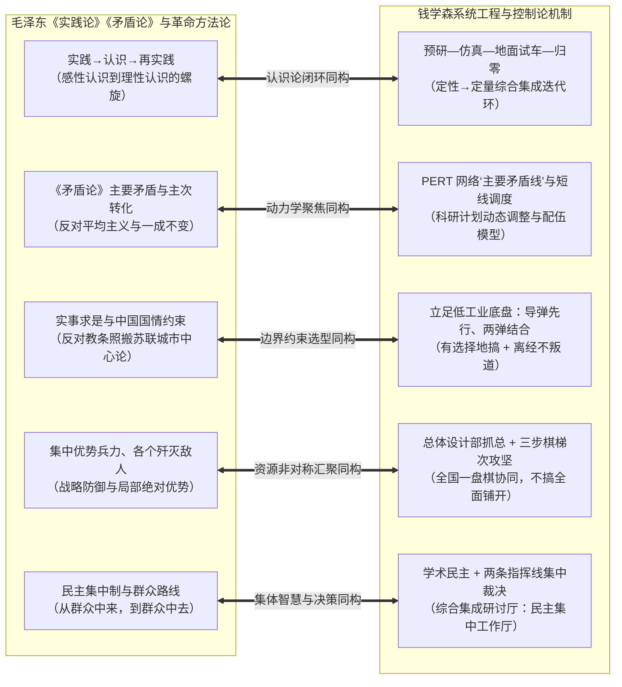

# 毛泽东《实践论》《矛盾论》与钱学森系统工程的异曲同工

> **核心命题**：20 世纪中国最具原创性的两套实践哲学与工程方法论——毛泽东在革命战争年代确立的《实践论》《矛盾论》军事—政治辩证法，与钱学森在建国后工业与科技“一穷二白”条件下开创的系统工程体系——并非两套互不相关的语汇，而是**共享同一套辩证唯物主义内核的“双生范式”**：二者皆旨在解决**“如何以弱胜强、如何在极端资源匮乏与高度不确定环境中，凭借严密组织结构、动态抓主矛盾和实践反馈闭环，实现系统级的战略破局”**。

---

## 一、历史与文本铁证：钱学森原著中的毛泽东思想引证谱系

钱学森并非在书斋中事后给系统工程“贴哲学标签”，而是在其 1958—1995 年的核心著述中，多次直接援引毛泽东著作作为系统工程的理论基石与认识论指南：

| 毛泽东原著 / 核心论断 | 钱学森直接引证的原著出处 | 原文引证与核心工程转化 |
| :--- | :--- | :--- |
| **《实践论》**（认识的两次飞跃、实践是检验真理的唯一标准） | **《工程控制论》第 1 章**（PDF p. 24）；**B26**（书第 190 页，PDF 第 198 页）；**《创建系统学》**（PDF pp. 248, 421–480） | 1. 《工程控制论》Ch.1 引毛主席语说明控制论经历**“实践—理论—实践”**循环； 2. **B26** 直接引《实践论》大段论述“什么是科学？科学就是适合客观实际情况”； 3. 《创建系统学》明确将**“从定性到定量综合集成法”**界定为《实践论》“从感性认识到理性认识飞跃”的现代实现 |
| **《中国革命战争的战略问题》**（“战争的全局”） | **B03《军事系统工程》**（书第 34 页，PDF 第 42 页） | 整段引述“世界可以是战争的一全局，一国可以是战争的一全局……凡属带有要照顾各方面和各阶段的性质的，都是战争的全局”，论证**局部必须服从全局、系统必置于更大系统之中** |
| **《十大军事原则》与自卫核威慑理论** | **B42《以理论为依据的需求体制》**（书第 314–315 页，PDF 第 322–323 页）；**B29**（书第 201 页） | 以解放战争“集中优势兵力打歼灭战”及 1956—1964 毛泽东自卫核威慑理论为例，确立**“以作战理论与国家战略需求统领武器系统研发”**的顶层设计逻辑 |
| **1969 年“技术革命”批示**（区分技术革新与技术革命） | **《工程控制论（第三版）》序**（PDF pp. 6–8）；**B01**（书第 8 页）；**B05**（书第 45, 50 页）；**B13**（书第 106 页）；**B15**（书第 121 页） | 在蒸汽机、电力、核能三项技术革命之后，钱学森严格依据毛主席定义，于 1979 年率先论证**“电子计算机是第四项技术革命”**，系统工程亦是一场软技术革命 |
| **1960 年代肯定华罗庚“统筹方法”与“大兵团作战”** | **B01**（书第 1 页，PDF 第 9 页）；**B06**（书第 60 页，PDF 第 68 页）；**B29**（书第 201 页） | 赞许统筹法用于大庆、铁路与农业；指出“毛主席曾经形象地把我国大规模的原子弹、氢弹、导弹科研工作比作大兵团作战”（引注《创建系统学》亦将两弹一星归结为**解放战争大兵团作战经验用于科研组织**，PDF p. 209） |
| **“自力更生为主，有选择地搞”** | **B29**（书第 201–202 页，PDF 第 209–210 页）；**B38**（书第 288 页） | 在“国力有限”下决定研制导弹核武器，并“有选择地搞，只搞那些在我国现阶段发展所必需的”，以战略聚焦换取非对称突破 |
| **《在延安文艺座谈会上的讲话》与七届二中全会** | **C04**（书第 375 页，PDF 第 383 页）；**B22**（书第 169 页，PDF 第 177 页） | 用“阳春白雪与下里巴人”阐明知识体系的多台阶结构；引“夺取全国胜利只是万里长征走完了第一步”激励领导机关面向新技术革命持续自我革新 |

---

## 二、五大底层机制同构性深层剖析

如果剥离革命战争与现代科技工程的表层术语差异，毛泽东《实践论》《矛盾论》的实战方法论与钱学森系统工程核心机制之间，存在着令人震撼的**结构性同构（Structural Isomorphism）**：

### 同构一：《实践论》“感性→理性→实践检验”螺旋 ↔ “预研—仿真—试验—归零”与综合集成迭代

- **毛泽东的认识论公式**：《实践论》指出，认识始于实践中的感性材料（定性直觉与局部经验），经过去粗取精、去伪存真、由此及彼、由表及里的加工制作，飞跃为概念与理论（理性认识），再回到实践中接受检验、修正错误，如此循环往复以至无穷。
- **钱学森的工程与系统学转化**：
  1. **控制论中的“实践—理论—实践”**：《工程控制论》第 1 章（PDF p. 24）开篇引《实践论》确立技术科学的认识论循环；第 16 章“自寻最优点系统”与第 18 章“自适应系统”更将这种“试探—测量反馈—修正方向”写进了数学控制律（先微调输入试探输出导数 `dy*/dt`，越过极值点再反转方向）。
  2. **科研探索的“敢猜敢改”**：在 **B06《论科学技术研究的组织管理与科研系统工程》**（书第 56 页，PDF 第 64 页）中，钱学森直言“科研系统工程免不了要猜，可能猜对，也可能猜错”，关键在于建立灵敏的情报反馈与多次计划调整机制；在 **C01**（书第 356 页，PDF 第 364 页）中勉励青年学者：“放开胆子干……错了就改嘛！只有勇于实践，才能够更快更好地来完成我们的任务。”
  3. **综合集成法对《实践论》的当代复刻**：在 **《创建系统学》**（PDF pp. 66, 248, 421–480）及 **C08**（书第 395–396 页，PDF 第 403–404 页）中，钱学森反复强调：“从定性到定量，从感性认识上升到理性认识，这是辩证统一的认识论。”延安时期受限于计算工具，只能从感性材料提炼出战略大轮廓；现代有了百余参数的大模型与电子计算机，就能把老农、专家、一线工人的零散定性经验“缝”入模型，经多轮试算与专家复核实现螺旋收敛。

### 同构二：《矛盾论》“抓主要矛盾与矛盾转化” ↔ PERT“主要矛盾线”、短线调度与阶段配伍

- **毛泽东的矛盾辩证法**：《矛盾论》指出，复杂事物发展过程中存在许多矛盾，其中必有一种是主要的、起领导和决定作用的矛盾；抓住主要矛盾，一切问题就迎刃而解；同时矛盾双方与主次地位在运动中不断转化，必须反对静止僵化。
- **钱学森的数学化与工程化对应**：
  1. **网络图中的“主要矛盾线”**：在 **B01**（书第 4–7 页，PDF 第 12–15 页）讨论企业与航天计划协调技术（PERT）时，钱学森将西方所称的“关键路径（Critical Path）”精准重命名为**“主要矛盾线”**——成千上万道工序互相制约，决定总工期与全局成败的只是那条制约瓶颈线；电子计算机的作用就是实时追踪变动中的**“短线”**（瓶颈）与**“窝工”**，迅速集中调度资源打通短线。
  2. **农业“配伍模型”的阶段转化**：在 **B07《农业系统工程》**（书第 66–67 页，PDF 第 74–75 页）中，钱学森与张沁文用中医“君臣佐使”阐述不同时期的技术组合：“关键是找到主要矛盾，集中力量缩短关键工序时间……每个阶段有一个阶段的主要矛盾，因此每个阶段的配伍模型都不同。”
  3. **晚年对“思想僵化”的矛盾论警示**：1991 年 8 月致于景元信中，钱学森直言：**“矛盾是一个发展运动，会转化的。我们的许多失误都在于未跟上实际，思想僵化，不知道矛盾已经转化，出现新矛盾了。”**（《创建系统学》OCR 原文，p. 421–480 摘录）

### 同构三：“实事求是、不唯书不唯上” ↔ 立足低资源约束的工程选型与“离经不叛道”

- **革命战争的“农村包围城市”**：在半殖民地半封建中国，教条主义者照搬俄国“城市中心暴动”必然撞得头破血流；毛泽东坚持从敌强我弱、乡村统治薄弱的实际出发，走农村包围城市之路。
- **低工业底盘下的“导弹先行”与体制抉择**：1955—1956 年面对“超音速轰炸机 vs. 地地导弹”的路线分歧，钱学森没有盲从美苏空军优先路径，而是立足中国缺乏高推重比航发、精密机床、海量飞行员和遍地长跑道机场的现实，果断力主**“导弹先行、两弹结合”**（单程一次性飞行绕开耐疲劳材料瓶颈，集中智力突破控制制导），在 **B29** 中明确总结为**“国力有限……有选择地搞，只搞那些在我国现阶段发展所必需的”**（书第 202 页，PDF 第 210 页）。
- **方法论自主性**：在 **B38** 开篇（书第 288 页，PDF 第 296 页），钱学森同样告诫科研人员：“考虑问题一定要从马克思列宁主义、毛泽东思想的立场、观点和我国的实际出发，**不能一味跟外国人走**。”在 **B28**（书第 198–199 页）中他甚至直指苏联高度集中的计划体制犯了 19 世纪拉普拉斯的机械错误，主张适合中国实际的**“宏观控、微观放”**。

### 同构四：“集中优势兵力打歼灭战” ↔ 总体设计部统筹与系统控制弥补局部元件劣势

- **以全局势能扭转局部劣势**：红军和解放军在总体装备与兵力劣势下，从不四面出击打消耗战，而是通过“缩短战线、诱敌深入、在运动中集中数倍优势兵力”各个歼灭敌人（十大军事原则）。
- **以“强系统结构”弥补“弱元件底盘”**：
  1. **《工程控制论》第 18—19 章的数理哲学**：器件精度不足、噪声大、失效率高（弱元件），怎么办？不是等待单颗元件达到完美（在早期工业条件下不现实），而是通过**闭环负反馈**压缩误差、通过**冯·诺伊曼复合冗余与 Moore-Shannon 网络**（第 19 章）用不甚可靠的继电器/门电路堆叠出高可靠系统！
  2. **五院“总体设计部”与“三步棋”**：全国工业底子薄、专家极其稀缺，如果各分院各自为政、平均铺开型号，必然处处半途而废（如 1962 年 DF-2 初试因弹体弹性模态与控制回路缺乏总体耦合分析而失利）。因此建立不承担具体部件、专司抓总的**总体设计部**（**B01** 书第 3 页），在“全国一盘棋”统筹下实施**“三步棋”**（预研、研制、生产梯次衔接，绝不打无准备之仗，**B29** 书第 203 页），实质就是科技战场上的“集中优势兵力打歼灭战”。

### 同构五：“民主集中制与群众路线” ↔ 学术民主、“两条指挥线”与综合集成研讨厅

- **从群众中来、到群众中去**：在调研和决策酝酿阶段充分发扬民主、汇聚一线群众的零散鲜活经验；在行动阶段实行高度集中统一的军事指挥。
- **航天“两条指挥线”与“21 世纪的民主集中工作厅”**：
  1. 在五院，技术论证上允许“百家争鸣”（**B38**：“意见不同并无坏处，可以交流讨论、互相启发”），一线车间发现短线要“动员群众出谋献策”（**C01** 书第 355 页）；但一旦经过总体设计部数学模拟与论证定案，**总设计师签字负责（技术指挥线）**与**型号调度指令（调度指挥线）**就必须铁律执行（**B28** 书第 200 页；**B29** 书第 204 页）。
  2. 到了晚年《创建系统学》，钱学森一针见血地将**“从定性到定量综合集成研讨厅体系（HWMSE）”**称为**“21 世纪的民主集中工作厅”**（《创建系统学》PDF pp. 421–480 书信集）——先由各路领域专家（“民主”广纳定性意见）各自畅所欲言，再经由计算机数学模型与真实统计数据“集中”校验收敛，直至形成可签字承担后果的科学决策方案。

---

## 三、对比总结表：两套范式的双向互译矩阵

| 核心维度 | 毛泽东革命与军事辩证法 | 钱学森系统工程与系统科学体系 | 底层共同逻辑 |
| :--- | :--- | :--- | :--- |
| **初始边界条件** | 半殖民地半封建、敌强我弱、武器装备与物资极度匮乏 | 工业基础薄弱、计算能力落后、专家密度低、外部封锁断供 | **在极限约束条件下求生存与破局，而非富余资源下的精致优化** |
| **认识论机制** | 《实践论》：实践→感性→理性→再实践，反对主观唯心与教条 | 预研试验→数学建模/仿真→试车归零；“从定性到定量综合集成法” | **拒绝一次成型的先验蓝图，依靠高频率反馈迭代逼近客观规律** |
| **矛盾处理机制** | 《矛盾论》：抓主要矛盾和矛盾的主要方面，动态把握矛盾转化 | PERT 网络“主要矛盾线”、短线调度、分阶段“配伍模型” | **识别决定系统生死的关键瓶颈（序参量/短线），集中突破** |
| **组织与决策机制** | 民主集中制、群众路线、“支部建在连上”、十大军事原则 | 总体设计部、两条指挥线、学术民主与总师签字制、综合集成研讨厅 | **以高度有序的组织拓扑结构，把分散弱小的个体聚合成压倒性整体合力** |
| **哲学最高纲领** | 辩证唯物主义与历史唯物主义（“实事求是”） | 系统论桥梁汇入马克思主义哲学（“离经不叛道”、尊重前科学） | **工具与方法必须不断革新，但一切方案以客观实效为终极准绳** |

> **结语**：理解了《实践论》《矛盾论》与《论系统工程》之间的血脉同构，就能彻底破除两种常见误读：其一，系统工程不是脱离国情与人的因素的纯数学算法游戏；其二，中国国防航天在艰难岁月中创造奇迹，绝非单纯依赖“精神意志”，而是将**辩证唯物主义方法论成功工程化、数学化与组织制度化**的必然结果。
