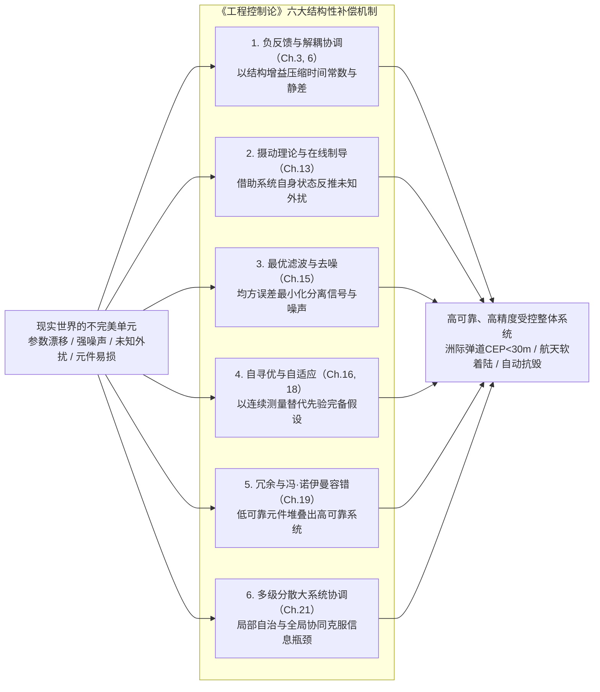

# 工程控制论核心：反馈、容错与薄弱元件的可靠系统构建

> **核心文本锚点**：
> - **《工程控制论（第三版）》（钱学森、宋健著，科学出版社 2011）**：
>   - `钱学森序：现代化、技术革命与控制论`（PDF pp. 4–16）与 `宋健前言`（PDF pp. 17–19）
>   - 第 1 章《引论》（PDF pp. 24–39）、第 3 章《输入、输出和传递函数》（PDF pp. 97–125）、第 6 章《协调控制》（PDF pp. 198–216）
>   - 第 13 章《摄动理论和制导系统》（PDF pp. 551–607）、第 15 章《噪声过滤的设计原理》（PDF pp. 676–784）
>   - 第 16 章《自寻最优点的控制系统》（PDF pp. 786–811）、第 18 章《自镇定和自适应系统》（PDF pp. 888–910）
>   - 第 19 章《冗余技术和容错系统》（PDF pp. 911–944）、第 21 章《大系统》（PDF pp. 1004–1059）
> - **B18**《关于系统学的通信》（书第 145–147 页，PDF 第 153–155 页）与 **B47** 宋健《工程控制论》（书第 346–350 页，PDF 第 354–358 页）

---

## 一、核心工程哲学：从“要求每个零件完美”到“以结构驾驭不完美”

在传统机械制造与开环工程观念中，系统的精度与可靠性直接受制于组成元件的制造精度和材料稳定性：如果陀螺仪有漂移、放大器参数会老化、继电器会误动作、风速与大气密度不可预知，系统就必然失效。

1954 年钱学森著《工程控制论》（英文版）问世，将“控制论中能够直接应用到工程设计的理论、概念和方法”提炼为一门独立的**技术科学**（**B47**，书第 346 页，PDF 第 354 页）。贯穿全书 21 章（第三版）的最深层工程哲学，可以浓缩为一句话：**通过巧妙的系统连接结构、信息反馈、在线自适应与概率冗余机制，把局部有缺陷、有噪声、受扰动乃至低可靠性的薄弱元件，组织成整体高精度、高稳定、高可靠的受控系统。**

这一思想恰恰切中了 20 世纪 50—70 年代中国工业底盘薄弱的痛点，也成为后来钱学森构建“系统工程”与“系统学”的数理原点：

---

## 二、机制一：闭环反馈与多变量协调控制（以结构换精度）

### 1. 反馈：放弃“事先算准一切”，转为“测量偏差并纠偏”

在《工程控制论》第 3 章讨论涡轮发电机转速控制时（`OCR 原文` 第 61–120 页摘引原文，第 3.7 节），钱学森用最简洁的代数关系揭示了反馈的本质：
- **开环控制**：系统时间常数正比于 $I/c$，负载转矩变化引发的稳态偏差反比于阻尼系数 $c$。若要精确控速，设计者必须事先精确知道所有负载扰动和系统物理参数——在现实中这几乎不可能。
- **闭环反馈**：只需将输出量测量后回授至输入端形成偏差信号，再乘以反馈放大系数 $k$，原方程中的 $c$ 即被替换为 $c+k$：

> “只要我们使 $k$ 比 $c$ 大得很多的话，就可以使时间常数和偏差转速大大地减小。其余的条件都不必加以改变，只要把开路控制系统加上一个反馈线路使它变为闭路控制系统的话，系统的反应速度和控制的精确度就可以提高很多，因而也就可以大大地改进控制系统的性能。”（《工程控制论》第 3 章）

这意味着**系统不需要对自身部件参数拥有极致的制造公差，只需具备“感知偏差—施加负反馈”的信息回路，即可用结构增益大幅压低静态误差与响应滞后**。同时，第 4.8 节也辩证指出了**静差与稳定性的根本矛盾**：“静差反比例于系统的放大系数……但放大系数趋于无穷时系统稳定性将变坏”（`OCR 原文` 4.8 节），故工程上常采用“误差反馈 + 外扰前馈”的**复合控制（Ch. 5.3）**求得兼顾。

### 2. 多变量系统的协调控制与“互不影响准则”（Ch. 6）

当系统拥有多个耦合的受控量（如加力燃烧室涡轮喷气发动机的压缩机转速、燃烧室喷油率、加力喷油率与尾喷管面积，PDF p. 198），调一个变量会牵动其余变量。第 6 章（PDF pp. 198–216）通过传递函数矩阵 $E(s)$、测量矩阵 $L(s)$ 与控制器矩阵 $C(s)$ 联立闭环方程（式 6.2-8/6.2-9）：
- 将外部扰动 $V_k(s)$ 与指令信号 $X_\nu(s)$ 对输出的影响写成矩阵形式；
- 依据发动机矩阵 $E$ 的余因子比例关系，精确设计耦合补偿矩阵 $C(s)$，使闭环系统矩阵退化为对角矩阵——即实现**“互不影响的协调控制”**，从架构上消除了多子系统相互打架的耦合灾难。

---

## 三、机制二：摄动理论、随机滤波与动态抗扰（Ch. 13 & Ch. 15）

### 1. 摄动理论与制导系统：借飞行器自身动力学“反测”未知外扰（Ch. 13）

真实火箭发射面临大气密度偏差 $\delta\rho$、推力偏差 $\delta T$、风速扰动 $\delta w$ 等无法在发射前预知的环境变化。钱学森在第 13 章《摄动理论和制导系统》（PDF pp. 551–565）指出，电子计算机普及后，弹道摄动理论的价值已不在于离线算弹道，而在于**设计高精度变系数线性制导系统**：
- 在标准弹道附近将非线性飞行方程线性化，得到变系数摄动方程与**伴随方程（§13.3）**；
- 在§13.7“问题的一般提法”（PDF p. 565）中，钱学森点出了一条极具巧思的工程原理：**只需直接测量三个干扰中的一个（如测出某一动力学偏差），并利用摄动方程组（13.5-7）建立的内部约束关系，“实质上也就是借助于火箭本身来间接测量干扰”**，从而在制导控制律中消除所有未知偏差对命中落点的影响（**终端不变性问题**，§13.9）。
- 这一控制论突破带来了数量级跃升：正如《工程控制论（第三版）》钱学森序（PDF p. 13）所对比的，二战德国未使用现代控制论的 V-2 火箭射程 300 公里，落点半数散布半径高达 **13 公里**；而应用工程控制论后，射程 **1 万公里**的洲际导弹圆公算偏差可控制在 **30 米以内**，“海盗号”能在 **7,000 万公里**外的火星实现软着陆。

### 2. 噪声过滤与卡尔曼递推滤波：从强噪声中打捞微弱信号（Ch. 15）

当输入观测值 $x(t) = f(t) + n(t)$ 被剧烈随机噪声 $n(t)$ 污染时（PDF p. 676），第 15 章以误差均方值 $\overline{E^2}$ 最小化为核心准则（式 15.1-14）：
- 揭示通频带选择的对立统一：通频带过宽则放进大量噪声，过窄则畸变有用信号；
- 分别推导稳态 Wiener 最优过滤、有限记忆最优过滤、以及针对非平稳随机过程的状态空间**卡尔曼（Kalman）递推滤波（§15.11–15.12，PDF pp. 731–740）**与线性二次高斯（LQG，§15.14）控制——使系统无需存储海量历史数据，仅靠当前状态估计与新观测误差递推修正，即可在强噪声环境中保持高保真跟踪。

---

## 四、机制三：不完备先验信息下的自寻优与自适应（Ch. 16 & Ch. 18）

在第 18 章开篇（PDF p. 888），钱学森与宋健从认识论高度将所有控制系统分为两大类：
1. **确定系统（全信息系统）**：设计前完全掌握受控对象特性、输入特性与环境条件（第 1–13 章主要讨论对象）；
2. **先验信息不完备系统**：存在三类未知/不确定因素——① 输入随机变化（Ch. 14–15）；② **受控对象特性及环境边界条件未知或时变**（Ch. 16、Ch. 18，如飞机机翼结冰导致气动特性骤降、钢板轧前厚度未知、吊车负载未知）；③ **元件可靠性与制造工艺误差**（Ch. 19）。

针对第二类不确定性，本书给出两大自主演进机制：

### 1. 自寻最优点系统：“连续理解与连续测量”（Ch. 16）

当机翼结冰使原本最优的巡航参数失效时，第 16 章（PDF pp. 786–789）提出**“连续理解和连续测量”**原理：
- 系统不再依赖死板的预设曲线，而是主动对输入施加周期性试探微扰，测量输出变化率 $\mathrm{d}y^*/\mathrm{d}t$，到达临界负值即反转输入方向，使系统围绕动态漂移的最优点 $y^* = -kx^2$ 不断搜索跟踪（周期 $T^*$、搜索范围 $\Delta^*$）。
- 钱学森特别定量刻画了自适应的物理代价——**搜索损失 $D^* = \frac{1}{3}\Delta^*$**（式 16.2-2），揭示了搜索周期 $T^*$、抗干扰阈值与搜索损失之间的必然权衡：**想完全消除探测代价就不可能发现漂移的最优点，适度的试探损耗正是系统换取环境适应力的必要投资**。

### 2. 自镇定系统与复杂性警钟（Ch. 18）

第 18 章引入 W. R. Ashby 提出的**自行镇定系统（Homeostat）**（§18.1–18.4，PDF pp. 889–896）：当系统因外扰失稳越过开关边界时，切换装置自动变更连接参数 $\zeta$ 直到进入稳定的**终点场**。然而，钱学森并未盲目乐观，而是通过严密概率推导给出了一个极其深刻的复杂性定理（§18.3–18.4）：
- 当一个 $n$ 阶线性系统的参数矩阵元素随机取 $[-9, +9]$ 整数时，系统天然稳定的概率随阶数 $n$ 呈指数崩溃，近似为 $p \approx 1/2^n$（表 18.3-1：$n=2$ 时为 $24\%$，$n=3$ 为 $12\%$，$n=4$ 骤降至 $1\%$）；即使强迫对角线元素非正、施加局部限制（表 18.3-2），稳定概率仍随变量增多急剧下降；
- 由此，达到稳定终点场所需的平均开关调整次数为：
  $$N = \frac{1}{p} \quad (\text{式 } 18.4\text{-}1)$$
  对庞大复杂系统而言，若靠纯粹无导向的随机试错（$p$ 极小），$N$ 将趋于天文数字而无法在有限时间内稳定！因此必须进一步采用**对扰动的参数测量适应（§18.5）**与**模型参考自适应控制系统（MRAC，§18.6，PDF pp. 905–909）**——利用参考模型直接比较误差 $e(t)$ 并按李雅普诺夫稳定条件律动态调整控制器参数，从而将适应时间压缩到工程可用尺度。

---

## 五、机制四：冗余技术与容错系统——“用不太可靠的元件组成高可靠系统”（Ch. 19）

**第 19 章《冗余技术和容错系统》（1954 年原版第 18 章，PDF pp. 911–944）是钱学森系统思想中最具前瞻性的数理明珠之一。** 1981 年钱学森在 **B18《关于系统学的通信》**（书第 145–146 页）中两次致信强调，正是这一思想构成了连接工程控制论与“系统学”的关键桥梁。

### 1. 无冗余串联系统的可靠性“诅咒”

若系统由 $N$ 个无备份串联元件组成，单个元件可靠度 $R_i(t) = e^{-\lambda_i t} \le 1$，则整机可靠度为乘积（式 19.1-3，PDF p. 912）：
$$P(t) = R_1(t) R_2(t) \cdots R_N(t)$$
元件数 $N$ 越大，系统越脆弱——这正是大规模电子计算机与复杂导弹面临的“复杂度—可靠性死锁”。

### 2. 三大结构容错方案：如何打破乘积衰减律？

第 19 章仿照生物自修复机制（开篇即以人脑 $10^{10}$ 个细胞中每小时死亡约 1,000 个、一生死亡十分之一即 $10^9$ 个却仍能终身可靠思维为例，PDF p. 911；**B47** 书第 348 页亦予重申），给出三条严格的容错数学路径：

1. **重复线路与 $k/N$ 表决冗余（§19.2，PDF pp. 913–915）**：
   - 只要 $N$ 个相同并联/备份组件中有至少 $k$ 个正常工作即不破坏系统性能，其可靠度为：
     $$P_{k/N}(t) = \sum_{i=k}^{N} C_N^i R^i(t) (1 - R(t))^{N-i} \quad (\text{式 } 19.2\text{-}1)$$
   - 其中 $N-k$ 称为**容错能力**；工程上最经典的是**三模冗余（$2/3$ 冗余）**，$P_{2/3}(t) = R^3(t) + 3R^2(t)(1-R(t))$，容错能力为 1；当 $R=0.9$ 时，单机失效率 $10\%$，而 $2/3$ 表决系统失效率瞬间降至 $2.8\%$。
2. **冯·诺伊曼复合冗余（Multiplexing，§19.3–19.5，PDF pp. 915–926）**：
   - 当某组件出错不仅不出力，还会**主动输出错误信号污染下游**时，简单并联反而降低可靠性（PDF p. 915）。
   - 对此，钱学森完整演绎了冯·诺伊曼“复合方法”：用 $n$ 根线束代替单根信号线，用 $n$ 个易出错的谢弗门（与非门，单门出错概率 $\varepsilon$）并联执行逻辑运算，再接入**随机重排复原装置**（将输出分成 $2n$ 根线随机配对再接下一级 $n$ 个谢弗门，总代价约为 $3n$ 个门）。
   - 推导两级串联后兴奋线比例 $\alpha_0 \to \alpha_1 = 1 - \alpha_0^2 \to \alpha_2 = 2\alpha_0^2 - \alpha_0^4$（式 19.3-2），并精确解出其非平凡不动点：
     $$\alpha_0 = \frac{1}{2}(\sqrt{5}-1) \approx 0.618034$$
     当输入错误率偏离 $0.618$ 较远（即处于有效区间 $[0, 0.382]$ 或 $[0.618, 1]$）且引入大数高斯统计修正 $\Delta\zeta$（式 19.4-23）时，**复原装置会在每一级自动把错误率压向 $0$ 或把正确率推向 $1$！** 钱学森赞叹道：“**应用概率论中最基本的概念，可以用不甚可靠的器件堆累成一个可靠的具有相同功能的组件。**”（PDF p. 917）
3. **莫尔-香农（Moore-Shannon）网状线路冗余与结构优化（§19.7–19.9，PDF pp. 930–938）**：
   - 利用 $3\times 3$ 等串并联混联继电器网络构建不对称容错拓扑，使整个网络等价于一个高可靠超级元件；并在 §19.9 证明在元件总数固定下，不同网状连接拓扑决定系统的最终失效率边界（式 19.9-5）。

---

## 六、从局部控稳向“大系统”分散协同的跨越（Ch. 21）

《工程控制论（第三版）》终章《大系统》（PDF pp. 1004–1059）完成了从单台自动机器向国家电网、铁路网、人口系统与战略防御系统（含超过 200 万条计算机软件指令的 6 个控制子系统+6 个支援子系统+6 个维护调试子系统，PDF p. 1007）的跨越，提炼出大系统的**三大固有特征**（§21.2，PDF pp. 1007–1010）：

1. **大范围多源信息采集、滤波辨识与通信网络**：以计算机网络为底座处理海量含噪异构数据；
2. **多级控制与多级协调结构（图 21.2-1 与 21.2-2）**：下级保留局部独立性，上级负责协调冲突；
3. **过程模型（外模型 vs. 内模型）与分散控制中的“全局—局部冲突”**：由于微型/小型机分散在各节点，每个节点只能观测局部状态与上级协调信号——“**某一种控制作用对一个局部是好的，而从全局来看可能是不好的甚至是不能允许的**”（PDF p. 1010）。这便在数理层面直接引出了模块 `02-02` 与 `04-01` 的核心组织命题：仅靠控制论的局部自动调节已不够，必须升维至**系统工程的总体统筹与系统学的综合集成**。

---

## 七、跨时代思想沉淀：工程控制论的五大通用构造律

| 工程构造律 | 数理原型（《工程控制论》章节） | 对低资源/弱单元组织与当代系统的普适启示 |
| :--- | :--- | :--- |
| **结构代偿律** | 闭环反馈压缩静差 $1/(c+k)$（Ch. 3）；复合冗余（Ch. 19） | **系统可靠性不必等所有单点元件完美；优良的反馈与表决拓扑可以直接“制造”出超越单体的系统精度与鲁棒性** |
| **等价翻译律** | 拉普拉斯变换 $t \leftrightarrow s$（Ch. 2）；函数空间投影（Ch. 2.6） | 复杂难解的问题（微分/物理耦合）往往可通过转换表达空间（代数/几何投影）变为可解问题 |
| **代理测量律** | 摄动方程利用火箭自身动力学反推外扰（Ch. 13.7） | 当环境扰动不可直接观测时，受控系统自身的运行偏差轨迹就是最好的“传感器” |
| **代价守恒律** | 静态精度 vs. 稳定性（Ch. 4.8）；搜索损失 $D^*=\frac{1}{3}\Delta^*$（Ch. 16） | 没有免费的适应性；高频试探与冗余备份的“局部开销”，正是维持动态最优点与容错能力的必要成本 |
| **失稳剪枝律** | 随机系统稳定概率按 $1/2^n$ 崩溃（Ch. 18.3）；局部好而全局崩（Ch. 21.2） | 随着单元数 $n$ 剧增，无约束自由耦合系统必将走向不稳定；必须引入层级约束与协调级（总体控制中心） |
