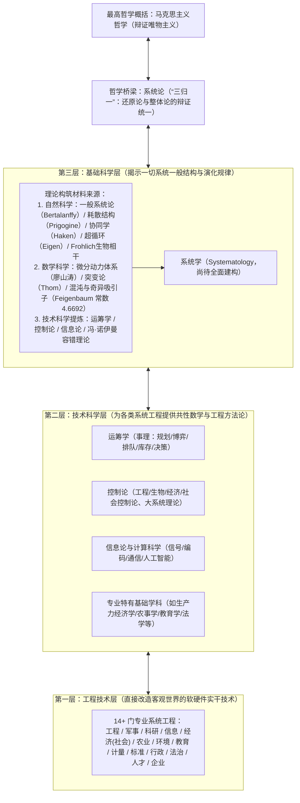
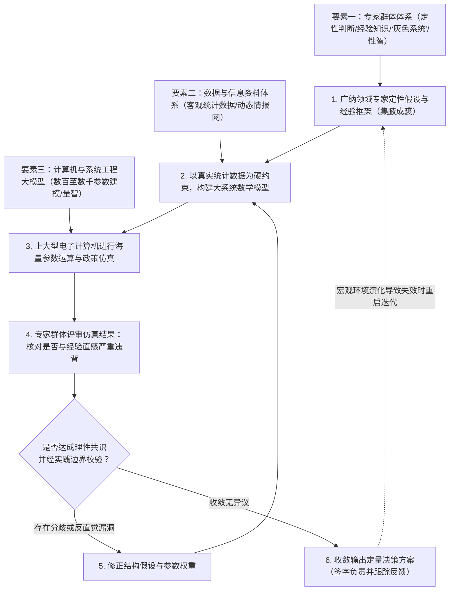

# 系统科学三层架构与开放复杂巨系统方法论

> **核心文本锚点**：
> - **《论系统工程（新世纪版）》**：**B01**（书第 1–12 页）、**B04**（书第 37–44 页）、**B12**（书第 92–100 页）、**B17**（书第 141–144 页）、**B18**（书第 145–147 页）、**B38**（书第 288–299 页）、**B39**（书第 300 页）、**B44**（书第 323–327 页）、**B45**（书第 328–335 页）、**C01**（书第 351–356 页）、**C03**（书第 360–363 页）、**C04**（书第 364–379 页）、**C07**（书第 386–391 页）、**C08**（书第 392–396 页）
> - **《创建系统学》（2001）**：《我对系统学认识的历程》（PDF p. 34）、《处理开放的复杂巨系统不能简单化》（PDF p. 60）、《定性定量是一个辩证过程》（PDF p. 66）、《关于人·机结合》（PDF p. 117）、《一个科学新领域——开放的复杂巨系统及其方法论》（PDF p. 228）、《再谈开放的复杂巨系统》（PDF p. 254）、《以人为主发展大成智慧工程》（PDF p. 336）及 1984—2000 年书信篇（PDF pp. 341–581）

---

## 一、系统科学的三层架构与学科演化（1978 → 1986）

在 1978 年发表 **B01** 时，钱学森还只是把“运筹学”当作系统工程的技术理论基础，甚至在 **C01**（1979.11，书第 355 页）对控制论能否直接纳入企业系统工程保持审慎。但随着 1979—1982 年间对国际前沿科学（特别是经由许国志转赠 R. Rosen 论文、经由方福康沟通 I. Prigogine 与 H. Haken、以及经由贝时璋获取 M. Eigen 论文，详述见 **C04** 书第 368–371 页与 **C05** 书第 381–382 页）的深度融通，钱学森正式确立了**与自然科学、社会科学并列的独立大部门——系统科学**，其内部呈严密的**三层台阶 + 一座哲学桥梁**结构（**B17** 书第 142–143 页；**B38** 书第 295–299 页；**C04** 书第 371–372 页；**C08** 书第 392–393 页）：

### 三层架构的五大核心辨析

1. **为什么叫“系统工程”而不叫“系统工程学”？**（**B38** 书第 289–290 页；**C02** 书第 357 页）：工程技术强调“实干”与改造客观世界，且随对象分门别类（共有工程、军事、科研、企业、信息、社会、环境、教育、计量、标准、农业、行政、法治等至少 14 门专业，见 **B38** 书第 291 页），中文加“学”字会混淆工程实践与科学理论的层次。
2. **技术科学层的“共性基础 + 专业特有基础”双轨制**（**B38** 书第 290–292 页；**C01** 书第 354–355 页）：任何一门系统工程既需要**运筹学、控制论、信息论与计算科学**作为共性技术科学底座，又必须依赖各自对象的**特有科学基础**（如企业系统工程须懂生产力经济学，农业须懂农事学，军事须懂军事科学），绝不可“光靠几个数学公式加计算机一个劲地算”。
3. **系统学（Systematology）的两大任务**：
   - 依据 `B17`（书第 142–144 页）与《创建系统学》（PDF pp. 34, 455），系统学的核心使命是克服“从微观到宏观”的鸿沟：**“从组成系统的单元的性能和相互作用推导出整个系统的结构（有序化）及功能，而这是受外界影响的。即：外界影响 → 系统结构 → 系统功能。”**
   - 同时在 **C04**（书第 370–371 页）看到 Feigenbaum 混沌常数（$4.66920166\dots$）后，钱学森敏锐提出著名的**“钱学森猜想”**：既然系统能从无序自组织为有序，也可能在非线性参数越过阈值时从有序堕入混沌紊乱；治理之道正是**“截断系统的某些联系，即增加层次，就可以防止紊乱的出现”**。
4. **“软科学”在三层架构中的精准落位**（**C07** 书第 386–388 页；**C08** 书第 392、395 页）：软科学不是独立于系统科学之外的玄学，而是**系统科学中“技术科学层（运筹/控制/信息）+ 工程技术层（系统工程）+ 交叉学科 + 经验性艺术”面向领导决策与社会管理的综合应用**，它离不开与硬件、软件并列的第三支柱——**“斡件（orgware，组织件）”**。

---

## 二、系统的演化谱系与“开放的复杂巨系统”的科学界定

1986 年起，钱学森在北京主持“系统学讨论班”，在 **B39** 喊出“大系统理论要创新”后，经过四年集中攻关，于 1990 年在《自然杂志》发表里程碑论文《一个科学新领域——开放的复杂巨系统及其方法论》（收入《创建系统学》PDF p. 228）及《再谈开放的复杂巨系统》（PDF p. 254），彻底重构了系统分类谱系。

### 1. 基于“方法论边界”的系统四分类与四象限

钱学森明确反对圣菲研究所（Santa Fe Institute）等西方学者从纯抽象概念定义“复杂性”，主张**以认识和改造方法论的适用边界来界定系统类型**（《创建系统学》`OCR 原文` pp. 1–60, 241–300）：

> “凡现在不能用还原论方法处理的，或不宜用还原论方法处理的问题，而要用或宜用新的科学方法处理的问题，都是复杂性问题，复杂巨系统就是这类问题。”（《创建系统学·我对系统学认识的历程》）

据此，客观世界的系统演化为清晰的四级谱系：

| 系统类型 | 子系统数量规模 | 子系统种类与耦合特征 | 典型对象 | 有效处理方法论 | 局限与失效边界 |
| :--- | :---: | :--- | :--- | :--- | :--- |
| **1. 简单系统** | 少数至数十个 | 种类极少，关系明确（可用少量方程组描述） | 机械装置、单台控制器、普通工程元件 | **还原论方法**、经典控制论、常微分方程 | 无法处理海量自由度与不可忽略的非线性涨落 |
| **2. 简单巨系统** | 亿万级（极多） | **子系统种类很少**，相互关系相对单一（同质性强） | 气体分子集合、激光器、铁磁体、化学振荡（BZ反应） | **统计力学**、非平衡态热力学（**耗散结构**）、**协同学（Haken 序参量支配原理）** | 面对子系统“种类成百上千、中间层次不清”的系统立即失效（如大脑、社会） |
| **3. 复杂巨系统** | 上亿至万亿级 | 子系统**种类繁多**（成百上千种），呈**多层次结构**且中间层次常不可辨认，高度非线性 | 生物体、地壳生态构造等 | 局部统计 + 结构分解均无法完全还原，须转向整体唯象与综合方法 | 纯微观推导（如想从单个神经元直接推出思维）注定失败 |
| **4. 开放的（特殊）复杂巨系统** | 万亿级且动态演进 | **① 开放性**（与环境持续交换物质、能量、信息）；**② 巨量**；**③ 复杂多样**；**④ 多层次**；**⑤ 特殊性**（子系统包含具有自主意识、价值判断与博弈行为的**人**） | **人体系统、人脑系统（$10^{12}$ 神经元）、地理系统（地球表层）、社会经济系统、全球互联网** | **唯一有效方法：“从定性到定量综合集成法”**（及综合集成研讨厅体系） | 任何纯粹还原论、Forrester 系统动力学、西方单纯定量模型或泛系论均失灵 |

此外，在 1993—1994 年书信中（《创建系统学》OCR 原文 pp. 481–540），钱学森还补充了**“系统本身简单/复杂 × 环境简单/复杂”四象限分类**：如智能机器人本身是简单/小型大系统，却工作在复杂环境中；人体/人脑本身是复杂巨系统；而改革开放的中国社会则属于**“系统本身极其复杂 + 国际环境剧烈变化”的双重开放复杂巨系统**。

### 2. 对西方复杂性学派与各类“替代捷径”的精准剖析

钱学森在《创建系统学》中对国际主流复杂性理论做出了极其清醒的批判性吸收：
- **对耗散结构与协同学的划界**：高度肯定 Prigogine 与 Haken 为**简单巨系统**打下微观统计物理基础；但明确指出将它们直接搬用于大脑（$10^{12}$ 神经元且种类极繁）或人类社会，依然是“简单化”陷阱（PDF pp. 60, 361–420）。
- **对 Forrester 系统动力学（SD）与 Meta-analysis 的批判**：SD 模型往往只有十来个到几十个拍脑袋确定的耦合参数，把复杂的经济子系统强行压缩为单一常数；国外 Meta-analysis 则把定性与定量平列在同一平面，犯了机械唯物论错误（PDF pp. 64–66, 361–420）。
- **对美国圣菲研究所（SFI）的准确定位**（1993—1997 书信，PDF pp. 481–581）：SFI 从“半微观”出发，借助遗传算法、Swarm 等人工生命/计算机模拟探索宏观涌现，堪称综合集成体系中一位有价值的“SFI 专家”；但 SFI 缺乏辩证唯物主义认识论指导，只停留于局部模拟与定性启示，无法像“从定性到定量综合集成法”那样形成可承担国家决策后果的定量闭环。
- **对“泛系论”的纠偏**：只讲宏观整体而不能深入系统内部结构与定量参数，只能得出空洞的哲学同义反复，无法指导宏观调控（1994.1.23 致于景元信）。

---

## 三、方法论范式跃迁：为什么必须转向“从定性到定量综合集成法”？

### 1. 纯粹数学优化的失灵现场

在前一阶段（《工程控制论》与早期系统工程），核心范式是**“建立精确数学模型 → 解析/数值求极值”**（线性规划、庞特里亚金极大值原理、动态规划、最优控制）。然而在 1979 年后的中国经济体制改革、物价工资测算、三峡工程与生态环境治理实践中，钱学森与于景元等人深刻体会到：
- **维数灾难与参数时变**：社会经济系统与地球表层涉及几百上千个强耦合参数，且随着政策实施和人的心理预期变化，系统结构本身在动态演化（“任何解答只能管一定时期”，PDF pp. 301–360）；
- **部分规律尚未形式化**：专家脑海中的“不成文经验”（如老经济学家、老农、资深临床大夫的直觉判断，即**“前科学”**与**“性智”**），尚无法直接写成严谨微分方程，但离开这些经验，数学模型就会变成脱离真实的“唯心计算”（**C08** 书第 395 页；《创建系统学》PDF p. 409）。

### 2. “从定性到定量综合集成法（Meta-synthesis）”的三要素与六步螺旋闭环

钱学森与于景元在航天部 710 所实践（受老经济学家马宾指导，**C08** 书第 395 页）基础上总结出该原创方法论，并于 1989—1990 年将名称由“定性与定量相结合”正式修订为**“从定性到定量综合集成法”**——一字之差，凸显了**从感性定性认识螺旋上升到理性定量认识**的认识论跃迁方向（《创建系统学》PDF pp. 66, 421–480）。

### 3. 三大标志性原型实践与方法论意义

1. **航天部 710 所“财政补贴、价格、工资综合平衡”研究（1982—1985）**：面对农副产品提价引发的财政补贴危机，单纯听各路经济学家开会谁也“不保险按我的意见准行”（**C08** 书第 395 页）。于景元团队建立包含 **115 个变量的国民收入分配模型**与 **237 部门产业关联矩阵**，在计算机上完成 **105 种政策模拟**并经专家多轮评审修正，输出量化方案误差控制在实际运行 **3% 以内**（**B46** 书第 340–342 页；《创建系统学》OCR 原文 pp. 1–60）。
2. **三峡工程决策建言（1990 致姚依林信）**：指出只用十几个参数争论三峡必陷简单化僵局，必须把水利、生态、移民、航运、防洪、财政各路专家意见综合入数百参数的计算机模型反复论证（《创建系统学》OCR 原文 pp. 421–480）。
3. **中西医结合与人体开放复杂巨系统**：把中医几千年宏观辨证施治的经验框架（“前科学”/唯象框架）与现代生理学、细胞分子指标（如阴虚/阳虚与 cAMP/cGMP 定量测定，**B16**）结合，以个体差异化诊疗克服机械标准化（《创建系统学》PDF pp. 54, 60）。

---

## 四、迈向终点与新起点：从“综合集成研讨厅”到“大成智慧工程”

在系统学三层架构与综合集成方法确立之后，钱学森在 1992 年进一步将这一方法论制度化、技术化为**“从定性到定量综合集成研讨厅体系（Hall for Workshop of Metasynthetic Engineering, HWMSE）”**与**“大成智慧工程（MsE）”**（《创建系统学》PDF pp. 98, 117, 336, 421–540）：

- **体系结构定位**：把古今中外千亿人的智慧结晶、专家群体、统计信息库、知识工程、人工智能与高速计算机网集成于同一“研讨厅”，构成**“以人为主、人机结合”**的复杂超巨型智能系统。
- **认识论升华（量智与性智的统一）**：计算机与数学模型极大扩展了人类的**“量智”**（逻辑推理与海量计算），而人类专家与文艺审美修养则提供宏观把控与直觉顿悟的**“性智”**（形象思维与灵感思维）。二者通过综合集成研讨厅形成双向协同闭环，不仅能解决传统数学优化束手无策的开放复杂巨系统问题，更为当代 AI 时代设计**“人类统帅 + 异构多智能体研讨协同”**的新型组织系统留下了跨越三十年的顶层架构蓝图（详论见模块 `06`）。
