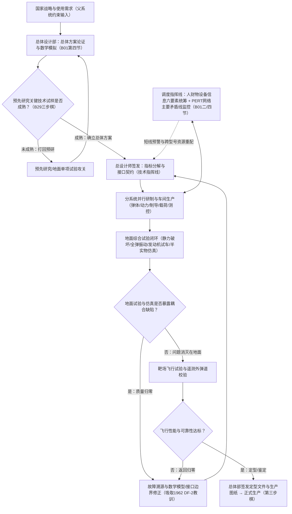

# 航天总体设计部与两条指挥线的工程闭环实例

> **核心文本锚点**：
> - **B01**《组织管理的技术——系统工程》（第一节、第四节，书第 1—4、6—8 页，PDF 第 9—12、14—16 页）
> - **B03**《军事系统工程》（第五节，书第 28—31 页，PDF 第 36—39 页）
> - **B29**《聂荣臻同志开创了中国大规模科学技术研制工作的现代化组织管理》（书第 203—205 页，PDF 第 211—213 页）
> - **《星际航行概论》**（第 4 章 §4.4 运载火箭设计过程、第 8 章 制导精度与总体权衡）
> - **《创建系统学》**（《社会主义建设的总体设计部》）与 **B28**（书第 198—200 页，PDF 第 206—208 页）

---

## 一、复杂工程的核心矛盾：为什么“分系统局部最优”会酿成“总体灾难”？

在手工业作坊和传统单机机械时代，总设计师尚能凭个人头脑把各部件装进同一个技术图景里。然而，当对象演变为战略导弹或运载火箭时，其嵌套层级急剧膨胀（**B01**，书第 3 页，PDF 第 11 页）：

> “例如，研制一种战略核导弹，就是研制由弹体、弹头、发动机、制导、遥测、外弹道测量和发射等分系统组成的一个复杂系统；它可能又是由核动力潜艇、战略轰炸机、战略核导弹构成的战略防御武器系统的组成部分。导弹的每一个分系统在更细致的基础上划分为若干装置，如弹头分系统是由引信装置、保险装置和热核装置等组成的；每一个装置还可更细致地分为若干电子和机械构件。在组织研制任务时，一直细分到由每一个技术人员承担的具体工作为止。”

在这种多层级、强耦合的工程系统中，**最致命的陷阱在于“局部最优主义”**。钱学森在 **B01**（书第 2 页，PDF 第 10 页）中一针见血地指出：

> “在制造一部复杂的机器设备时，如果它的一个一个局部构件彼此不协调，相互连不起来，那么，即使这些构件的设计和制造从局部看是很先进的，但这部机器的总体性能还是不合格的。”

历史与工程原著中，这种“分系统孤立优化导致系统失效”的矛盾至少有三大经典实证：

1. **1962 年“东风二号”首飞失利的弹性耦合教训**：
   - 1962 年 3 月 21 日，我国自行研制的“东风二号”中近程地地导弹首次飞行试验起飞后不久失控坠毁。故障分析揭示了典型的跨专业耦合盲区：结构设计人员追求减重与气动外形，而控制与制导专家在设计姿态控制回路时**沿用了“刚体假设”**，未把细长箭体的**弹性体弯曲振动模态**纳入控制动力学方程，致使飞行中弹体弹性振动频率与姿态控制系统工作频率发生共振耦合，加之发动机推力与结构强度裕度匹配失衡，最终导致系统级崩溃。
   - 正是这次惨痛代价，促使五院在 1962 年 11 月《第五研究院暂行条例》中彻底强化**总体设计部**的统筹权威，并确立“把一切问题消灭在地面”的全弹地面综合试验制度（**B29**，书第 204 页，PDF 第 212 页）。
2. **《星际航行概论》揭示的跨专业指标冲突（重量、推进、轨道与精度之争）**：
   - **喷管面积比与推进剂选型冲突**：理论上喷管面积比越大、比冲越高，但大喷管带来极高的结构重量与空气阻力；液氟（$\mathrm{F_2}$）理论比冲极高，却因极强腐蚀性在工程上无法实用（《星际航行概论》Ch. 2—3）。全箭“每减少一克也要努力”，因为 $2.5\text{ kg}$ 以下小零件占结构总重高达 $46.1\%$（《星际航行概论》§4.3）。
   - **动力轨道与制导精度的根本矛盾**：从能量最省原则出发，“在势能低处（近地面）加速比在势能高处更经济”，故动力专家希望贴近地面一次加速（飞向木星总速仅 $19.87\text{ km/s}$）；但从制导精度看，从地面直接发射需 $0.765\text{ m/s}$ 极高速度精度，而从低卫星轨道起飞虽多耗约 $28\%$ 能量（总速 $25.40\text{ km/s}$），却可先测定轨道再择机发射（《星际航行概论》Ch. 6、Ch. 8）。钱学森在 §8.5 总结道：
     > “所以从动力及结构上考虑来选择轨道和从控制的精确度来选择轨道是存在着矛盾的。在实际的工作中，必须从总体的概念出发，考虑到各方面能做到的最大可能性，来综合平衡各种因素，最后决定出所采用的方案，也就是总效果较好的方案。”（《星际航行概论》Ch. 8）
3. **接口与体系结构失控的反面教材（美军全球军事指挥控制通信系统 WWMCCS）**：
   - 钱学森等人在 **B03《军事系统工程》**（书第 30 页，PDF 第 38 页）专门剖析了美国 1962 年建立全球军事指挥控制通信系统（WWMCCS）却长期失灵的案例：由于“结构松散，部门与部门之间，各种通信方式与手段之间的‘接口’问题没有解决好”，延宕整整十年，直到 1971 年改组并成立**总系统工程师办公室**（1971 年 15 人、1976 年增至 45 人），先抓“体系结构”与上下左右接口协调，才步入正轨。

---

## 二、总体设计部的组织解剖与五步工程闭环

为根治分系统割据，航天五院创造的**总体设计部**并非凌驾于专业之上的“空头指挥部”，而是一个由百余至数百名**“熟悉系统各方面专业知识的技术人员组成，并由知识面比较宽广的专家负责领导”**的实体化参谋机构（**B01**，书第 3 页；**B29**，书第 203—204 页）。其“不承担具体部件设计，专司抓总协调”的中立超脱地位，保证了它能从**父系统（更大系统）**与**全系统**的双重视角裁决分系统矛盾。

结合 **B01**（第一节、第四节）、**B29**（第三节）与 **《星际航行概论》§4.4**，航天总体设计部与两条指挥线的工程闭环可精确拆解为以下五个阶段：

### 第 1 阶段：总体方案论证与数学模拟（先算后造，把“大错误”消灭在图纸前）
- **输入**：国家战略与国防使用需求（如射程、载荷、突防、发射准备时间等笼统初始要求）。
- **总体部动作**：依据 **B01** 第四节（书第 7 页，PDF 第 15 页），把与系统有关的数量关系归纳为反映系统机制和性能的数学方程组（**数学模型**），在电子数字计算机上进行约束条件下的**系统数学模拟**：
  > “例如，为了在实际系统研制成功以前拟定与验证系统的总体方案，估计系统各组成部分之间的相互适应性，考察系统在实际的或模拟的外部因素作用下的响应，按照系统工程的方法，总是把与系统有关的数量关系归纳成为反映系统机制和性能的数学方程组，即数学模型，然后在约束条件下求解这个数学方程组，找出答案。这个过程就叫系统的数学模拟；它是用电子数字计算机来实现的。”（**B01**，书第 7 页，PDF 第 15 页）
- **闭环准则**：结合 **B29**“三步棋”原则，涉及全新原理的关键部件必须先通过**预先研究**拿出满意试样，方能启动全型号总体方案确定（《星际航行概论》§4.4 第一、二步：初步方案选择 → 方案确定）。

### 第 2 阶段：战术技术指标分解与多维权衡分配（Constraint Budgeting）
- **核心任务**：将总体的射程、落点精度（CEP）、可靠性、重量与研制周期，逐层分解为弹体、发动机、制导、遥测、地面发射等分系统的**战术技术指标与可靠性指标**（**B29**，书第 203 页；**B01**，书第 3 页）。
- **多目标权衡实例**：
  - **精度可行域**：如《星际航行概论》§8.3 所示，轨道入轨误差并非单一阈值，而是速度误差 $\delta v_0 / V$ 与角度误差 $\delta\alpha$ 构成的**菱形允许误差区域**，总体设计部必须把制导误差分配与推进关机精度、结构质量偏差联立求解。
  - **重量分配最优化**：如通讯设备与天线重量之和固定时，依据乘积最大化原则分配为 $W_A = W_T$（《星际航行概论》Ch. 9）；结构重量按级数、结构比与“以克计减重”逐级下达指标包。
- **动态再平衡**：研制中某分系统若确实无法达成原定指标（如发动机比冲偏低或结构超重），总体部严禁分系统“自行其是”或隐瞒，而是在总体层重新核算全弹性能，调用其他分系统余量进行系统级再分配。

### 第 3 阶段：接口契约与协调控制（Interface Management）
- **横向接口**：机械对接面、电气插头与协议、控制-结构动力学耦合边界（如弹性模态参数向控制系统的强制传递）、热环境与电磁兼容性（EMC）约束。
- **纵向接口**：如 **B01**（书第 3 页）强调，总体设计部既向下协调各分系统接口，又向上“把系统作为它所从属的更大系统的组成部分进行研制”（例如导弹系统与核弹头、地下井/机动发射车、靶场外弹道测控网的接口匹配，即 **B03** 所言之“体系结构”）。
- **签署负责制**：正如钱学森在 **B28**（书第 200 页，PDF 第 208 页）回忆航天工程规则时所言：“要有设计蓝图，并由总设计师在上面签字，以示负责。就像我们航天工程那样，如果根据设计制造、发射的卫星，出了故障，不但批准这项工程的领导人要负责，总设计师也要负责。”

### 第 4 阶段：两条指挥线协同与 PERT 计划协调控制（网络图与“主要矛盾线”）
- **双线协同机制（B29，书第 204 页）**：
  - **技术指挥线**（总设计师/副总设计师 + 总体设计部 + 各分系统技术负责人）：管“做什么、做到什么技术指标、怎么协调技术矛盾”。
  - **调度指挥线**（各级调度指挥部门 + 型号调度指挥员）：因为每个研究所、车间、工厂同时承担多个型号任务，调度线专管“人、物资、设备、财、任务、信息”六要素（**B01** 二节，书第 4 页）在跨型号、跨单位之间的排产与进度平衡。
- **计划协调技术（PERT）与计算机动态监控（B01，书第 4—8 页）**：
  1. 克服传统“线条图（甘特图）”无法反映工序依赖关系的缺陷，将成千上万项工序之间的技术制约与先后顺序绘制为**网络图**，求出决定总工期的**主要矛盾线（关键路径）**；
  2. 1963 年起我国国防科研试点将电子计算机用于 PERT（**B01**，书第 7 页），实现三大工程收益：
     - 建立高效进度数据库，随时调阅任一零件/工序的历史与最新状态；
     - 实时识别经常变动中的**“短线”（瓶颈工序）**与**“窝工”（资源闲置）**，迅速采取调度措施；
     - 在计算机上对多种候选调度方案做仿真对比，择优调整。

### 第 5 阶段：地面大型综合试验、鉴定定型与质量归零闭环
- **严苛的六阶段研制纪律（《星际航行概论》§4.4）**：初步方案选择 → 方案确定 → 初步设计 → 工艺设计 → 样机生产与地面试车（破坏强度试验、水平测试、垂直测试、全机地面试车）→ 飞行试验。“每一阶段必须全部通过才能进入下一阶段，任何轻率都会造成不可估量的损失。”（《星际航行概论》§4.4；Ch. 3 更指出新发动机研制最少准备报废 40 台原型机、耗时 2.5 年以上，必须通过试车台充分暴露问题）。
- **质量归零原则**：针对 1962 年 DF-2 失利教训，建立“故障不归零不放行”的严格归零机制——任何地面试车或飞行异常，必须回溯至设计图纸、工艺文件或数学模型假定（如补全弹性体模态方程），经总体设计部与分系统联合复核并重新通过地面验证后，方能签发定型（或鉴定）文件与正式生产图纸（**B29**，书第 203 页）。

---

## 三、总体设计部 + 两条指挥线工程闭环流程图

---

## 四、从航天型号向宏观建设“总体设计部”的范式外推

钱学森在晚年与同事多次指出，航天总体设计部的真正价值不仅在于造出火箭和卫星，更在于它证明了**“把整体协调职能组织化、实体化”**是攻克一切超大规模复杂系统的通用密钥：

- **国民经济总体设计部（B08、B28、《创建系统学》）**：钱学森明确反对各部委“各说各的发展战略，没有一个综合性的总体发展战略”，主张在国务院建立实体化的“国民经济和社会发展总体设计部”，像航天总设计师一样在经济社会设计蓝图上签字负责（**B28**，书第 200 页，PDF 第 208 页）。
- **国家法制和法治总体设计部（B30，书第 212 页，PDF 第 220 页）**：作为全国人大及其常委会的咨询参谋机构，由法学家、社会科学家、自然科学家、系统科学家与大型计算机检索系统构成，审查上万件法律法规的完备性与无矛盾性。
- **综合集成研讨厅（《创建系统学》）**：在 20 世纪 90 年代信息网络条件下，将航天总体设计部升级为“人机结合、以人为主”的**综合集成研讨厅体系**，使其能够处理比航天工程更加复杂、包含“人的意识与社会博弈”的开放复杂巨系统。
