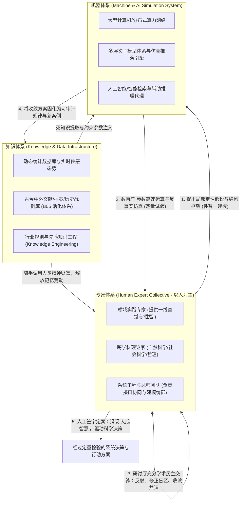

# 钱学森人机结合思想前瞻：从 1979 情报网到综合集成研讨厅

> **核心文本锚点**：
> - **B05**《情报资料、图书、文献和档案工作的现代化及其影响》（1979 年，书第 45—50 页，PDF 第 53—58 页）
> - **B22** 宋健《新技术革命与领导机关的改革》（1984 年，书第 165—169 页，PDF 第 173—177 页）
> - **B32**《新技术革命与系统工程——从系统科学看我国今后 60 年的社会革命》（1985 年，书第 222—233 页，PDF 第 230—241 页）
> - **C07**《软科学是新兴的科学技术》（1986 年，书第 386—391 页，PDF 第 394—399 页）
> - **C08**《软科学是定性与定量相结合的系统科学》（1987 年，书第 392—396 页，PDF 第 400—404 页）
> - **《工程控制论（第三版）》** 钱学森序《现代化、技术革命与控制论》（PDF 第 4—12 页）
> - **《创建系统学》** 讲话篇（《定性定量是一个辩证过程》《关于大成智慧的谈话》《关于人·机结合》等，PDF 第 66—69、98—105、117—120 页）、论文篇（《一个科学新领域——开放的复杂巨系统及其方法论》《再谈开放的复杂巨系统》《以人为主发展大成智慧工程》等，PDF 第 228—244、254—260、336—340 页）及书信篇

---

## 引言：跨越半个世纪的预见——从“人伺候机器”到“机器伺候人”

在今天讨论大语言模型、检索增强生成（RAG）、多智能体协作（Multi-Agent Collaboration）与人机协同（Human-AI Symbiosis）时，人们往往以为这些概念诞生于 21 世纪 20 年代的硅谷。然而，若回溯中国系统科学原始文献，就会发现钱学森自 1979 年至 20 世纪 90 年代，已经沿着一条极其严密的理论主线，推演出了现代人工智能与信息网络时代的组织与认知形态：

1. **1979 年（B05）**：当个人计算机尚未在中国普及、互联网尚未向公众开放时，他预言以电子计算机、高密度存储、通信卫星和交互终端构成的**自动化信息检索网**，将把人从繁重的记忆性脑力劳动中解放出来，使人类全部精神财富得以“随手调用”。
2. **1984—1987 年（B22、B32、C07、C08）**：面对全球新技术革命浪潮，他与宋健、于景元等人将信息网与决策机构改革结合，提出了**“知识活化”**、**“斡件（Orgware）”**以及**“专家经验 + 统计数据 + 计算机模型”**三方迭代的软科学方法原型。
3. **20 世纪 90 年代（《创建系统学》）**：在正视社会、人脑、互联网等**“开放的复杂巨系统”**之本质困难后，他拒绝了西方“纯机器智能取代人脑”的机械唯物主义路线，提出了**从定性到定量综合集成法（Meta-synthesis）**、**综合集成研讨厅体系（HWSMsE）**与**大成智慧工程（MsE）**，明确指出信息革命的本质是**“第五次产业革命”**，其核心是**“以人为主、人机结合”**——让计算机从“人伺候机器”转变为“机器伺候人”，从而实现人类智力的集体延伸。

钱学森之所以能如此精准地穿越技术周期，根本原因在于他始终站在**技术革命与人类脑力劳动方式变革**的历史唯物主义高度来看待计算机与网络（《工程控制论》序，PDF 第 4—10 页；**B05**，书第 45 页；**B32**，书第 223—226 页）。

---

## 一、1979 年情报与知识网络前瞻：计算机解放“记忆性脑力劳动”

### 1.1 历史痛点：“知识爆炸”与“单干户”科研的不可持续

1979 年 7 月，钱学森在《科技情报工作》发表 **B05《情报资料、图书、文献和档案工作的现代化及其影响》**（书第 45—50 页，PDF 第 53—58 页）。文章开宗明义地引用毛泽东 1969 年关于“技术革命不同于技术革新”的界定——技术革命是指如蒸汽机、电力、核能那样引起生产力与社会深刻变革的重大技术飞跃——进而明确提出：**电子计算机本身就是一项同级的技术革命**，因为“在广泛的领域内电子计算机代替了人的一部分脑力劳动”（**B05**，书第 45 页，PDF 第 53 页）。

他敏锐地指出了知识生产模式正在遭遇的结构性危机：
- **个体记忆与查阅能力的物理极限**：文献增长呈爆炸趋势。钱学森举了一个极具冲击力的定量例子：“仅以科学技术文献中的一小部分——化学文献为例，光是浏览一下世界上一年内发表的有关化学的论文和著作，一位化学家每周看四十小时，要读四十八年。这就清楚地说明要象过去那样，一位学者、作家完全靠自己去查所需的图书、资料，搞‘单干户’的工作方式，已是不太可能的了。你要查图书、资料，你就没有时间搞研究、搞创作；你要搞研究、搞创作，你就没有时间查图书、资料。”（**B05**，书第 45—46 页，PDF 第 53—54 页）
- **部门割据导致的系统低效**：针对当时国内科技情报“部门分隔，地区分隔，消息不通，各自为政”的现状，同一篇重要外文文献往往“你也译，我也译；你也印发，我也印发”，把本就稀缺的智力资源耗费在低水平重复劳动中（**B05**，书第 46 页，PDF 第 54 页）。

### 1.2 信息系统工程的四大技术支柱

为了破局，钱学森在 **B05** 第二、三节（书第 46—49 页，PDF 第 54—57 页）把图书、文献、情报和档案统称为**“信息”**，提出建立全国乃至全球联通的**“信息系统工程”**，并精确拆解出相互耦合的四大核心技术问题：

| 技术支柱 | 1979 年痛点剖析 | 钱学森的前瞻设计（B05，书第 46—49 页） | 当代 AI 知识基础设施映射 |
| :--- | :--- | :--- | :--- |
| **1. 存储技术** | 纸张存储密度极低，“一列火车也装不下，一所大楼也容不下” | 放弃人眼直接阅读的载体限制，转向高密度光电/磁介质；并惊人地预言未来记录单元可从微米缩小至**“原子尺寸，即埃的尺寸”**，使存储物质量缩小几亿倍以上 | 向量数据库、高密度云存储、模型参数化知识记忆 |
| **2. 终端技术** | 人工抄录、靠“背篓精神”爬山涉水送资料 | 在使用者身旁配置带显示、键盘与通话接口的“终端”，将编码机器语言译回文字/图像，并预言**“将来终端技术有了发展时，终端可以自动地把外文翻译出来”** | AI 对话界面、IDE 协同终端、多模态实时翻译与渲染 |
| **3. 检索技术（核心）** | 若只存储不检索，一年化学文献仍需查 48 年，“现代化就行不通” | 制定编码规则、库存排列与检索程序，利用快人千万倍的电子计算机实现分级交互检索：**“先显示题目 → 选定后调出提要 → 再进一步要详细摘要或复制件”**，将 48 年压缩至不到 1 分钟 | 语义检索引擎、RAG 分层召回（标题→摘要→原文切片） |
| **4. 通信与标准化** | 信息孤岛林立，无法共享计算与存储中心 | 中心信息库与计算机通过通信线路（尤其是**通信卫星**）与终端联成一体；强调全球编码标准化，并专门警示**汉字编码**“是百年大计，最好由国家召集各有关方面共同研究，不能只靠情报工作者来选定” | 分布式 API 网络、统一数据协议（如 MCP/JSON Schema）与字符集标准 |

这一蓝图令人震撼之处不仅在于技术细节的准确（分层渐进式检索流程几乎就是现代交互式检索的标准范式），更在于他将**情报网络与计算机网络视为同一套系统**（**B06**，书第 55 页，PDF 第 63 页：“运用情报信息系统工程建起来的情报网，可以使同一个系统也包括电子计算机的网络。使用电子计算机的人可以远离电子计算机而工作”）。

### 1.3 认识论与教育革命：从“博学强记”走向“创造性融会贯通”

在 **B05** 第四节（书第 49—50 页，PDF 第 57—58 页），钱学森进一步追问：当全部人类精神财富（不仅包括科技文献，还包括文学、绘画、乐谱、录音录像乃至全息三维造型艺术）都能通过终端“随手调用和享受”时，人类本身将发生什么变化？

1. **脑力劳动的分层解放**：古人夸学者“博学强记”，实际上是把大量脑力消耗在低效存储上。“脑子不要花在记忆上了，那脑子还干什么？从繁重性记忆脑力劳动解放出来的人，将有可能把智慧集中到整理人类的知识，全面考察，融会贯通，从而能搞更多更高的创造性脑力劳动。人将变得更为聪明，人类的前进步伐更将加快。”（**B05**，书第 49—50 页，PDF 第 57—58 页）
2. **教育体系的重构**：既然知识枝节可由终端随时调用，教育的重心就必须彻底转向**“整体，不是枝节”**——一方面学好基础与科学体系（自然科学体系、社会科学体系、系统科学与马克思主义哲学），另一方面掌握运用这些理论改造客观世界的“技巧或手艺”，最终使**脑力劳动与体力劳动的差别大大缩小，趋于消亡**（**B05**，书第 50 页，PDF 第 58 页）。

### 1.4 从“死知识”到“活情报”：知识活化的框架机制（1985，B32）

1985 年，钱学森在 **B32《新技术革命与系统工程——从系统科学看我国今后 60 年的社会革命》**（书第 229—230 页，PDF 第 237—238 页）中进一步补全了信息工作的第三环。他指出，情报工作不仅是（1）搜集与（2）储存检索，更关键的是（3）**知识的活化**：

- **死知识 vs. 活情报**：存在库里的原始资料是“死知识”；将其提取出来，放进系统分析的理论框架中进行组合、分解，弄清相互关系与历史演进，才能让“不明显的东西变得很突出”。
- **经典战例（恩格斯与普法战争）**：恩格斯没有任何特殊秘密情报渠道，仅凭伦敦与曼彻斯特公开发表的报纸消息，却在普法战争关键战役打响前精准预言了作战方式与胜败结果，并于开战次日见报。钱学森剖析其秘诀在于：恩格斯拥有马克思主义哲学与军事学构成的系统框架，把报纸上的“死消息”填入框架，便实现了“死知识的活化”。
- **智能机与信息系统的结合**：面对现代呈几何级数增长的信息量，单靠人工活化已不可能，**“要借助现代化分析手段，这就是智能机。虽然智能机只能代替一部分人的智能工作，但这就可以省好多事。智能机与信息系统的结合是非常重要的，没有这个结合，信息情报就可能分析不透，就可能作出错误的判断”**（**B32**，书第 230 页，PDF 第 238 页）。基于此，他将知识的积累、提取和使用正式命名为超越农、工、服务业的**“第四产业（精神财富的创造和使用产业）”**。

---

## 二、1984—1987 年新技术革命与软科学转向：参谋系统与“定性—定量”雏形

如果说 1979 年的 **B05** 解决的是“知识获取与脑力解放”，那么 1984—1987 年的 **B22、B32、C07、C08** 则把计算机、信息库和专家智力直接引入**组织管理与高层决策**，孕育出“综合集成”的制度与方法雏形。

### 2.1 领导机关的“信息饥饿”与决策科学化改革（B22，1984）

宋健在 **B22《新技术革命与领导机关的改革》**（1984 年，书第 165—169 页，PDF 第 173—177 页）中，以当时中国经济与物资管理中的真实痛点为切口，揭示了传统经验式决策的失灵：
- 领导者“常常淹没在大量信息之中理不出头绪，而又苦于有用的信息不足，处于信息饥饿状态。他们不得不在迷雾中徘徊，在无数的会议中消耗光阴”；
- 流动资金因信息不通、清一次账需半年而被迫冻结；全国年产 3000 万吨钢，却在成千上万个地址不详的仓库积压 1000 多万吨，干部耗费两个月翻账本核对“账、物、卡”，其实只要拿出 1% 的积压损失就足以建成自动化物资管理系统。

对此，**B22** 提出了领导机关改革的三大结构性方案（书第 167—169 页，PDF 第 175—177 页）：
1. **设立职业性系统分析部门**：把综合计划局、处改造为“信息采集综合、系统分析、政策设计与模拟试验”专职分工的实体机构；“领导所真正需要的是**数据、事实、状态分析、发展趋势预测和能够影响这种发展趋势的可能政策措施及模拟试验结果**”，而非“座谈会”式模棱两可的汇报与拍脑袋决断。文中以国家计生委依据 1983 年人口普查和千分之一抽样数据、建立人口动力学方程并测算三种生育率方案为例，证明“建立在科学预测和政策模拟基础上制定的政策，即便有些误差也绝不会闹出大乱子来”。
2. **建立动态映象数据库与办公自动化系统**：各主管部委必须在计算机数据库中建立所属事业和企业系统的**“动态映象”**（即今天所说的企业数字孪生与实时状态看板），并依托通讯卫星打通全国数据传输网络。
3. **跨界人才融合与角色边界**：大量吸收自然与技术科学工作者为社会管理和决策服务，但同时保持清醒的权力与专业边界——“这不是说技术人员能够代替具有多年管理工作经验和对所属系统有深刻的感性认识的老同志，更不是说各级主要领导同志都要由技术人员来担任”。

### 2.2 “斡件（Orgware）”与软科学的三要素循环（C07，1986）

1986 年，钱学森在《红旗》发表 **C07《软科学是新兴的科学技术》**（书第 386—391 页，PDF 第 394—399 页），将软科学定义为系统科学在组织、管理与决策中的应用（“软的技术革命”），其核心推进体现在三个层面：

1. **超越硬/软件的“斡件（Orgware）”视角**：钱学森指出，软科学不仅需要电子计算机硬件与软件，还必须重视计算机技术界新提出的 **`orgware`（组织件）**——他将其意译为**“斡件”**（取“斡旋”之意），即“用它把各方面的关系联系起来，是比硬件、软件更高层次的东西”（**C07**，书第 388 页，PDF 第 396 页）。这直接切中了现代人机系统设计的命门：算力与算法只是底座，真正决定效能的是连接专家、数据、算力与组织流程的**“斡件”架构**。
2. **社会主义软科学的制度优势与客观性前提**：钱学森引用 1984 年 ACM 通讯及美国咨询刊物的自我批评——尽管西方拥有“大规模的经济模型、高深的数学、大型计算机”，宏观经济预测仍频频“大大地错了”，根源在于其报告服务于商业利益集团博弈、误导投资者或总统拉选票（**C07**，书第 386 页，PDF 第 394 页）。由此他得出论断：科学方法与数学模型必须在没有局部私利扭曲的全局立场上，才能“老老实实地”发挥效用。
3. **正式提出软科学三要素与迭代程序**（**C07**，书第 389 页，PDF 第 397 页）：
   - **三要素**：① 信息、情报资料；② 专家的经验与判断（且明确主张重视**模糊数学**，因为专家意见常带有非精确的模糊性）；③ 定量建模与计算机（斡件）。
   - **迭代程序**：“在搜集资料以后，请专家讨论，提看法和意见；然后，根据专家的意见来建立模型，上电子计算机计算；算的结果，再请专家来评审，把模型修改以后，再上电子计算机计算；算的结果，再请专家评审，再改进，再建模型，反复进行。”
   - **呼唤“指挥部”**：他在文末批评科研工作的“零星、分散”毛病，强调跨单位横向联合攻关“一定要有一个强有力的科学技术‘指挥部’，即真正能够调度和指导研究工作的核心组织”（**C07**，书第 390 页，PDF 第 398 页）。

### 2.3 从“硬科学”到“软硬结合、定性定量结合”（C08，1987）

1987 年 11 月 14 日，钱学森在北京图书馆新馆落成纪念活动上作 **C08《软科学是定性与定量相结合的系统科学》**（书第 392—396 页，PDF 第 400—404 页），进一步从认识论上回答了“为什么单靠硬科学和计算机算不准复杂社会问题”：

1. **还原论与整体论的辩证统一**：近代科学从文艺复兴起采用层层分解的还原论（分子→原子→基本粒子，生物→器官→分子生物学），实事求是却容易丢掉整体；古代整体观虽看整体，却缺乏实验与深层分析工具而流于笼统。**系统科学则是还原论与整体论的辩证统一**（**C08**，书第 393 页，PDF 第 401 页），例如动力学中“低层次的混沌，可能就是高层次有序的一个必要条件”（**C08**，书第 394 页，PDF 第 402 页）。
2. **“软”的科学本质——未成文的经验知识**：钱学森指出，“领导科学”必须加上“领导艺术”，而“艺术不是唯心主义，不是胡猜”，它的科学含义是**“还要靠很多经验，不成文的经验，没有写到书本上的经验和感受”**——即“只能定性而不能定量的那一些知识”（**C08**，书第 395 页，PDF 第 403 页）。
3. **航天部 710 所的实证突破**：在 **C08**（书第 395—396 页，PDF 第 403—404 页）、**B35**（书第 253 页，PDF 第 261 页）、于景元 **B46**（书第 341 页，PDF 第 349 页）与《创建系统学》（OCR 阅读笔记第 1–60 页）中，共同拼出了马宾指导、航天部 710 所（信息控制研究所）联合经济学家攻克“农副产品提价导致财政补贴倒挂”问题的完整实证拼图：
   - **C08**（书第 395–396 页）说明了其组织与方法机制：老经济学家虽有深厚直觉，但坦承“如果按我这个意见去办，也不保险准行”，因为缺乏定量工具；710 所遂与统计部门、经济专家组成三方协同，把专家定性意见与大量统计数据“捏在一起”，建成“上百或者几百个”参数的数学模型（注：`C08` 原文仅言“上百或者几百个”参数，未列具体变量数），上计算机运算后再请专家评审——专家一旦指出“算出来的结果有哪点不合理”，系统专家便改模再算，“一直做到他们都提不出什么意见了，他们的经验都包括进去了，数据也都用了，那就定案”；
   - **B35**（书第 253 页）补出经济模型的计算细节：模型“有好几百个未知数”，用每秒一百万次计算机反复调整计算，最终得出调整粮油价格不出乱子的“五、六、七”结论（农业年增 `5%`、轻工 `6%`、重工 `7%`）；**B46**（书第 341 页）则明确记述在大型计算机上作了 **105 种政策模拟**；
   - **`《创建系统学》`（据视觉 OCR 阅读笔记第 1–60 页）**进一步载明其具体规模与精度：包含 **115 个变量**的国民收入分配模型与 **237 个部门**的产业关联矩阵，选出 **5 种**政策建议且实践误差控制在 **3% 以内**。

这一“三方碰撞、模型收敛”的机制，直接奠定了 90 年代“综合集成研讨厅”的工程基座。

---

## 三、20 世纪 90 年代跃迁：开放的复杂巨系统、综合集成研讨厅与大成智慧

### 3.1 本体论突破：为什么“开放的复杂巨系统”让传统方法失灵？

1990 年前后，钱学森、于景元、戴汝为发表《一个科学新领域——开放的复杂巨系统及其方法论》（《创建系统学》，PDF pp. 228–244）与《再谈开放的复杂巨系统》（PDF pp. 254–260），对系统复杂性给出了严格的**方法论分类谱系**：

1. **四类系统与方法论边界**：
   - **简单系统**（子系统少）：可用经典力学、传统工程控制论精确求解；
   - **简单巨系统**（子系统数量极大但种类少、同质性强，如气体分子、激光）：虽不能追踪个体轨迹，但可用统计物理、耗散结构、协同学等理论从微观统计推导出宏观性质；
   - **复杂巨系统与开放的复杂巨系统**：具备四大特征——① **开放性**（与环境持续交换物质、能量、信息）；② **巨量性**（子系统达数千万、上亿乃至万亿级）；③ **复杂性**（子系统种类达几十、几百乃至成千上万种，且相互作用具有高度非线性与环境依赖性）；④ **多层次性**（层次极多，且中间层次往往不可辨认）。人体、人脑、地理表层、互联网及人类社会均属此类；其中**社会系统**因组成单元是具有自主意识和博弈行为的人，更被称为**“开放的特殊复杂巨系统”**。
2. **批判机械简化与纯计算路线**：
   - **还原论失效**：对开放复杂巨系统一旦机械切块（如治长江中上游防护林只交由林业部而割裂水利、农业、财政、交通），“一分解，紧要的东西都跑了”（《创建系统学》OCR 笔记第 271、340 行）。
   - **圣菲研究所（SFI）与系统动力学的局限**：钱学森充分肯定 SFI 用巨型机从“半微观”探索宏观涌现的价值，将其视作综合集成体系中一位有益的“SFI 专家”；但他同时指出，Forrester 系统动力学仅靠十几个“拍脑瓜”压缩的参数处理社会问题必然“最后只有唯心了”，而 SFI 单靠计算机模拟也无法真正复现复杂巨系统（《创建系统学》OCR 笔记第 493、640、700 行）。

### 3.2 认识论跃升：从“定性定量结合”到“从定性到定量综合集成”

钱学森特意将早期提法“定性与定量相结合”修正为**“从定性到定量综合集成法（Meta-synthesis / Metasynthetic Engineering）”**。他反复强调这绝非文字游戏，而是马克思主义认识论（《实践论》）的严谨表达（《创建系统学》讲话篇《定性定量是一个辩证过程》，PDF pp. 66–69）：

- 外国的 `Meta-analysis` 把定性与定量放在同一平面机械拼合；
- 真正的科学认识是**螺旋上升的阶梯**：起点只能是专家与实践者零散的、局部的、带有模糊性的**感性定性认识**；经过跨学科抽象与数据约束，构建子模型体系并依托计算机完成**定量试验与仿真**；再将定量结果反馈给专家群体引发思想碰撞、修正认知盲区，最终跃升为全局的、经过实证校验的**理性定量认识（以及更高层次的定性洞察）**。
- 正如钱学森在 1994 年 1 月致于景元信中所总结：“只用还原论不行，只用泛系论也不行，要从整体上看问题，但又必须深入到系统结构考虑问题。定性与定量相结合。”（《创建系统学》书信篇，OCR 笔记第 672 行）

### 3.3 综合集成研讨厅体系（HWSMsE）的三元架构与运行闭环

为把上述方法论工程化、常设化，钱学森在 20 世纪 90 年代初提出了**“从定性到定量综合集成研讨厅体系”（Hall for Workshop of Meta-synthetic Engineering, HWSMsE）**。它不是一间普通会议室或一套软件，而是将人、机器与知识熔为一炉的**“21 世纪民主集中工作厅”**，由三大有机体系耦合而成：

在这个体系中，钱学森特别强调其**知识生产属性**：研讨厅不仅传递已有信息，更具有**“产生新知识的功能”**，是**人机结合的精神生产力**的新形态（《创建系统学》OCR 笔记第 390 行）。

### 3.4 为什么坚持“以人为主、人机结合”，反对“纯机器 AI 取代人”？

在人工智能热潮反复兴衰的年代，始终存在一种“机器智能终将全面取代人类决策”的技术乌托邦倾向。钱学森在《关于人·机结合》（PDF pp. 117–120）、《关于大成智慧的谈话》（PDF pp. 98–105）及《以人为主发展大成智慧工程》（PDF pp. 336–340）中，从三个维度对此作出了深刻反驳：

1. **人脑与计算机的本体论差异（动态开放巨系统 vs. 规则/统计机器）**：
   - 钱学森明确区分了人脑与机器的本质：人脑拥有约 $10^{12}$ 个神经元，是在社会实践中不断演化的**动态开放复杂巨系统（dynamic noology）**；“智能机器人”即便能适应复杂环境，其内部构造仍属简单系统或小型大系统（《创建系统学》OCR 笔记第 489、573、644 行）。
   - 人类的思维包含四种不可割裂的形式：**抽象（逻辑）思维**、**形象（直感）思维**、**社会（集体）思维**与**灵感（顿悟）思维**（《创建系统学》OCR 笔记第 550—551 行）。计算机在逻辑推理与海量数值计算上远胜人脑，但**形象直感**与从“过去全部积累之有”中触发的**顿悟飞跃**（如爱因斯坦所言“从事实到设想的飞跃依赖形象直感”），目前仍是人类独有的优势。
2. **“量智”与“性智”必须互补，缺一不成大成智慧**：
   - 钱学森借用哲学家熊十力的术语提出：**“量智”**是以科学技术为主、从局部到整体研究量变的理智；**“性智”**是从整体感受入手、依靠形象思维与人文艺术修养领会事物本质的智慧（他曾坦言妻子蒋英的声乐艺术熏陶让他“避免死心眼，避免机械唯物论”，**《创建系统学》** OCR 笔记第 352、630—632 行）。
   - 机器体系极致放大了“量智”，但若没有专家群体的“性智”统御方向与边界，纯机器推演极易陷入“精密的谬误”——这与现代大模型在缺乏人类领域判准时产生“一本正经的幻觉”如出一辙。
3. **解放人而非奴役人的技术伦理，与责任签字制**：
   - 钱学森在《关于人·机结合》中提出了一个极具人文温度的判准：**第五次产业革命（信息革命）的本质，是使计算机从“人伺候机器”转变为“机器伺候人”**（《创建系统学》OCR 笔记第 124 行）。人通过信息终端与灵境技术（VR）延伸感官和大脑，而不是沦为算力流水线的附庸。
   - 更为关键的是**责任归属原则**：机器与理论模型无法承担历史与工程后果。正如钱学森在 **B28**（书第 200 页，PDF 第 208 页）回忆航天规矩时所言，最终蓝图必须由“总设计师在上面签字，以示负责”。**AI 可以给出 105 种模拟方案，但只有人类主帅才能识别价值权衡并签字担责。**

---

## 四、认识论闭环总览：从局部定性假说到涌现大成智慧

纵观 1979 年至 20 世纪末的演进，钱学森实际上为人类在 AI 与网络时代如何认识和改造复杂世界，建立了一套完整的**四步迭代认识论闭环**：

1. **定性启迪（Qualitative Hypothesis）**：借助 **B05** 所设想的全局知识检索网唤醒历史经验，汇聚跨领域专家的“性智”与一线实践直觉，形成初步的定性框架与矛盾判断（允许各执一词、相互争鸣的“学术民主”）。
2. **模型翻译与定量试验（Quantitative Modeling & Simulation）**：由系统科学家（“斡件”设计者）将多源定性假设与客观统计数据耦合为多层次子模型体系，依托计算机/AI 的高速算力开展大样本、反事实仿真推演（克服人脑算力的时空限制）。
3. **异议校验与双向迭代（Iterative Critique & Convergence）**：把冰冷的定量结果交还研讨厅中的专家群体——一旦仿真结果与一线专家的经验直觉或实测数据发生抵触（“有哪点不合理”），立即逆向排查模型假定、缺失变量或数据噪声，改模重算，直到经验感受与定量数据双向自洽。
4. **集大成而涌现智慧（Emergent Metasynthetic Wisdom）**：最终产出的不再是某一位权威的个人拍板，也不是某个黑盒模型的孤立输出，而是融合古今中外知识库、机器算力与人类集体辩证思维的**“大成智慧”**——这正是“三个臭皮匠合成一个诸葛亮”在人工智能时代的科学化、工程化实现。
