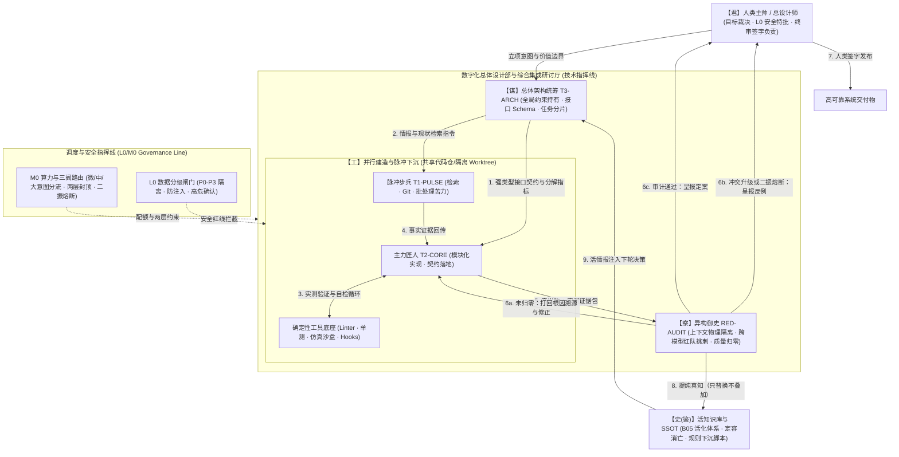

# AI 时代的钱学森范式：弱单元、强系统与多 Agent 总体设计部架构

> **核心文本锚点**：
> - **《工程控制论（第三版）》**：第 13 章《摄动理论和制导系统》（§13.7–§13.8，PDF 第 567–569 页）、第 19 章《冗余技术和容错系统》（§19.1–§19.3、§19.9，PDF 第 911–923、937–938、944–945 页）、第 21 章《大系统》（§21.1–§21.2，PDF 第 1004–1009 页）
> - **《论系统工程》**：**B01**《组织管理的技术——系统工程》（书第 1—12 页）、**B03**《军事系统工程》（书第 28—31 页）、**B06**《论科学技术研究的组织管理与科研系统工程》（书第 51—62 页）、**B09**《计量系统工程》（书第 77—81 页）、**B10**《标准化和标准学研究》（书第 82—83 页）、**B28**《关于系统工程与经济管理体制》（书第 198—200 页）、**B29**《聂荣臻同志开创了中国大规模科学技术研制工作的现代化组织管理》（书第 201—205 页）、**C07**《软科学是新兴的科学技术》（书第 386—391 页）
> - **《创建系统学》**：《从定性到定量综合集成法》《综合集成研讨厅体系》《大成智慧工程》及相关书信

---

## 引言：历史洞察的当代回响——为什么组织模式比单点资源更决定系统上限？

回望 1955—1970 年代中国国防航天的起步史，一个极具启发性的历史事实愈发清晰：**中国航天奇迹的本质，不在于在起跑线上就拥有绝对的人才密度与工业器件优势，而在于从“一穷二白、单元参差”的现实国情出发，构建了一套把有限人才与不完美部件组织成超高可靠大系统的系统管理与控制模式。**

当历史推进到 2026 年后的 AI 原生（AI-Native）时代，人类组织与研发团队正面临一个惊人相似的结构性处境：
- 一方面，基础大模型的通用能力与推理成本正在迅速商品化（Commoditization），但**单一模型单元天然带有随机性（幻觉、指令遵循漂移）、有限上下文窗口（Context Window）以及长链路误差累积**；
- 另一方面，少数资深架构师与领域专家的注意力极度稀缺，而海量生成代码、测试、文档与运维任务又呈指数级膨胀。

在算力与模型参数日益趋同的竞争格局下，真正拉开企业与研发团队战斗力代差的，不再是“谁买到了参数更大的单个模型”，而是**谁能用好钱学森的“弱单元、强系统”哲学——将概率性的 AI Agent、确定性的自动化工具链与高密度的人类专家判断，组织为一座数字化“总体设计部 + 综合集成研讨厅”。**

---

## 一、历史与 AI 时代的结构同构：“弱单元、强系统”第一性定律

### 1.1 跨时代现实约束的精确同构

1956 年的国防部第五研究院与 2026+ 年的 AI 原生研发组织，看似相隔七十年且载体迥异（金属继电器、推进剂、图纸 vs. 神经网络权重、Token 上下文、工具调用），但在系统工程动力学上呈现出高度一致的约束结构：

| 约束维度 | 1956 中国航天与工业现实 | 2026+ AI 原生组织与多 Agent 系统 | 共同面临的系统陷阱 |
| :--- | :--- | :--- | :--- |
| **基本单元可靠性** | 早期国产电子管、继电器与机械件公差大、离散性强（**《工程控制论》Ch.19**） | 大语言模型（LLM）本质为概率自回归采样，存在幻觉、隐蔽逻辑漏洞与长程注意力衰减 | **串联失效率爆炸**：链条越长，单点误差被放大为全系统崩溃 |
| **稀缺核心资源** | 寥寥百余位高阶专家、有限的外汇与手摇/早期计算机算力（**B29**） | 人类主帅/总师的认知带宽、有限的上下文窗口（Context Budget）与高阶模型配额 | **资源错配与算力空转**：让总师陷入微末事务，或让高价模型跑长循环苦力 |
| **局部—总体冲突** | 分系统孤立追求局部最优（如 1962 年 DF-2 忽略弹体弹性模态耦合，美军 WWMCCS 接口失灵，**B03**） | 子 Agent 局部修改代码通过单元测试，却悄然破坏全局 Schema、API 接口或状态不变量 | **局部最优、全局灾难**：系统整体涌现出不可预知的耦合故障 |
| **信息与反馈时滞** | 跨研究所图纸传递慢、生产“账物卡”滞后引发盲目排产（**B01 / B22**） | 多轮异步工具调用（Tool Loop）中出现状态漂移、记忆污染与“带病迭代” | **控制失稳与震荡**：未设熔断和时滞补偿，越修正越偏离目标 |

### 1.2 《工程控制论》给出的三大数学铁律

钱学森与宋健在《工程控制论（第三版）》中，实际上早已为“如何用不完美、有噪声的弱单元，合成高可靠的强系统”提供了严密的数学定理。这些定理几乎可以直接作为多 Agent 系统架构的底层设计法则：

#### 铁律一：串行衰减律与“复原机构”冗余定理（第 19 章 §19.1–§19.3）
在 **§19.1**（PDF 第 912—913 页）中，书里首先给出无冗余串联系统的冷酷公式：若系统由 $N$ 个独立单元串联而成，第 $i$ 个单元在 $[0, t]$ 内的可靠度为 $R_i(t)$，则全系统可靠度与失效率分别为：
$$P(t) = \prod_{i=1}^{N} R_i(t), \qquad Q(t) = 1 - \prod_{i=1}^{N} R_i(t)$$
由于 $R_i(t) \le 1$，“系统所含元件越多，它的可靠性就越小”。这对当代 **Single-Agent 长链条自主执行（Long-Horizon Tool Loop）** 是直接的数学判死刑：哪怕单个模型每一步准确率高达 $95\%$，连续无校验执行 $20$ 步后，全链一次成功的概率已跌至 $0.95^{20} \approx 35.8\%$！

为此，第 19 章引用了约翰·冯·诺依曼（J. von Neumann, 1956）《概率逻辑与从不可靠元件合成可靠有机体》及摩尔-香农（Moore & Shannon, 1956）、许廷钰（1964）的经典理论（第 19 章参考文献 `[14][16][39]`，PDF 第 944、945 页），系统论述了两类破局机制：
1. **$k/N$ 多数表决冗余（§19.2，PDF 第 914 页）**：如常用的 $2/3$ 冗余，靠独立通道交叉投票容忍单通道故障；但同时警示：**若存在共模错误输出，简单并联同质单元不仅不能提高可靠性，反而使可靠性下降**（PDF 第 915 页）——这在数学上解释了为什么**同源模型“自写自审”或同质多 Agent 投票往往无法捕获系统性幻觉**。
2. **复合冗余与复原机构（Multiplexing & Restoring Organ，§19.3，PDF 第 915—916 页）**：把单一通道扩展为 $n$ 束平行通道，并在关键层级之后强制插入**复原装置**（设定置信度阈值 $\delta$ 对错误线束进行清洗与重整），从而将局部门电路的概率出错率 $\varepsilon$ 压缩在可控边界内——人脑 $10^{10}$ 个细胞每年损毁约 $10^7$ 个却能保持一生思维可靠，正是依靠此类组织结构冗余（PDF 第 911 页）。

#### 铁律二：协调失效条件下的“最佳冗余粒度”定理（第 19 章 §19.9）
多 Agent 架构师常陷入两个极端：要么“全盘一把梭”（单一巨大 Agent 打包到底），要么“极度碎片化”（把每个微小函数都拆成独立 Micro-Agent 并由调度器频繁切换）。第 19 章 **§19.9《从线路结构上提高系统可靠性》**（PDF 第 937—938 页及表 19.9-1）用一组精确计算击穿了这两种迷思：

设一个由 $l=4$ 个串联单元（每个单元失效率 $p=0.05$）组成的基本系统，提供 $w=2$ 份冗余资源，比较三种架构的总体失效率：
- **架构 A（全系统整体备份 $p_{41}$）**：只在最外层做整体切换；
- **架构 B（逐单元细粒度备份 $p_{42}$）**：每一个微单元都配一个切换开关；
- **架构 C（分组/分层模块化冗余 $p_{43}$）**：将系统合理划分为 $2$ 个模块组，在模块边界配置开关。

当切换开关（对应多 Agent 系统中的**路由协调器 / Handoff 协议**）并非绝对可靠时，表 19.9-1 给出了极具震撼力的量化逆转（设开关成功率为 $0.97$ vs. $0.90$）：

| 冗余与切换结构 | 协调开关高可靠 ($0.97$) 时的失效率 | 协调开关可靠度下降 ($0.90$) 时的失效率 | 对多 Agent 架构的数学启示 |
| :--- | :---: | :---: | :--- |
| **整体系统备份 ($p_{41}$)** | $0.0441$ | $0.0713$ | 上下文切换开销最小，但单次失败重来代价高 |
| **逐单元细粒度备份 ($p_{42}$)** | **$0.02243$（最优）** | **$0.0815$（最差！）** | 一旦协调/路由自身存在 $10\%$ 的信息丢失或误判，过度碎片化拆分反而成为可靠性最低的陷阱 |
| **分组模块化冗余 ($p_{43}$)** | $0.0308$ | **$0.0690$（最优！）** | **“两层封顶 + 模块化边界验收”在现实不完美协调下实现全局最佳鲁棒性** |

钱学森与宋健在此明确总结：**“由于开关并非绝对可靠，即 $p_s \ne 0$，因此，应用过多开关并不一定能获得系统的最佳可靠性。如果把诸基本系统分成几个部分，然后把相应部分通过上述性质的开关并联起来，这时可能获得具有更高可靠性的系统。”**（PDF 第 938 页）这正是现代多 Agent 工程应当严守“两层封顶、按模块边界切分、禁止三层以上递归甩锅”的数学基石。

#### 铁律三：大系统的多级协调与摄动不变性（第 13 章 §13.7–13.8 & 第 21 章 §21.2）
在 **第 21 章《大系统》§21.2**（PDF 第 1007—1009 页）中，书中指出了大系统的三大特征——多源信息采集滤波、多级协调结构、混合过程模型化——并给出了分散控制的根本警示：
> “这就可能出现一种常见的总体和局部的矛盾：某一种控制作用对一个局部是好的，而从全局来看可能是不好的甚至是不能允许的。如果没有正确的全局性协调……无论每一级的控制如何好，全局性能可能是很不好的，甚至有可能不稳定。”（PDF 第 1008 页）

而在 **第 13 章《摄动理论和制导系统》§13.7–13.8**（PDF 第 567—569 页）中，更进一步指出：面对外部随机扰动 $f(t)$（类似 AI 运行中的环境波动、Dirty Data 或上游偏差），仅仅优化反馈矩阵 $C(t)$ 只能做到极小化最坏偏差 $\min_{C(t)} \max_{f(t)} I$，无法彻底消除外扰；必须在控制律中显式引入**前馈干扰补偿向量 $U(t)$**，才可能逼近“过程不变性”或“终端不变性”。换言之，现代多 Agent 系统不能只靠“事后报错重试”（反馈），更必须依靠**事前清晰的接口契约、结构化上下文注入与静态校验门禁（前馈补偿）**。

---

## 二、钱学森“总体设计部 + 综合集成研讨厅”与现代多 Agent 组织架构的深度映射

把上述历史组织经验（**B01、B03、B06、B09、B10、B28、B29**）、控制论铁律与 90 年代“综合集成研讨厅”思想投影到当代人机协同治理实践中，我们可以看到它们与一套成熟的多 Agent 组织工程基线——**`J0 / M0`“一主五分·两层生克”协同体系**——呈现出逐层对应的深度同构。

### 2.1 全景对应表：从航天五院到 AI 多 Agent 总体设计部

| 钱学森系统工程核心机制 | 原始文献锚点与历史内涵 | 现代多 Agent 组织映射（`J0 / M0` 体系） | 解决的核心工程矛盾 |
| :--- | :--- | :--- | :--- |
| **1. 总体设计部 + 总设计师** | **B01 / B28 / B29**：不承担具体部件设计，专司总体方案、指标分解、接口协调与签字担责；总师受百人级参谋部支撑 | **【君】（人类主帅）⊕【谋】`T3-ARCH`（架构统筹槽位）**：人类把控价值判断与终审签字；统筹 Agent 持有全局约束与任务拆解契约，禁止其下场跑长苦力循环 | 根治子 Agent “各改各的、破坏全局架构”的局部最优灾难 |
| **2. 计量与标准化体系** | **B09 / B10 / B03**：无计量无以协同，不搞标准化是“小农经济”；WWMCCS 教训倒逼“体系结构与接口管理” | **Schema / 接口契约 / 代码规范与基线校验**：先定目录树、类型契约与测试断言，再派发并行开发；跨模块修改必须对齐接口契约 | 消除多 Agent 并发产出之间的“语义漂移”与接口断裂 |
| **3. 两条指挥线（技术线 ⊕ 调度线）** | **B29 / B01**：技术指挥线管性能与设计闭环；调度指挥线管“人、物资、设备、财、任务、信息”六要素及 PERT 网络关键路径 | **技术逻辑线 ⊕ 安全与算力配额线（`L0 + M0`）**：技术线管规划→编码→测试；调度线管 `P0–P3` 数据分级隔离、Token/模型档位路由、**两层封顶**与**二振熔断** | 防止高阶模型在琐碎报错中死循环烧钱，守住安全与隐私底线 |
| **4. 技术科学下沉 + 斡件（Orgware）** | **C07 / B05 / B32**：将经验规律抽象为可传授的“事理”与自动化工具，用“斡件”连接人与机器 | **【工】（`T2-CORE` + 脉冲步兵 `T1-PULSE`）+ 确定性脚本底座**：常规成物交由主力匠人模型；检索、Git、Lint、测试执行全部下沉为确定性脚本或低成本 `Flash` 脉冲步兵 | 释放人类与高阶智力的认知带宽，避免“高射炮打蚊子” |
| **5. 独立试验与质量归零 + 学术民主** | **B29 / B06 / C08**：“把一切问题消灭在地面”、故障不归零不放行；论证期“充分学术民主”与“调查研究”，反对一言堂 | **【察】异构御史（`RED-AUDIT`）**：上下文物理隔离 + **异构模型交叉审计**（如 `Google ⊕ Claude`），破除同源模型盲区共振，执行 AI 时代“质量归零”闭环 | 打破单个 AI“自己写自己夸”的共模幻觉，确保实测证据可信 |
| **6. 活情报库与知识活化** | **B05 / B32 / 《创建系统学》**：反对“死档案堆”，强调框架活化与动态更新 | **【史(鉴)】（SSOT 单一事实源与定容消亡）**：只替换不叠加，将验证过的教训下沉为 Hook/测试脚本，严格控制核心上下文文件容量 | 防止规则文档与记忆库无限膨胀引发“上下文腐烂” |

### 2.2 四大核心支柱的深度机理剖析

#### 支柱一：主帅与总体设计部（【君】+【谋】`T3-ARCH`）——全局约束与接口权威
钱学森在 **B01**（书第 3 页）反复强调，总体设计部的生命线在于其超脱于具体部件利益的**中立抓总地位**；而 **B03**（书第 30 页）记录了美军 WWMCCS 耗费十年才领悟的教训——必须设立一个精干的“总系统工程师办公室”，先抓“体系结构”与“上下左右接口协调”。在 **B10《标准化和标准学研究》**（书第 82 页）中，他更犀利地指出：“标准化是现代化的标志之一。不搞标准化是小农经济。我们当‘小炉匠’当惯了，小手工业，小生产。”

映射至现代 AI 组织：
- **拒绝“提示词小炉匠”**：若让一群 Agent 各自凭模糊自然语言自由发挥，本质上就是数字时代的“小炉匠单干”；
- **先立标准与接口，再放权并行**：由【君】确立目标边界与高危红线，由【谋】（`T3-ARCH`）先输出全局规范（数据结构 Schema、API 边界、目录约定与验收指标），再像 **B28** 要求总设计师签字那样确认总体方案——只有总体设计通过，才允许多个开发 Agent 进入并行分支（例如独立 Git Worktree / 隔离工作区）协同建造。

#### 支柱二：两条指挥线与“三阀”治理（技术线 ⊕ 安全/配额调度线）
聂荣臻与钱学森创立的“两条指挥线”之所以精妙，是因为它承认**“逻辑正确性”与“资源有限性”是两类正交的约束**（**B29**，书第 204 页）。在 AI 时代，如果只管技术线不管调度线，多 Agent 系统就会迅速演变为Token 黑洞与数据泄露温床；反之，若用行政命令微操技术细节，则重演 **B28** 批判的“拉普拉斯式空想”（试图从中心一竿子插到底控制每一个分子/每一个 Token）。

因此，现代 AI 总体设计部必须并行两条刚性治理线，并引入**动态缩放阀门**：
1. **L0 数据分级与物理隔离线（安全红线）**：正如国防航天严格保密与民用开放分离，AI 组织必须按敏感度实行 `P0 公开 / P1 内部 / P2 脱敏后入 AI / P3 绝不入库绝不入 Prompt` 四级刚性隔离；任何高危操作（删库、改权限、对外发布、重写历史）必须先经人类【君】确认（`AG-11`），AI 永不越权宣布 `final`（`AG-28`）。
2. **M0 模型路由与“两层封顶 + 二振熔断”调度线（成本与熵控线）**：
   - **七席位按需路由**：日常成物由高性价比常驻中军（`T2-CORE`）承担；苦力检索/脚本执行下沉给脉冲步兵（`T1-PULSE` / `Flash`）；顶层架构【谋】由强推理模型（`T3-ARCH`）统御；严禁高价推理模型亲自跑几十步机械 Tool Loop。
   - **两层封顶原则**：依据《工程控制论》§19.9 所揭示的“过多开关导致可靠性反降”定理，组织结构严格封顶于**“主帅/总师部 → 一线执行/审计子代理”两层**，杜绝三层以上套娃递归。
   - **三阀防僵化机制**：① **空间阀**（种子探索期允许快速试错、稳态生产期启用全量规约）；② **事件阀**（微意图由 `君→工` 直通短路，不搞繁琐 ADR/审批流；中意图增设二层自检；大意图才拉满总体论证与异构审计）；③ **时间阀**（能写成自动化脚本和 Hook 的规则立刻删掉自然语言条文）。
   - **二振熔断交接**：同一问题连续失败 $2$ 次，绝不允许 Agent 靠蛮力“反复重试碰运气”，必须立即熔断停手，生成紧凑状态交接单（现状、已排除假设、报错证据，≤200 行），切换至更高推理油门或异构破局专家（`T4-ACE`）接管。

#### 支柱三：技术科学下沉与“斡件（Orgware）”自动化（【工】`T2-CORE` + `T1-PULSE`）
钱学森在 **C07**（书第 388 页）极具洞察地抓住了 **`orgware`（斡件）** 的概念，又在 **B05** 中强调将人类从机械记忆与重复计算中解放出来。在 AI 开发中，大模型最怕的不是复杂推理，而是“让概率模型去干确定性工具的事”（例如让 LLM 手算哈希、凭记忆猜 API 行号、人工核对格式）。
因此，优秀的 AI 组织工程必须贯彻**“能确定化就绝不概率化”**的原则：
- 把格式检查、类型校验、单元测试、依赖审计、敏感词扫描全部下沉为**确定性脚本与 Git/CLI Hooks**；
- 让脉冲步兵 `T1-PULSE` 驱动这些确定性工具充当“感知器与执行机构”（**《工程控制论》序**，PDF 第 9—10 页），并向主力匠人 `T2-CORE` 交回冷峻、客观的**实测自检证据**（而非“我认为应该没问题”的空洞承诺）。

#### 支柱四：异构交叉验证（【察】`RED-AUDIT`）与 AI 时代“质量归零”
1962 年“东风二号”坠毁后的最大制度遗产，是确立了**“把一切问题消灭在地面”**与**“故障不归零不放行”**的铁律（**B29**，书第 203—204 页）；而在 **B06**（书第 57 页）中，钱学森同时阐述了“充分学术民主基础上的正确集中”——在技术探索期必须鼓励反对意见和跨领域挑刺，绝不能“以领导喜怒为转移、报喜不报忧”（**B46**，书第 343 页）。

在多 Agent 时代，这一机制对应于**两项不可替代的工程防御**：
1. **上下文隔离 + 异构模型红队（【察】`RED-AUDIT`）**：《工程控制论》§19.2 早已证明“存在共模错误时，同质并联反而降低可靠性”。同一模型家族在长上下文中极易对自己的代码逻辑产生“确认偏误”。因此，高风险交付必须拉起**上下文物理隔离的独立审计代理**，且优先采用**异构模型阵营交叉挑刺**（例如以 `Google Gemini` 系为主军构建实现，拉起 `Claude Sonnet / Opus` 系作为“异构御史”独立审计架构盲区、边界漏洞与幻觉假设）。
2. **AI 时代“质量归零”五步闭环**：借鉴航天质量归零标准，任何测试失败或线上异常，不能止步于“让 AI 打个补丁绕过去”，而必须完成归零五步：
   - ① **定位准确**（精确到行号、契约字段或上下文污染源）；
   - ② **机理清楚**（区分是需求模糊、模型推理失误、还是工具接口有歧义）；
   - ③ **故障复现**（编写可稳定复现该 Bug 的自动化测试用例）；
   - ④ **措施有效**（修复实现 + 将防呆规则编码入测试/Hook/Skill）；
   - ⑤ **举一反三**（检查同类模块是否存在同源假设缺陷，实跑全套回归通过后方能归零放行）。

---

## 三、AI 时代新型研发与企业的实战落地方案

综合钱学森在 **B01**（总体设计部）、**B05/B32**（活情报网）、**C07/C08**（综合集成程序）以及《创建系统学》（综合集成研讨厅）的全部遗产，现代研发团队、创业公司乃至“一人超级企业”无需坐拥百人规模即可复刻航天级工程可靠性。其标准实战形态是：**“1 名/小群人类主帅 + 数字化总体设计部 + 多模型综合集成研讨厅”**。

### 3.1 数字化总体设计部与综合集成研讨厅协同架构图

### 3.2 五步可操作落地规程（Playbook）

1. **第一步：系统定界与“三阀”分流（防止用牛刀杀鸡，也防止赤手搏虎）**
   - 对照钱学森的复杂性分类：凡属于边界清晰、局部可还原的**“微意图”**（如改单处文案、修确定性小 Bug），直接走 **`君 → 工` 短路通道**，禁止叠床架屋写长篇设计文档；
   - 凡涉及跨模块耦合、外部未知环境、或包含多方主观博弈的**“开放复杂任务”**（如新系统架构设计、跨团队流程重构、复杂策略制定），强制启动**完整研讨厅流程**：先在讨论态由人类与【谋】对齐目标、边界和不可妥协的红线（`P0–P3` 分级）。
2. **第二步：先立“计量与标准”，再放行并行施工（B09/B10/B03）**
   - 在任何代码或内容生成 Agent 启动之前，由数字化总体设计部（【谋】）先行锁定三项“计量基准”：① **输入输出 Schema / 数据结构定义**；② **模块边界与禁止跨越的耦合红线**；③ **可自动执行的验收测试集（地面试车台）**。
   - 若多 Agent 需要同时修改多个模块，必须为各写作者分配**隔离的工作副本（如 Git Worktree / Share Workspace）**，由总体部负责合并时的接口裁决，绝不允许多个 Agent 在同一工作区盲写覆盖。
3. **第三步：两线并行与“二振熔断”（B29 + Ch.19 容错）**
   - 技术线推进具体实现时，严格执行**“两层封顶”**：统筹者派发明确切片给执行者，执行者不再向下私自裂变多级子包工头；
   - 遇到密集文件检索、日志清洗、测试批跑，立刻下沉给低成本高吞吐的脉冲步兵（`T1-PULSE`）或确定性脚本；
   - 一旦同一子任务连续两次调试未通过（“二振”），立即强制停手并写入精简的交接单，由主帅或高阶推理/异构模型介入重构思路——彻底杜绝 Agent 在死胡同里消耗数十万 Token 的“情绪化盲改”。
4. **第四步：“把一切问题消灭在地面”——强制异构审计与归零闭环**
   - 任何交付宣称完成前，必须经过两道“地面试车”：① **硬验证**：实际运行 Linter、类型检查与全量测试，禁止跳过用例或放宽断言，并将原始命令行输出作为证据；② **软审计（【察】）**：对关键改动拉起上下文隔离的**异构红队代理**（只读其产物与契约，不共享其推导过程中的心理包袱），专查边界条件、隐含假设、安全越界与耦合破坏。未通过即退回“质量归零”，直到复现、修根、回归全绿。
5. **第五步：知识活化与“定容消亡”（B05 / B32 / 【史】）**
   - 不要把每次任务的对话记录原封不动堆进项目文档——那正是 **B05** 批评的“汗牛充栋却无法调用的死档案”；
   - 每次重大排障或架构演进结束后，由【史】进行“只替换不叠加”的提纯：凡能变成自动化检测脚本、CI 规则或单元测试的经验，**立刻下沉为代码并删除对应的文字唠叨**；仅将真正关乎全局边界与反直觉教训的精华写入受容量限制（如不超过 80–120 行）的项目核心规约文件，使整个系统越用越轻盈、越跑越聪明。

### 3.3 反模式警戒清单：钱学森早已预警过的 AI 工程病灶

| AI 时代常见反模式 | 对应的钱学森历史批评锚点 | 组织级解药 |
| :--- | :--- | :--- |
| **1. 全能单 Agent“一把梭”** | **B01** 批判把大工程仍当“个体泥瓦匠”包办，或 **B06** 批判科研“小炉匠单干户” | 建立总体规划与执行分离的总体设计部架构，复杂任务分段交接与契约化拆解 |
| **2. 同源模型“自写自夸”** | **《工程控制论》§19.2** 警示共模故障下并联反降可靠性；**B46** 批判只听顺耳汇报的“一言堂” | 强制引入上下文隔离的异构模型【察】担任红队审计，奖励“发现反例”而非“附和通过” |
| **3. 忽略接口的局部优化狂热** | **B03** 剖析美军 WWMCCS 接口失灵十年；**B29 / DF-2** 忽略结构—控制耦合导致坠毁 | 总体部不抓局部代码细节，死盯跨模块接口 Schema、不变量与全链路集成测试 |
| **4. “拉普拉斯式”微操或无限递归拆包** | **B28** 批判苏联模式“对每个分子一览无遗”的空想；**Ch.19 §19.9** 证明过多切换开关反致失效率上升 | 遵循“宏观控、微观放”与**两层封顶**：给定清晰契约后放手让模块化执行者自治求解 |
| **5. 文档无限膨胀的“死知识堆”** | **B05 / B32** 批判只存不活的档案堆导致“信息饥饿与信息淹没并存” | 实行定容消亡的 SSOT 制度，经验优先固化为自动化脚本与测试，保持上下文高信噪比 |

---

## 结语：向未来进发——人的主体性与系统智慧的复归

从 1956 年在百废待兴的荒滩上筹建五院总体设计部，到 1979 年呼唤全国自动化情报网把人脑从记忆重负中解放，再到晚年提出“以人为主、人机结合”的综合集成研讨厅与大成智慧工程——钱学森用长达半个世纪的理论创造与工程实践，回答了今天 AI 时代最核心的追问：

**机器越强大、算力越充沛、单元模型越趋向概率化与自动化，人类的系统工程组织能力反而越加决定成败。**

AI 时代的终极胜负手，从来不是用硅基智能去替代碳基人类的创造力与责任担当，而是用钱学森的“系统科学”与“斡件”智慧，把随机波动的概率模型、冷峻精准的自动化工具链，以及人类主帅的战略直觉与价值判断熔铸为一体——在有限的现实约束中，再度实现**“以弱单元构造强系统，集大成而得智慧”**的工程跃迁。
