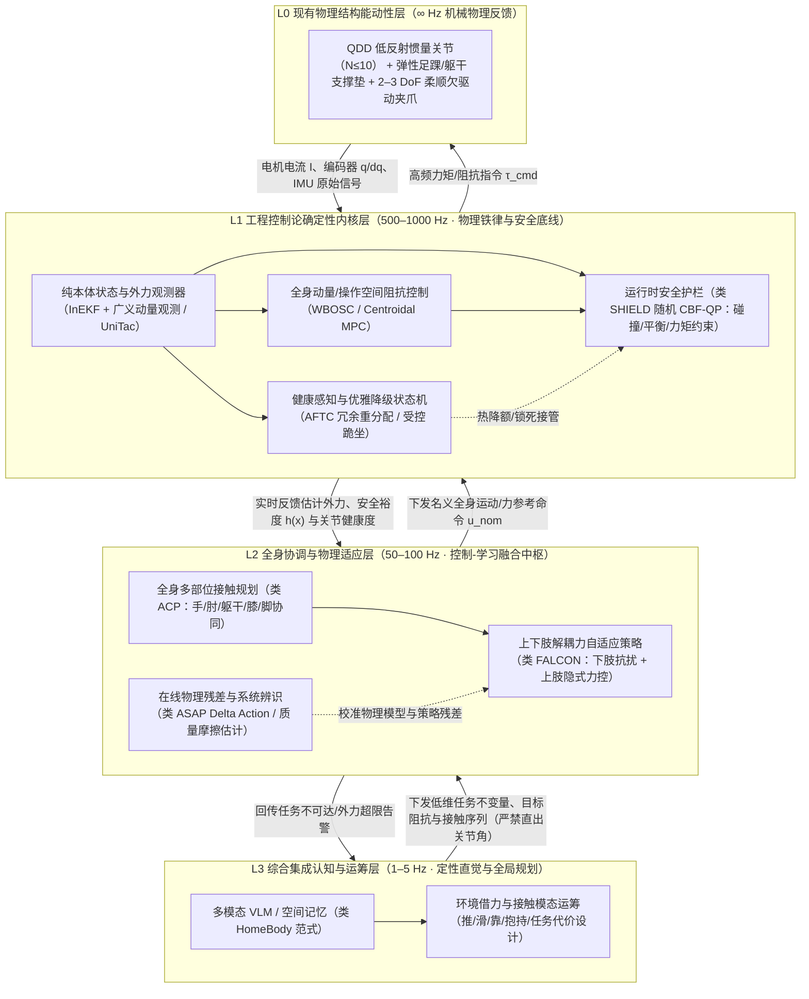

# 从总体设计部到具身智能：人形机器人的“结构能动性、控制论底座与系统整合”架构研究

> **核心文本锚点与观点边界声明（遵循 [GEMINI.md](../GEMINI.md) §2.4）**：
> - **钱学森原著理论锚点**：本报告系统科学机理均锚定本研究库已考订的四部原著底本及专题研究——[01_工程控制论核心_反馈_容错与薄弱元件的可靠系统构建.md](../02_系统思想_从工程控制论到开放复杂巨系统/01_工程控制论核心_反馈_容错与薄弱元件的可靠系统构建.md)、[02_系统科学三层架构与开放复杂巨系统方法论.md](../02_系统思想_从工程控制论到开放复杂巨系统/02_系统科学三层架构与开放复杂巨系统方法论.md)、[01_航天总体设计部与两条指挥线的工程闭环实例.md](../04_实例融合_总体设计部与系统工程经典实战案例/01_航天总体设计部与两条指挥线的工程闭环实例.md) 及 [02_AI时代的钱学森范式_弱单元强系统与多Agent总体设计部架构.md](./02_AI时代的钱学森范式_弱单元强系统与多Agent总体设计部架构.md)。
> - **当代前沿推演界定**：全文涉及的 2024—2026 年人形机器人学术与工程框架（FALCON、ASAP、SHIELD、ACP、UniTac、WBOSC、RBO Hand、Digit 等）及其与钱学森系统工程思想的映射架构，均显式界定为**【当代具身智能前沿调研与系统架构推演（非四部原著底本直引）】**。

---

## 引言：当代具身智能的结构性撕裂与系统工程追问

当代以人形机器人（Humanoid Embodied AI）为代表的具身智能研发，正显现出一种值得警惕的两极撕裂：左手陷入**极端机械还原论**（盲目堆叠 20+ 自由度全驱动灵巧手、单关节峰值力矩与静态制造公差），右手陷入**极端数据黑盒论**（试图用海量遥操作数据或端到端神经网络直接拟合高维行为表象）。两极看似一硬一软，实则在系统方法论上犯了同一个错误——**将系统总体可用性寄托于昂贵的局部元件指标或暴力轨迹记忆，而忽视了在给定物理结构约束下，通过系统总体权衡、动力学潜能压榨、闭环反馈控制与多层次协同整合来创造整体涌现能力。**

本研究基于钱学森从《工程控制论》（1954/2011）到《论系统工程》（新世纪版）再到《创建系统学》（2001）的思想体系，对当代人形机器人技术路线展开辩证审视与前沿谱系梳理，并提出面向低成本高可用场景的四层总体设计部整合架构。

---

## 一、辩证法校准：硬件革新、古典控制与数据学习的真实物理边界

遵循钱学森实事求是与辩证唯物主义的科学态度，批判“堆料内卷”与“黑盒炫技”绝不意味着退回“古典控制万能论”或否认关键硬件革新的物理价值。必须首先划清三条客观物理边界：

### 1.1 历史铁证：纯解析控制派为何曾停滞二十年？

从 20 世纪 90 年代末至 2010 年代中后期，纯解析动力学与传统零力矩点（ZMP）控制长期受困于平整实验室地面，根源在于两道硬物理壁垒：

1. **高减速比刚性传动从物理上锁死了现代力控**：传统工业式关节采用 $50:1$ 至 $160:1$ 的谐波或行星减速器。电机转子惯量 $I_m$ 折算到关节输出端的**反射惯量（Reflected Inertia）**按减速比平方急剧放大：
   $$I_{\text{ref}} = N^2 I_m$$
   当 $N = 100$ 时，转子惯量被放大 $10{,}000$ 倍。足端触地或手臂碰撞瞬间，巨大锁死惯量冲击齿面，摩擦与背隙淹没外力信号，使高带宽阻抗/力控制从物理层失效。
2. **开放多接触环境的建模维数灾难**：面对湿滑地面、软体对象、未知偏心负载与任意接触切换，离散接触组合呈指数爆炸，封闭式解析模型难以毫秒级穷举。这恰恰呼应了钱学森在《创建系统学》中的判断：**面对开放复杂巨系统，必须从纯粹还原论解析优化跃迁为“定性（直觉/学习）与定量（严密控制模型）相结合”的综合集成方法。**

### 1.2 工程分水岭：“为控制赋能的结构创新” vs. “掩盖懒惰的堆料内卷”

| 判别维度 | **真·系统化硬件革新（机电控协同）** | **伪·指标堆料内卷（机械还原论陷阱）** |
| :--- | :--- | :--- |
| **驱动与关节** | **准直驱执行器（QDD，$N \approx 5:1\text{–}20:1$）** 与 **腱绳远程驱动**：主动降低减速比与远端惯量，将反射惯量 $N^2 I_m$ 压低两个数量级，换取天然反向可驱动性与无传感电流力控（$\tau \approx K_t I$） | 在高摩擦刚性位置环上盲目攀比纸面峰值扭矩与重复定位精度，无视碰撞吸能与力透明性，刚性接触极易打齿损机 |
| **末端执行器** | **任务驱动的自由度权衡**：工业与常规搬运优先采用高载荷比、高可靠简易夹爪 + 全身力控；仅在狭小空间**手内重定向（In-Hand Reorientation）**等拓扑刚需下引入欠驱动/柔顺复合手 | 无视任务场景，盲目绑定脆弱高价的 20+ 自由度全驱动灵巧手与密集电子皮肤，用极高失效率完成简单夹爪+推滑即可胜任的工作 |
| **算法与训练** | **物理先验 + 分层解耦 + 残差对齐**：用学习吸收非光滑接触与未知摩擦残差，用确定性控制律守住动量、阻抗与安全不变集 | **全黑盒端到端暴力拟合**：放弃牛顿动力学约束与稳定裕度，靠海量示范轨迹硬背高维关节角，离开训练分布即骤然失稳 |

---

## 二、六大“系统思想同路人”的数理机理与前沿拆解【当代前沿调研】

全球学术界与工业界中，已有六大前沿技术谱系在核心工程逻辑上与钱学森《工程控制论》及总体设计部思想高度同构：

| 同路谱系 | 对应的钱学森原著理论锚点 | 核心反内卷机理 | 代表团队、平台与前沿框架（2024–2026） |
| :--- | :--- | :--- | :--- |
| **1. 被动动力学与本质柔顺派** | **B01** 总体权衡 / 《工程控制论》Ch.3 以结构换性能 | 以弹性储能、机械柔顺与低反射惯量原生吸收高频冲击，不靠高增益硬扛 | **Agility Robotics**（Digit / SLIP）、**DLR**（TORO / David VSA）、**MIT**（Sangbae Kim QDD）、**1X**（NEO 腱绳柔顺） |
| **2. 环境借力与全身接触派** | 《矛盾论》借力转化 / 系统整体涌现 | 放弃“唯指尖精密抓取”，盘活全身 9 大部位及桌面/墙面物理约束 | **TU Berlin**（Oliver Brock / RBO Hand ECE）、**MIT/TRI**（Russ Tedrake 接触隐式优化）、**ETH RSL**（Marco Hutter / 2026 *ACP*） |
| **3. 本体反测外扰与少传感派** | 《工程控制论》Ch.13 §13.7 借本体反测干扰 & Ch.15 最优滤波 | 不铺满易损电子皮肤，靠关节电流、编码器与 IMU 动力学反演接触位置与外力 | 广义动量外力观测器、**IIT/Brown**（2025 *UniTac*）、混合因子图接触推断、**InEKF** |
| **4. 全身解耦协调与残差对齐派** | 《工程控制论》Ch.6 互不影响协调 & Ch.18 分散破解维数灾难 | 上下肢解耦防内耗、质心动量统筹全局，用真实物理残差校准仿真偏差 | **UT Austin/Apptronik**（Luis Sentis / WBOSC）、**IIT**（Daniele Pucci / ergoCub）、**CMU**（Guanya Shi / *FALCON*, *HOVER*, *ASAP*） |
| **5. 控制论安全护栏与分层集成派** | 《工程控制论》Ch.18 稳定域约束 / 《创建系统学》综合集成法 | 运行时高频控制屏障函数（CBF）锁死安全边界，大模型仅司高层定性规划与代价设计 | **Caltech CAST**（Aaron Ames / HZD + CBF, *SHIELD*, *HANDOFF*）、*ConstrainedMimic*、**Stanford**（Karen Liu / *HomeBody*）、*CoRAL* |
| **6. 容错降级与机电控协同设计派** | 《工程控制论》Ch.19 容错冗余 / **B09** 总体设计部 | 热降额/故障下冗余自由度动态重分配与受控降级，将机械构型与控制律联合寻优 | 主动容错控制（AFTC）、*FailBench* 故障评测、Body-Control Co-Design、形态条件世界模型 |

### 2.1 物理结构即“$\infty\text{ Hz}$ 硬件模拟计算机”：被动动力学与柔顺控制
* **Agility Robotics（Jonathan Hurst，Cassie / Digit）**：基于弹簧负载倒立摆（SLIP）模型，在腿部机械结构中嵌入被动弹性以自然储能和卸荷，并采用简单耐用的工业夹爪配合 MPC 与规划栈，率先在 GXO 等仓储物流场景验证了高出勤率商业闭环。
* **德国宇航中心 DLR（Alin Albu-Schäffer，TORO / David）**：围绕可变刚度驱动（VSA）与基于无源性（Passivity-based）的阻抗控制（如 *ESΠ* 控制律），在数学上保障与任意未知刚度环境交互时的能量无源稳定性。
* **MIT（Sangbae Kim）与 1X（NEO）**：前者以准直驱本体感知执行器将冲击载荷转化为可控动力学资产；后者通过前臂腱绳传动降低远端惯量，获得天然柔顺与力透明性。

### 2.2 把环境约束变成免费控制反馈：非抓取与全身多部位接触
* **TU Berlin（Oliver Brock，RBO Hand）**：提出**环境约束利用（Environmental Constraint Exploitation, ECE）**——不把桌面、墙角视为需高精度视觉规避的障碍，反而用廉价软体欠驱动手主动借力滑推、靠边对齐，把高维定位误差自然压缩到环境几何流形上。
* **MIT / TRI（Russ Tedrake，Drake）**：发展**接触隐式轨迹优化（Contact-Implicit Optimization）**，将状态、输入与互补接触力（$\phi(q) \ge 0,\ \lambda \ge 0,\ \phi(q)^\top \lambda = 0$）联合求解，使系统自动发现借力与非抓取操作策略。
* **ETH Zurich RSL（Marco Hutter，2026 *ACP*）**：*Humanoid Mobility via Attention-based Contacts* 彻底摆脱对人类动捕（MoCap）参考轨迹的依赖，以机载 LiDAR 局部地形图驱动 **50 Hz 交叉注意力接触规划器**，实时统筹**双手、双肘、双膝、双脚、骨盆共 9 个身体部位**的接触借力与全身协调控制。

### 2.3 呼应《工程控制论》Ch.13 §13.7：以本体动力学反测外扰
钱学森在《工程控制论（第三版）》第 13 章 §13.7（书第 536 页，PDF 第 565 页）指出，利用系统内部动力学方程约束即可“借助于火箭本身来间接测量干扰”。在人形机器人中：
* **广义动量外力观测器**：基于多体动力学 $M(q)\ddot{q} + C(q,\dot{q})\dot{q} + g(q) = \tau + \tau_{\text{ext}}$ 与广义动量 $p = M(q)\dot{q}$，无需含噪的加速度微分，即可构造全机身无传感外力观测器：
  $$\hat{\tau}_{\text{ext}}(t) = K_O \left[ p(t) - \int_0^t \left(\tau + C^\top(q,\dot{q})\dot{q} - g(q) + \hat{\tau}_{\text{ext}}\right) \mathrm{d}s \right]$$
* **UniTac（IIT / Brown，2025）与 InEKF**：*UniTac* 仅凭机器人自带的关节位置与力矩本体感知历史，无需昂贵脆弱的全身电子皮肤即可实时定位全身接触；配合**混合因子图**与**不变扩展卡尔曼滤波（InEKF）**，甚至可在无足底力传感器与移动支撑面上精准估计外力与状态。

### 2.4 破解高维耦合与仿真-现实物理鸿沟（Ch.6 & Ch.18）
钱学森与宋健在第 18 章（书第 864–869 页，PDF pp. 894–899）以 $p \approx 1/2^n$ 警示全耦合高维系统的维数灾难，并提出以“运动状态的分散现象”将适配时间由天文尺度压至秒级。当代三大标杆与之深度呼应：
* **WBOSC（UT Austin / Apptronik，Luis Sentis）与质心动量控制（IIT，Daniele Pucci）**：在浮动基座欠驱动动力学下，通过任务优先级零空间投影与质心动量统筹，消除行走平衡与上肢操作之间的相互干扰。
* **FALCON（CMU Guanya Shi，2025）**：采用共享全身本体感知的**下肢抗扰稳态代理 + 上肢隐式力自适应追踪代理**双层解耦架构，辅以逆动力学力矩可行域约束的 3D 外力课程，直接使标准商用 **Unitree G1** 在行走状态下完成 **0–20N 搬运、0–40N 开门与 0–100N 拖拉重车**。
* **ASAP（CMU / NVIDIA，RSS 2025）**：拒绝盲目用暴力域随机化（DR）牺牲敏捷度，通过实机轨迹训练**物理残差动作模型（Delta Action Model）**并反嵌回仿真器校准动力学偏差，再微调出高敏捷全身策略。

### 2.5 控制论安全护栏 + 高层定性综合集成（Ch.18 & 《创建系统学》）
* **SHIELD（Caltech CAST，Aaron Ames 等，2025–2026）**：面向黑盒 RL 策略缺乏数学安全保障的痛点，利用真实硬件数据（如 Unitree G1）学习生成式随机残差动力学 $x_{k+1} = f(x_k, u_k) + w_k\ (w_k \sim p_\theta)$，并在运行时通过微创二次规划（QP）滤波器强制执行**期望意义下的随机离散时间控制屏障函数（CBF）**条件：
  $$\mathbb{E}_{w_k \sim p_\theta}\left[ h(x_{k+1}) \mid x_k, u_k \right] \ge \gamma(h(x_k))$$
  在不重训底层策略的前提下锁死碰撞与稳定安全边界（同类工作还包括 $\ge 1\text{ kHz}$ 运行时护栏 *ConstrainedMimic*）。
* **Stanford HomeBody（2026）与 CoRAL**：让 VLM 专注长程空间记忆、定性运筹与动态代价函数设计，将高频执行交回底层技能库、MPPI 采样规划与在线系统辨识，严格复现“定性到定量综合集成”的分工边界。

### 2.6 面向工业可用性的容错与优雅降级（Ch.19）
* **黑盒 RL 的“非线性容错悬崖”**：近期针对商用人形机单侧关节力矩衰减的实测表明，普通 RL 策略虽能隐式掩盖 $20\%\text{–}25\%$ 的轻中度力矩下降，但一旦热降额或磨损突破 **$55\%\text{–}75\%$** 临界区间，系统会骤然失稳跌落。
* **主动容错控制（AFTC）与优雅降级**：引入扩张状态观测器（ESO）与在线效率辨识，在热降额、单关节锁死或通信看门狗超时发生时，优先执行**冗余自由度载荷重分配**；超限时主动切入**受控降级姿态（移重心 → 单膝跪地/受控坐下）**而非直接断电砸地，并借助 **FailBench** 等基准量化评估故障存活率。

---

## 三、面向低成本高可用本体的四层总体设计部整合架构【架构推演】

将上述六大谱系纳入钱学森“总体设计部 + 两条指挥线”框架，形成面向普通 1.2–1.5 m QDD 商用本体（仅配 2–3 DoF 柔顺简易夹爪、无全身电子皮肤）的四层闭环参考架构：

### 3.1 层间契约与“两条指挥线”红线

| 层级 | 运行频率 | 技术指挥线职责 | 安全与资源调度线硬红线 |
| :--- | :---: | :--- | :--- |
| **L3 认知运筹层** | `1–5 Hz` | 识别几何与环境支点，制定借力策略与代价参数 | **严禁直接输出高频关节目标角**；须声明接触预期与回退条件 |
| **L2 协调适应层** | `50–100 Hz` | 9 部位接触分配、上下肢解耦力控与在线残差校准 | 仅在 L1 宣告的**力矩与热裕度可行域**内规划；二振发散即上报切策略 |
| **L1 控制论内核** | `500–1000 Hz` | InEKF、广义动量反演、WBOSC、SHIELD-QP 与 AFTC | **对上层指令握有绝对安全否决权**；严禁引入不可预测延迟的黑盒推理 |
| **L0 物理结构层** | `∞ Hz` | 靠 QDD 低惯量、高摩擦躯干衬垫与柔顺夹爪原生吸能 | 优先保证反向可驱动性与热裕量，拒绝无明确收益的脆弱自由度 |

### 3.2 典型工程推演：简易夹爪完成“15 kg 偏心纸箱搬运 + 推开 40 N 防火门”

1. **环境借力非抓取起箱（L3 + L0/L2）**：不靠双指悬空硬提；L3 规划“桌边滑动—前臂兜底—胸腹防滑垫贴合抱持”，借桌面承受初始重力并自动消除对齐误差，再以躯干三点接触将载荷力臂缩短 $60\%$ 以上，使 15 kg 载荷落入普通肩肘电机连续工作区。
2. **纯本体反测未知偏心负载（L1 + L2 FALCON）**：起箱瞬间，L1 凭下肢电流偏差与 IMU 倾角在 $50\text{ ms}$ 内反算出箱内偏心质心；下肢抗扰代理自动调整髋踝偏置与后倾角对冲倾覆力矩，上肢恒力抱持，互不内耗。
3. **非末端多部位顶推防火门（L2 ACP + L1 SHIELD）**：双手被占满时，L2 调度臀部/右肩侧向接触推杆式门扇；若门轴突发 60 N 卡滞，L1 随机 CBF-QP 在 $1\text{ ms}$ 内修正质心加速度，宁降速也不击穿足底摩擦锥。
4. **热降额优雅降级（L1 AFTC）**：连续作业触发左膝 $30\%$ 热降额预警时，不等跌入 $55\%$ 崩溃悬崖，提前将负载向健侧与髋关节重分配，缩减步幅安全放箱后转入受控降温待机。

---

## 四、具身智能“总体设计部”五大工程门禁与 2026—2030 三大硬骨头

### 4.1 研发组织五大工程门禁（呼应 B01 / B09 / B10 / B29）

1. **结构减法答辩**：任何新增自由度、大扭矩电机或昂贵传感器立项前，须反证无法通过被动柔顺、环境借力、全身接触或纯本体观测解决 $80\%$ 同类任务。
2. **反射惯量与力透明性基线**：将反向可驱动门槛、反射惯量比与电流-力矩线性度置于静态峰值力矩之前，防止机械结构锁死控制。
3. **高频确定性安全护栏前置**：任何 RL/VLA 策略上实机前必须穿透 $500\text{–}1000\text{ Hz}$ 独立安全滤波器（限位、饱和、自碰撞与 CBF 护栏）。
4. **物理残差闭环替代盲调奖励**：建立类 ASAP 的实机残差采集与仿真校准流水线，禁止靠无休止魔改奖励函数掩盖底层摩擦/延迟建模误差。
5. **故障注入成为必考 KPI**：将类 FailBench 的单关节热降额、通信丢包、突加偏心负载与地面摩擦突变纳入出厂验收，以**故障降级存活率**替代理想环境单次炫技视频成功率。

### 4.2 系统科学视角下的三大待解科学硬骨头（2026—2030）

1. **可变形体与非光滑微接触的轻量化“技术科学”模型**：面对布料、柔性线束等无限维软体，亟需提炼类似双足 SLIP 模型的极简降阶物理表达，弥合解析动力学与纯黑盒视觉模型之间的鸿沟。
2. **全生命周期磨损、自标定与“弱元件终身可用”**：当本体连续服役上万小时出现齿隙增大、微退磁与结构微变形时，如何实现零人工停机标定的静默在线自辨识与跨关节代偿重构，仍是《工程控制论》第 19 章的终极蓝海。
3. **跨构型、跨厂商的“具身物理控制微内核”标准化（B10）**：终结“换一款本体全部策略推倒重来”的小农经济模式，将本体观测、质心动量控制、CBF 护栏与容错状态机沉淀为跨硬件形态复用的标准化底层内核。
