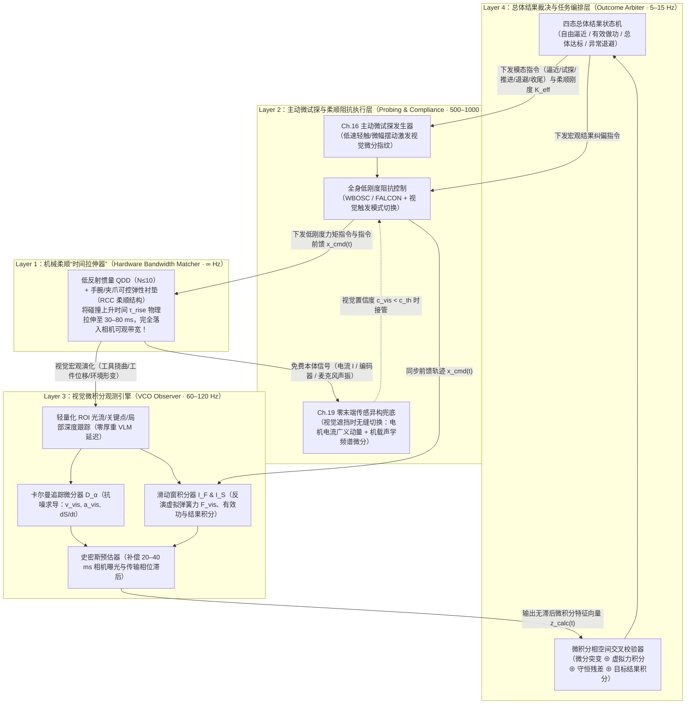

# 无感触碰与视觉微积分校验：末端无传感人形机器人的系统级总体结果判断控制架构（VCO-Arch）

> **核心灵感与研究命题**：
> 熟练的挖掘机操作手在铲斗尖端没有任何触觉或力传感回传的条件下，仅靠观察铲斗/大臂的运动突变、土石涌动与地形累计变化，就能精准判断“是否撞上硬岩、是否吃满载荷、槽底是否挖平”；人手握持电动螺丝刀打螺丝时，手掌并不直接触碰螺帽底面与螺纹咬合区，却能凭视觉上螺丝下沉速率骤降归零、累计沉入齐平与机身反扭微偏转，在毫秒间准确判定“打紧到位、滑丝空转还是错牙歪斜”。
>
> **本质提炼**：这揭示了一条绕开“昂贵易损末端电子皮肤与六维力矩传感器内卷”的颠覆性系统工程路径——**末端无感触碰（Sensorless Contact）⊕ 视觉微积分交叉校验（Visual Differentiation-Integration Verification）⊕ 系统级总体结果判断闭环（Outcome-Driven Control）**。
>
> **观点边界声明（遵循 [GEMINI.md](../GEMINI.md) §2.4）**：文中引用钱学森《工程控制论》原著均精确标注章节页码；针对挖掘机/电批机理的抽象提炼、视觉微积分数学算子与 **VCO-Arch** 人形机器人系统级架构，均显式界定为**【原创工程架构推演与当代前沿综合（非四部原著底本直引）】**。本文承接模块 `06` 前序研究 [03_从总体设计部到具身智能_人形机器人的系统控制整合架构.md](./03_从总体设计部到具身智能_人形机器人的系统控制整合架构.md)，向“末端零传感条件下的系统级闭环控制”纵深推进。

---

## 一、认识论跃迁：为什么末端“无感”反而能成就更强的系统控制？

### 1.1 打破传统机器人学的“接触点原地测力执念”

当代具身智能操作研究陷入了一个根深蒂固的局部还原论定式：**要完成精细物理交互，就必须在“接触发生的那一平方毫米表面”原地铺满触觉阵列、指尖力传感器或昂贵六维腕力传感器。** 这一思路在真实物理世界面临三重死结：

1. **恶劣工况下的“串联可靠性诅咒”**（《工程控制论（第三版）》第 19 章 §19.1，PDF 第 912 页，$P(t)=\prod R_i(t)$）：接触表面恰恰是承受冲击、磨损、油污、水洗、高温与静电最剧烈的地带，把最娇贵、布线最密集的精密传感器塞进最易损的指尖或工具尖端，在工程可靠性上本末倒置；
2. **工具隔离效应（Tool-Mediated Blindness）**：人类 90% 的高价值生产劳动是**隔着工具**完成的（挖机铲斗、电动螺丝刀、扳手、铲子、扫帚、手术钳）。一旦抓起工具，哪怕机器手指尖贴了十万个压电点，指尖也摸不到螺丝牙与挖斗刃口；
3. **过度执着“微观过程力”，忽视“宏观总体工作结果”**：工业与家庭作业的终极考核指标从来不是“第 0.42 秒指尖法向力是否精确等于 12.3 N”，而是**“螺丝是否垂直旋紧且与工件齐平”“沟槽是否挖到标高”“门是否推开到位”**——即系统级总体工作结果。

### 1.2 与钱学森《工程控制论》四大核心机理的深度同构

挖掘机老司机与电批熟练工的“无感作业直觉”，并非玄妙经验，而是精准暗合钱学森《工程控制论（第三版）》的四条硬核控制论原理（参见 [01_工程控制论核心_反馈_容错与薄弱元件的可靠系统构建.md](../02_系统思想_从工程控制论到开放复杂巨系统/01_工程控制论核心_反馈_容错与薄弱元件的可靠系统构建.md)）：

| 钱学森原著控制论定理 | 原始文献锚点 | 挖掘机 / 电批人工操作的物理直觉 | 人形机器人“无感触碰 + 视觉微积分”架构映射 |
| :--- | :--- | :--- | :--- |
| **1. 借系统本体轨迹反测未知外扰** | 《工程控制论》Ch.13 §13.7（书第 536 页，PDF 第 565 页） | 挖斗碰到地下孤石时，不用测石头的反作用力，看大臂突然停顿和机身微微上翘便知阻力暴增 | 利用**指令运动学预测 $x_{\text{cmd}}$ 与视觉实测位姿 $x_{\text{vis}}$ 的时空残差**，借机械结构自身变形反演未知接触与外力 |
| **2. 终端不变性（Terminal Invariance）** | 《工程控制论》Ch.13 §13.9（PDF 第 567–569 页） | 挖土过程允许中途土质松硬变化、铲斗走位略有偏摆，只死盯最终坑底平整度与满斗率 | 以**宏观工作结果空间积分 $\Delta S(t)$ 落入目标不变集 $\mathcal{G}_{\text{outcome}}$** 作为闭环终止与纠偏的最高判据 |
| **3. 连续理解、试探激励与搜索代价** | 《工程控制论》Ch.16 §16.1–16.2（PDF 第 786–789 页，$D^*=\frac{1}{3}\Delta^*$） | 挖机轻点试探硬土、电批低速轻顶找准螺孔，根据视觉变化率 $\mathrm{d}y^*/\mathrm{d}t$ 决定发力还是退回 | 引入**主动微试探激励（Probing Excitation）**，以可控的微小动作代价主动激发可观测的视觉微分响应 |
| **4. 滤波求导与积分抑噪的辩证统一** | 《工程控制论》Ch.15 维纳/卡尔曼最优滤波（PDF pp. 676–740） | 人眼不会因为画面瞬间抖动误判打紧，而是把“瞬间停顿（微分）”与“已沉入深度（积分）”合起来看 | 以**追踪微分器 / 卡尔曼观测器**解决视觉帧间求导放大噪声难题，并与**时窗积分器**交叉互验 |

> **当代前沿实证对照（2024–2026）**：这一思路已在多个垂直领域初露锋芒——例如无触觉传感器的**驾驶室视角自主挖机闭环控制**（利用视觉位姿网络如 *TransMPNet*、模仿学习 *ExACT* 及前后深度地形图体积差校验满斗率）、微创手术中**通过器械挠曲与组织光流形变反演交互力**（实现亚牛顿级无传感视觉测力），以及基于**视觉—运动学残差（Visual-Kinematic Discrepancy）**触发自由空间向柔顺接触控制切换的新锐框架。本架构的核心价值，是将这些零散突破上升为**面向通用人形机器人的系统级总体结果控制理论与工程框架**。

---

## 二、核心数理模型：“视觉微积分”四大算子与交叉校验矩阵

设人形机器人末端或所持工具在相机坐标系（或本体基座系）下存在三类物理量（**末端完全不安装触觉与力/力矩传感器**）：
- **指令期望轨迹** $x_{\text{cmd}}(t) = \mathrm{FK}(q_{\text{cmd}}(t))$：上层控制器要求末端/工具到达的理想位姿；
- **视觉实测工具位姿** $x_{\text{vis}}(t)$：由手腕/胸部/头部相机追踪得到的工具真实位姿与微倾角 $\phi_{\text{tool}}(t)$；
- **视觉实测对象结果态** $S_{\text{obj}}(t)$：被作业对象的直接几何/形态结果（如螺丝露出高度 $z(t)$、旋转角 $\theta(t)$、箱体位置、门扇开角 $\psi(t)$、挖槽表面高度场 $h(u,v,t)$）。

定义**指令—视觉位姿残差**：
$$e_v(t) \triangleq x_{\text{cmd}}(t) - x_{\text{vis}}(t)$$

由此构建驱动整个无传感闭环的**四大“视觉微积分”数学算子**：

### 2.1 算子一：抗噪视觉微分算子 $\mathcal{D}_\alpha[\cdot]$（瞬态接触与突变探测器）

在 $30\text{–}120\text{ Hz}$ 相机采样下，直接做朴素差分 $\frac{x_{\text{vis}}(k)-x_{\text{vis}}(k-1)}{\Delta t}$ 会将亚像素噪声剧烈放大，彻底淹没真实接触信号。因此，遵循《工程控制论》第 15 章最优滤波原则，视觉微分必须由**二阶/三阶卡尔曼追踪微分器（Tracking Differentiator / $\alpha$-$\beta$-$\gamma$ Filter）**实现，输出平滑且低相位滞后的三大瞬态微分量：
1. **工具视觉速度与加速度**：$\dot{x}_{\text{vis}}(t),\ \ddot{x}_{\text{vis}}(t)$；
2. **指令—视觉速度残差（受阻率）**：$\dot{e}_v(t) = \dot{x}_{\text{cmd}}(t) - \dot{x}_{\text{vis}}(t)$；
3. **作业对象瞬时演化率与局部光流散度**：$\dot{S}_{\text{obj}}(t)$ 与局部接触区光流突变率 $\dot{\mathcal{F}}_{\text{roi}}(t)$。

**物理判据（无感触碰的瞬态指纹）**：
- **自由空行程**：$\|\dot{e}_v(t)\| \approx 0$ 且 $\dot{S}_{\text{obj}}(t) = 0$；
- **发生无感触碰瞬间（$t = t_c$）**：工具在视觉上发生阶跃减速（$\ddot{x}_{\text{vis}}(t_c)$ 出现负向尖峰脉冲），同时残差增速 $\dot{e}_v(t)$ 跨过阻挡阈值 $\eta_d$，伴随局部对象光流起始或工具姿态微偏转率 $\dot{\phi}_{\text{tool}}(t)$ 突变。

### 2.2 算子二：视觉残差积分算子 $\mathcal{I}_F[\cdot]$（无传感“视觉虚拟弹簧力”与有效功反演）

当机器人关节（如 QDD 准直驱低刚度阻抗环）、手腕柔顺衬垫或工具杆件整体呈现已知的等效机械柔顺度 $(K_{\text{eff}}, B_{\text{eff}})$ 时，**整个机械臂连同工具本身就是一把巨大的、无需供电的“光学弹簧秤”**。

对无感触碰时刻 $t_c$ 之后的指令—视觉速度差做局部时窗积分，即可在末端零传感条件下反演出交互接触力 $\hat{F}_{\text{vis}}(t)$ 与有效机械做功 $\hat{W}_{\text{eff}}(t)$：
$$\hat{F}_{\text{vis}}(t) = K_{\text{eff}} \int_{t_c}^{t} \left(\dot{x}_{\text{cmd}}(\tau) - \dot{x}_{\text{vis}}(\tau)\right)\mathrm{d}\tau + B_{\text{eff}}\left(\dot{x}_{\text{cmd}}(t) - \dot{x}_{\text{vis}}(t)\right)$$
$$\hat{W}_{\text{eff}}(t) = \int_{t_c}^{t} \hat{F}_{\text{vis}}(\tau)^\top \dot{S}_{\text{obj}}(\tau)\,\mathrm{d}\tau$$

- **有效做功态**：$\hat{F}_{\text{vis}}(t)$ 处于合理作业区间，且对象变化率 $\dot{S}_{\text{obj}}(t) > 0$，有效功积分 $\hat{W}_{\text{eff}}(t)$ 稳步单调递增（如挖斗稳定切土、螺丝平稳吃进、重门匀速推开）；
- **死阻/撞岩卡滞态**：$\hat{F}_{\text{vis}}(t)$ 随积分残差急剧飙升，但 $\dot{S}_{\text{obj}}(t) \approx 0$，导致**能量转化效率比** $\rho(t) = \frac{\|\dot{S}_{\text{obj}}(t)\|}{\|\hat{F}_{\text{vis}}(t)\| + \varepsilon} \to 0$——系统立即可知“力气全憋在机构弹性变形里，工作对象纹丝不动”，必须在过载毁机前立刻触发卸荷退避。

### 2.3 算子三：任务结果空间积分算子 $\mathcal{I}_S[\cdot]$（总体工作状态达成度）

不仅看末端自身，更直接对被操作环境的状态演化做累积积分，构建面向最终交付的**系统级结果量**：
$$\Delta S(t) = \int_{t_0}^{t} \dot{S}_{\text{obj}}(\tau)\,\mathrm{d}\tau, \qquad J_{\text{outcome}}(t) = \| S_{\text{target}} - (S_0 + \Delta S(t)) \|_W$$
例如：螺丝累计旋入深度 $\Delta z$、总有效转角积分 $\Delta\theta$、沟槽前后深度图体积差 $\Delta V = \iint (h_0 - h_t)\,\mathrm{d}u\mathrm{d}v$、插接件插入肩台视觉缝隙收敛积分。

### 2.4 算子四：微分—积分相空间交叉校验（“电批打螺丝”与“挖机式铲挖”真值表）

单看视觉微分会陷入“停顿歧义”（停下来了，到底是打紧了还是卡死了？），单看视觉积分会遭遇“动态失控”（滑丝空转十秒才发现深度没变）。唯有**把微分算子与积分算子组成联合相空间交叉校验矩阵**，才能在末端零传感下瞬间辨明真伪工况：

#### 实例 A：人形机器人手持电动螺丝刀打螺丝（末端零扭矩、零触觉传感）

设螺距为 $p$，监控四项纯视觉微积分特征：旋转视觉角速度 $\omega_{\text{vis}}$（微分）、轴向视觉下沉率 $\dot{z}_{\text{vis}}$（微分）、电批机身/手腕反扭微偏转脉冲 $\dot{\phi}_{\text{body}}$（微分）以及累计下沉深度 $z(t)=\int \dot{z}_{\text{vis}}\,\mathrm{d}t$（积分），并构建**螺距运动学守恒检验残差** $r_{\text{pitch}}(t) \triangleq \left|\dot{z}_{\text{vis}}(t) - \frac{p}{2\pi}\omega_{\text{vis}}(t)\right|$：

| 工况状态 | 视觉角速度 $\omega_{\text{vis}}$（微分） | 视觉下沉率 $\dot{z}_{\text{vis}}$（微分） | 机身反扭/离合微颤 $\dot{\phi}_{\text{body}}$（微分） | 累计沉入深度 $z(t)$（积分） | 物理守恒检验 $r_{\text{pitch}}$ | 系统总体裁决与闭环动作 |
| :--- | :---: | :---: | :---: | :---: | :---: | :--- |
| **1. 正常旋入推进** | 高且稳定 | 正且稳定 | 平稳低噪 | 线性逼近 $z_{\text{flush}}$ | $\approx 0$（完美守恒） | **有效做功态**：维持恒定下压柔顺偏置，继续推进 |
| **2. 完美打紧到位** | 骤降归零（或离合打滑） | 骤降归零 | **出现典型反扭脉冲** | **$z(t) \approx z_{\text{flush}}$（齐平）** | 终止点收敛 | **总体结果达标！** 立刻断电停转、竖直提枪转下一孔 |
| **3. 滑丝 / 脱扣空转** | 持续高速旋转 | $\approx 0$（不下沉） | 无显著反扭冲量 | 停滞于 $z(t) < z_{\text{flush}}$ | **严重违背（$r_{\text{pitch}} \gg 0$）** | **滑丝异常！** $100\text{ ms}$ 内停转报警，切退丝换钉策略 |
| **4. 错牙 / 歪斜卡死** | 骤降归零 | 骤降归零 | **提前剧烈反扭脉冲** | **$z(t) \ll z_{\text{flush}}$**（且螺杆视觉倾角超限） | 提前锁死 | **卡阻异常！** 立刻反转退丝 2 圈 → 视觉重校垂直度 → 二次慢旋试探 |

#### 实例 B：挖掘机式作业 / 人形机器人无传感铲挖与盲推重物

| 工况状态 | 末端视觉速度 $\dot{x}_{\text{vis}}$（微分） | 残差力积分 $\hat{F}_{\text{vis}}$（积分） | 环境对象变化率 $\dot{S}_{\text{obj}}$（微分） | 结果空间累计积分 $\Delta V / \Delta S$（积分） | 系统总体裁决与闭环动作 |
| :--- | :---: | :---: | :---: | :---: | :--- |
| **1. 空载逼近** | $\approx \dot{x}_{\text{cmd}}$ | $\approx 0$ | $0$ | $0$ | 高速平滑接近目标面；临近切入前降速切微试探 |
| **2. 正常吃土/推进** | 略低于 $\dot{x}_{\text{cmd}}$ | 稳定处于中值区 | 土方涌动 / 箱体稳步移动 | 单调增长逼近 $\Delta V_{\text{target}}$ | 保持最优切入角与全身重心前倾配重 |
| **3. 触碰暗礁/死阻** | **骤降至 0（$\ddot{x}_{\text{vis}}$ 负尖峰）** | **急剧飙升超限** | $\approx 0$（效率比 $\rho \to 0$） | 未达标即停滞 | **硬阻熔断！** 立即卸荷上提/绕行换角试探，绝不闷头蛮干 |
| **4. 满斗/找平达标** | 平稳收弧 | 回落至纯重力载荷值 | 坑底高度场与目标面残差归零 | **$\Delta V \ge V_{\text{full}}$ 且平整度达标** | **总体结果达标！** 锁定姿态转入回转卸载工序 |

---

## 三、VCO-Arch：末端无传感人形机器人的系统级总体结果控制架构

要让“无感触碰 + 视觉微积分”在真实人形机器人上安全、高频、抗遮挡地稳定运行，必须直面一个致命物理矛盾：**视觉采样太慢（$30\text{–}120\text{ Hz}$），而刚体碰撞太快（$1\text{–}3\text{ ms}$）**。**VCO-Arch（Visual-Calculus Outcome-Driven Architecture）** 通过四层机电控算协同架构彻底攻克这一时间尺度鸿沟：

### 3.1 架构五大系统工程机理

1. **机械柔顺“时间拉伸器”（Layer 1 — 带宽匹配律）**：对于等效质量 $m$ 与等效接触刚度 $K_{\text{eff}}$ 的系统，碰撞特征上升时间为 $\tau_{\text{rise}} \approx \frac{\pi}{2}\sqrt{m / K_{\text{eff}}}$。通过主动压低 QDD 关节位置刚度并在腕部/夹爪指垫引入可控柔性层（或远心柔顺机构 RCC），将刚性撞击的 $1\text{–}3\text{ ms}$ 尖峰**物理拉伸至 $40\text{–}80\text{ ms}$**（相当于 60–120 Hz 相机下的 $3\text{–}10$ 帧），使机械结构同时充当“物理低通滤波器与光学放大镜”。
2. **主动微试探激励（Layer 2 — 呼应《工程控制论》Ch.16）**：在视觉接近目标表面但物理刚度与对准度未知时，由高速巡航自动切入低速低刚度**微试探模态（$2\text{–}5\text{ mm}$ 试探脉冲）**，以极小试探代价 $D^*$ 主动激发可观测的视觉微分响应，完成物理边界辨识后再释放作业功率。
3. **轻量化视觉引擎 + 史密斯预估器（Layer 3 — 严防 Ch.4 时滞失稳）**：严禁将 $200\text{–}500\text{ ms}$ 延迟的厚重 VLM 放进闭环。VLM 仅在启动或异常切换时低频划定视觉 ROI 与目标结果定义 $S_{\text{target}}$；闭环内仅运行 $60\text{–}120\text{ Hz}$ 轻量化稀疏光流/亚像素关键点跟踪 + 卡尔曼追踪微分器，并结合**史密斯预估器**补偿 $20\text{–}30\text{ ms}$ 曝光与传输延迟，守住 $> 45^\circ$ 相位裕度。
4. **事件驱动总体结果状态机（Layer 4 — 终端不变性）**：不再死板追求末端跑完固定时间轨迹，而是以微积分相空间确认“宏观结果落入目标不变集”作为收尾判据——未达标则依积分残差自动补作，已达标则提前止损停手。
5. **零末端传感的异构双备份（呼应《工程控制论》Ch.19）**：在不向末端增加任何传感器的前提下，后台并行运行**本体电机电流广义动量观测器**与**机载麦克风高频声学微分（$16\text{–}48\text{ kHz}$，类似工人听电批离合“哒哒”打滑声与撞击异响）**；一旦粉尘、自遮挡或逆光令视觉置信度跌破阈值，立即无感接管控制闭环。

---

## 四、科学唯实边界自检：适用条件、物理红线与“相对参照系”工程诀窍

依据实践唯实原则，明确 **VCO-Arch** 的四道物理边界与工程化解方案：

| 物理极限挑战 | 失效机理 | 系统工程对策与明确红线 |
| :--- | :--- | :--- |
| **1. 微米级超精密刚性过盈装配**（如 H7/g6 无倒角金属轴孔直插） | 卡死发生在 $10\text{–}30\ \mu\text{m}$ 尺度，产生肉眼可见宏观偏转前应力已超屈服极限 | 允许顺应时加装低成本**被动远心柔顺机构（RCC）**将微米卡阻放大为毫米级可见偏转；严禁顺应且精度 $< 0.05\text{ mm}$ 时应采用精密力控，绝不硬套纯视觉 |
| **2. 极脆光滑物体的瞬态微滑移**（如单手抓湿滑薄壁玻璃杯） | 宏观可见下滑出现时物体往往已加速脱手，而过大夹紧力易捏碎 | 改盲抓为“2 mm 低空微抬升 + 视觉微分检测杯身与指垫相对光流滑移”，配合欠驱动包络与高阻尼软胶接触面 |
| **3. 极端视觉退化**（纯白无纹理光滑面、强反光、全黑盲操） | 缺乏稳定光学纹理，视觉微分信噪比崩塌 | 在**工具自身（而非环境）**喷涂廉价高对比度视觉条纹以反推内部接触；全黑盲操自动移交“电流广义动量 + 声学微分”异构通道 |
| **4. 人形双足自身晃动污染视觉信号** | 头部相机随浮动基座微晃产生全局光流噪声，淹没末端微小速度微分 | **对象中心相对视觉微积分（关键诀窍）**：绝不在世界绝对系算微积分，而是死盯**“工具末端 ↔ 作业对象表面”的局部相对位移微积分**（如螺帽底面与板面间隙、铲斗刃口与坑底坡线），天然免疫机身抖动与外参漂移 |

---

## 五、从理论到实机：三步渐进 MVP 验证路线图

1. **阶段一（单臂定点验证）——无传感电批打螺丝 4 态识别**：单 QDD 臂低刚度阻抗握持市售电批 + 120 Hz 全局快门相机，在混入正常孔、滑丝孔与错牙孔的盲测中验证“相对视觉微积分 + 螺距守恒检验 $r_{\text{pitch}}$”，目标齐平准确率 $\ge 98\%$、异常检出延迟 $\le 150\text{ ms}$。
2. **阶段二（全身协调验证）——无力传感推门、推箱与铲平**：商用人形机 + 简易柔顺夹爪 + 头部 RGBD + 机载麦克风，验证“柔顺时间拉伸（$\tau_{\text{rise}} \ge 40\text{ ms}$）+ 类 FALCON 全身解耦 + 虚拟弹簧力 $\hat{F}_{\text{vis}}$ + 遮挡电流兜底”，目标未知阻尼下总体达成率 $\ge 92\%$、突遇卡死 $\le 80\text{ ms}$ 柔顺卸荷不失稳。
3. **阶段三（跨工具泛化）——工具无关的通用结果校验微内核**：由 VLM 在启动前将自然语言任务编译为“相对视觉特征对 + 守恒规律 + 微积分终止判据”契约下发给高速 VCO 内核，使人形机器人拿起任何未改装、无传感器的日常工具，仅凭“看结果、感突变、做微积分校验”即可完成作业。
