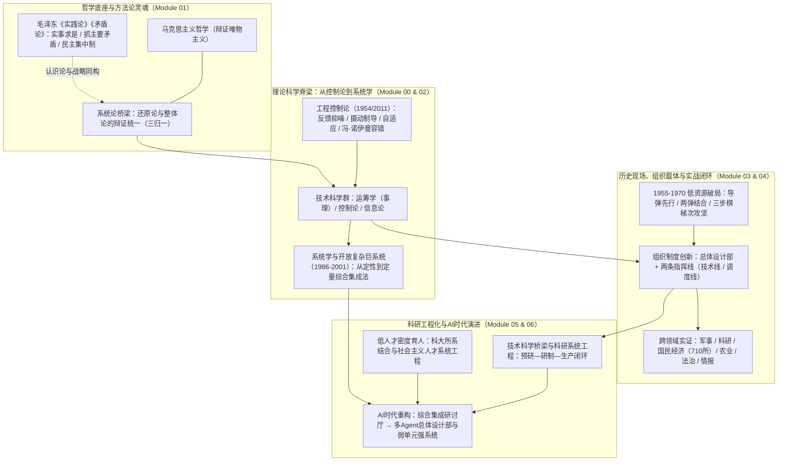

# 钱学森系统工程思想体系全维研究：从新中国低资源约束破局到 AI 时代新组织系统

> **核心命题**：系统工程并非“资源充裕国度下的精细化管理奢侈品”；恰恰相反，钱学森领导开创的中国系统工程思想与组织体制，是在 20 世纪 50—70 年代**低工业底盘、低计算能力、低专家密度与外部技术封锁**的极端约束下，用**严密的系统结构、反馈容错机制与总体抓总制度**，将有限、薄弱乃至不完备的局部单元组织为高可靠、强突防整体系统的“生存与破局之学”。这一思想从《工程控制论》的“以不可靠元件构筑可靠系统”出发，经航天“总体设计部”与“从定性到定量综合集成研讨厅体系”的两次跃迁，在当代大语言模型（LLM）与多智能体（Multi-Agent）时代正焕发出惊人的工程重构价值。

---

## 一、思想体系全景架构图

---

## 二、全库导航与 7 大模块索引（共 17 份核心文档）

本项目所有论断均严格锚定四大原著底本，书目版本、页码偏移与 55 篇论文完整清单见唯一真源索引：[《论系统工程》（新世纪版）及首批原始文献目录考订](sources/catalog_lun_xitong_gongcheng.md)。

| 模块 | 专题文档（点击直达） | 核心议题与主要贡献 |
| :---: | :--- | :--- |
| **真源索引** | [sources/catalog_lun_xitong_gongcheng.md](sources/catalog_lun_xitong_gongcheng.md) | 核验四大原著 PDF/文本元数据、`《论系统工程》` 55 篇全目录、书内/PDF 页码映射 |
| **`00` 总纲** | [01_四大原著底本考据与全书脉络提炼.md](00_原著底本与思想总纲/01_四大原著底本考据与全书脉络提炼.md) | 考据四大核心原著版本沿革，提炼钱学森系统思想四阶段演化脉络（技术科学→控制论→系统工程→系统学） |
| **`00` 总纲** | [02_论系统工程55篇核心文献分类精要.md](00_原著底本与思想总纲/02_论系统工程55篇核心文献分类精要.md) | 将 `B01–B47` 与 `C01–C08` 共 55 篇论文按七大主题集群分类精要，逐篇提炼核心命题与原文金句 |
| **`01` 哲学** | [01_马克思主义哲学与现代科学技术体系之桥.md](01_哲学原理_实践论矛盾论与系统辩证法/01_马克思主义哲学与现代科学技术体系之桥.md) | 剖析九至十一大科学部门、三层台阶、“三归一”系统论桥梁，以及还原论与整体论的辩证统一 |
| **`01` 哲学** | [02_毛泽东实践论矛盾论与钱学森系统工程的异曲同工.md](01_哲学原理_实践论矛盾论与系统辩证法/02_毛泽东实践论矛盾论与钱学森系统工程的异曲同工.md) | 实证对比《实践论》《矛盾论》与系统工程在认识螺旋、主要矛盾线、实事求是、集中优势兵力及民主集中制上的同构性 |
| **`02` 理论** | [01_工程控制论核心_反馈_容错与薄弱元件的可靠系统构建.md](02_系统思想_从工程控制论到开放复杂巨系统/01_工程控制论核心_反馈_容错与薄弱元件的可靠系统构建.md) | 精解反馈抑差、摄动制导、滤波、自镇定与冯·诺伊曼复合冗余等“以薄弱元件构建强系统”的数理本质 |
| **`02` 理论** | [02_系统科学三层架构与开放复杂巨系统方法论.md](02_系统思想_从工程控制论到开放复杂巨系统/02_系统科学三层架构与开放复杂巨系统方法论.md) | 梳理系统科学三层架构、系统四类演化谱系，以及从纯数学优化向“从定性到定量综合集成法”的范式跃迁 |
| **`03` 历史** | [01_1955至1970历史现场_资源约束与战略破局时间轴.md](03_历史记录_百废待兴下的中国国防航天起步实录/01_1955至1970历史现场_资源约束与战略破局时间轴.md) | 还原 1955–1970 极端资源约束现场，论证“导弹先行、两弹结合”的战略选型与关键历史里程碑 |
| **`03` 历史** | [02_聂荣臻与钱学森_中国大规模科技攻关体制的创生.md](03_历史记录_百废待兴下的中国国防航天起步实录/02_聂荣臻与钱学森_中国大规模科技攻关体制的创生.md) | 解剖“科研十四条”“五院暂行条例”及中央专委统领下“三步棋”与军政—科技协同攻关体制 |
| **`04` 实例** | [01_航天总体设计部与两条指挥线的工程闭环实例.md](04_实例融合_总体设计部与系统工程经典实战案例/01_航天总体设计部与两条指挥线的工程闭环实例.md) | 从 1962 DF-2 弹性耦合失利（外部航天史实补注）切入，详解总体设计部五步工程闭环、PERT 网络与“两条指挥线”协同 |
| **`04` 实例** | [02_跨领域系统工程实例_军事_科研_经济_农业与情报系统.md](04_实例融合_总体设计部与系统工程经典实战案例/02_跨领域系统工程实例_军事_科研_经济_农业与情报系统.md) | 横向剖析军事仿真、710 所价格补贴模型、农业“配伍模型”、人口控制与科技情报网络五大跨界实例 |
| **`05` 科研** | [01_从基础科学到工程实现_技术科学桥梁与科研系统工程.md](05_科研与工程化_技术科学方法论与人才系统工程/01_从基础科学到工程实现_技术科学桥梁与科研系统工程.md) | 阐明技术科学如何将基础规律转化为工程模型，及四类科研活动的动态计划与组织管理机制 |
| **`05` 科研** | [02_低人才密度下的快速育人_社会主义人才系统工程与科大实践.md](05_科研与工程化_技术科学方法论与人才系统工程/02_低人才密度下的快速育人_社会主义人才系统工程与科大实践.md) | 揭示五院“边建边研边学”、中科大“所系结合”与《社会主义的人才系统工程》的大规模育人之道 |
| **`06` AI 演进** | [01_钱学森人机结合思想前瞻_从1979情报网到综合集成研讨厅.md](06_AI时代新组织系统探索_从综合集成研讨厅到人机智协同/01_钱学森人机结合思想前瞻_从1979情报网到综合集成研讨厅.md) | 追踪钱学森 1979“情报网解放脑力”→ 1980 思维科学 → 1992“以人为主、人机结合”综合集成研讨厅的预见脉络 |
| **`06` AI 演进** | [02_AI时代的钱学森范式_弱单元强系统与多Agent总体设计部架构.md](06_AI时代新组织系统探索_从综合集成研讨厅到人机智协同/02_AI时代的钱学森范式_弱单元强系统与多Agent总体设计部架构.md) | 将工程容错、总体设计部、两条指挥线与综合集成法映射至当代 LLM/Multi-Agent 组织系统架构设计 |
| **`06` AI 演进** | [03_从总体设计部到具身智能_人形机器人的系统控制整合架构.md](06_AI时代新组织系统探索_从综合集成研讨厅到人机智协同/03_从总体设计部到具身智能_人形机器人的系统控制整合架构.md) | 以钱学森系统科学审视当代人形机器人硬件堆料与黑盒训练，拆解六大系统整合前沿谱系并构建低成本高可用四层架构 |
| **`06` AI 演进** | [04_无感触碰与视觉微积分校验_末端无传感人形机器人的系统级结果控制架构.md](06_AI时代新组织系统探索_从综合集成研讨厅到人机智协同/04_无感触碰与视觉微积分校验_末端无传感人形机器人的系统级结果控制架构.md) | 提出 VCO-Arch：以“柔顺时间拉伸 + 视觉微积分交叉校验 + 终端不变性”实现末端零传感条件下的系统级总体结果闭环控制 |

---

## 三、核心原著底本清单（SSOT）

本研究仓库全部本地原始文献存放于 `sources/raw/`（本地冷档案），涵盖钱学森系统科学思想演进的完整原著链条：

| 序号 | 书名与版本 | 作者 / 编者 | 出版时间与篇幅 | 思想演进定位 |
| :---: | :--- | :--- | :--- | :--- |
| **1** | **《工程控制论（第三版）》（上、下册）** | 钱学森、宋健 著 | 1954 英文初版 / 1958 中文初版 / 1980 修订 / 2011 科学出版社第 3 版（21 章 1,067 页） | **理论奠基**：确立技术科学范式与反馈、摄动、自适应、容错冗余等数理基石 |
| **2** | **《星际航行概论》** | 钱学森 著 | 1963 年 2 月科学出版社第 1 版（14 章 319 页） | **工程总体化**：多专业耦合与约束权衡的航天工程总论与高校育人教材典范 |
| **3** | **《论系统工程（新世纪版）》** | 钱学森 等著（中国系统工程学会、上海交大编） | 1982 初版 / 1988 增订 / 2006—2007 上海交大出版社新世纪版（55 篇正文+附录，405 页） | **体系定型**：总结航天总体设计部实践，创立“系统科学”部门并向社会/经济/军事等 14+ 领域全面外拓 |
| **4** | **《创建系统学》** | 钱学森 著 | 2001 年 11 月山西科学技术出版社（讲话篇 23 篇、论文篇 21 篇、书信篇 1983—2000，581 页） | **哲学跃迁**：直面开放复杂巨系统，提出“从定性到定量综合集成法”“综合集成研讨厅”与“大成智慧工程” |

---

## 四、研究方法论声明

1. **原著互证原则**：所有核心概念（如“总体设计部”“两条指挥线”“系统学”“开放的复杂巨系统”“从定性到定量综合集成法”）均以原著逐字引文与精确页码为锚点，拒绝脱离文本的二次演绎。
2. **历史与数理双重视角**：既还原 1955—1970 年极端匮乏条件下“为什么不得不如此组织”的历史实证，又深入《工程控制论》微分/概率方程与《论系统工程》科学体系学框架，剖析其跨时代的可迁移机理。
3. **严格区分原文与当代外推（遵循 `GEMINI.md` §2.4）**：模块 `00` 至 `05` 忠实锚定钱学森及合作者四部原著底本；凡补充的**外部航天/校史史料**（如 1059、DF-2 首飞失利机理、“八年四弹”规划、中科大创校动员等）或**现代工程延伸**（如“质量归零”“预研一代、研制一代、生产一代”），均显式标注 **`【外部航天史实 / 现代工程延伸（非四部原著底本直引）】`**；模块 `06` 在严密锚定 1979–2000 年人机结合原著预见的基础上，明确标示哪些属于面向当代大语言模型（LLM）与 Multi-Agent 系统的控制论类比与架构推演。
